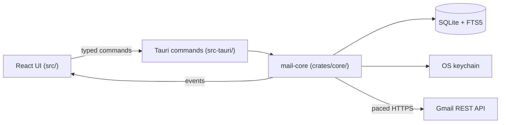
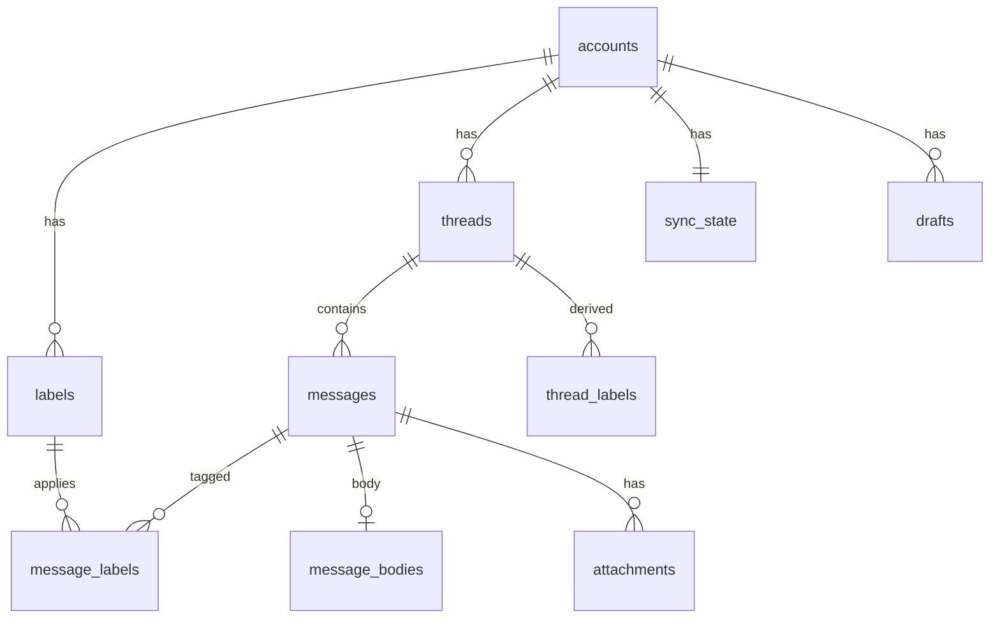
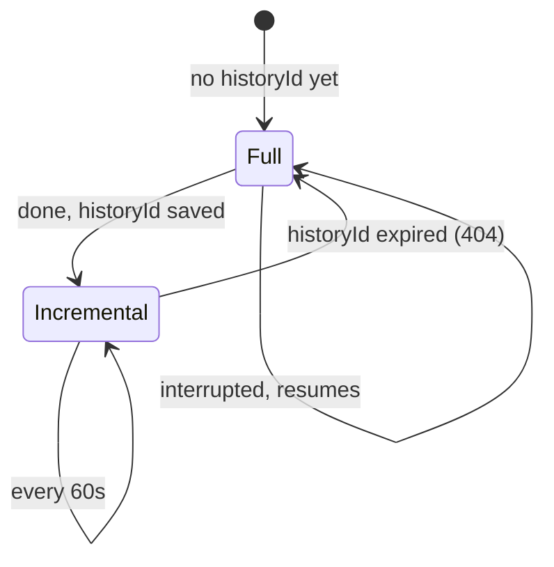
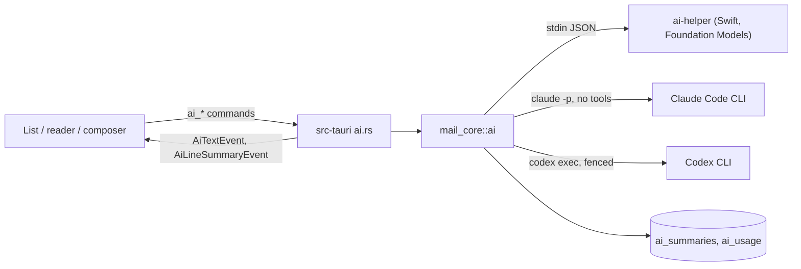
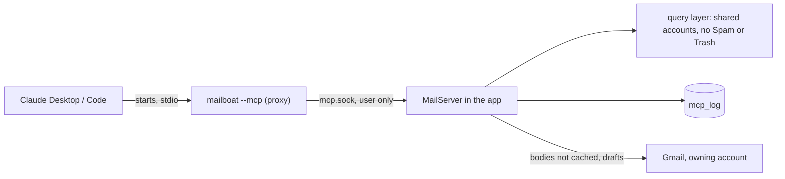

# Mailboat architecture

How Mailboat is put together and why. For what is left to build, see
[ROADMAP.md](ROADMAP.md). For agent rules and commands, see
[`AGENTS.md`](../AGENTS.md).

## Overview

| Part | Language | Responsibility |
|---|---|---|
| `crates/core` | Rust | Database, Gmail client, sync, sign-in, HTML sanitizing. No Tauri dependency, so its tests run fast. |
| `src-tauri` | Rust | Thin layer: registers commands and events, app setup, window, capabilities. |
| `src` | TypeScript/React | All UI logic: views, selection, keyboard, formatting. |

Types shared by Rust and TypeScript are generated by `tauri-specta` into
`src/platform/tauri/bindings.ts`. A test fails if that file is stale.

## Brand

The app's name lives in `brand.json`: `name` (what people read),
`shortName` (the installed program, the MCP server's name, temp and
backup files), `id` (the bundle ID: data and log folders, keychain
service, MCP socket and Windows pipe) and `envPrefix`
(`<PREFIX>_GOOGLE_CLIENT_ID`/`_SECRET`).

- Rust: `crates/core/build.rs` reads it into `BRAND_*` variables;
  `mail_core::brand` has them as constants, plus `data_dir()` for code
  that runs without Tauri (the MCP proxy, the dev examples).
- UI: `src/shared/lib/brand.ts` imports the file (`APP_NAME`).
- Tauri reads its name, bundle ID, program name and window titles only
  from `src-tauri/tauri.conf.json` (and the Windows one); a test
  (`tauri_config_matches_the_brand`) keeps them equal to `brand.json`.
  The Windows installer script uses Tauri's `${PRODUCTNAME}` and
  `${MAINBINARYNAME}`; `scripts/dev-run.sh` reads `brand.json`.
- Everything else has neutral names: the Rust packages `mail-core` and
  `desktop`, the `ai-helper`, the `email-link:` scheme, the database
  `mail.sqlite3`, saved settings `prefs.*`. `bun run check:brand` fails
  if the name is written anywhere else.

## Data model

Every Gmail-derived row belongs to an account. Gmail IDs are only unique
within one mailbox, so tables use a local integer `id` plus
`UNIQUE(account_id, gmail_*_id)`, and child tables reference parents through
composite `(account_id, id)` foreign keys. The UI only ever sees local IDs.

- `thread_labels` is the union of a thread's message labels, rebuilt on
  every change, so list views never scan messages.
- `messages_fts` (FTS5) indexes subject, people, snippet and body text for
  all accounts. Its rowid is `messages.id`.
- `sender_image_prefs` is the one table without `account_id`: it describes
  a sender, not mailbox data.
- Schema changes are numbered migrations in `crates/core/src/db/schema.rs`.

## One query layer

`mail_core::db::query::list_threads` serves every list view. It takes an
account filter (all, or a list of IDs) and a view (system label, user
label, or search). "All Inboxes" is the INBOX view with the "all" filter; a
single account's inbox is the same query filtered to one ID. System labels
match by Gmail ID across accounts; a user label is one row of one account,
so it never merges with another account's label of the same name. Paging
uses a `(last_message_at, id)` cursor.

Two views aren't Gmail labels: **All Mail** is every thread with at least
one message outside Spam and Trash, and **Archive** is All Mail minus
threads in the Inbox (Gmail has no archived label). Every other view
except Spam and Trash (Inbox, Starred, user labels, search, and their
unread counts) is also limited to All Mail: Gmail's trash call can leave
a thread's INBOX label in place, and Gmail itself hides trashed mail
everywhere but the Trash.

## Sync

Each account has its own background worker (`sync/worker.rs`) with its own
cursor, backoff and error state.

- **Full sync:** read the mailbox's current historyId first, then list the
  threads in the sync scope (newest 2,000 Inbox, 5,000 All Mail, 1,000
  Starred, and small Drafts/Spam/Trash windows) and fetch their metadata in
  batches.
- **Widening:** when the scope grows (`SCOPE_VERSION`), accounts synced
  under the old scope fetch only the threads they're missing, after a normal
  incremental pass; the history cursor is untouched.
  Progress is saved per thread; an interrupted full sync resumes from the
  same historyId and skips threads already fetched.
- **Incremental sync:** `history.list` from the saved historyId, then
  re-fetch every thread it mentions.
- **Bodies** are fetched when a message is opened, and the newest few are
  prefetched after each pass. The same fetch records the message's
  attachment parts (`attachments` table). Bodies cached before attachments
  were recorded (`message_bodies.parts_version` below
  `store::PARTS_VERSION`) count as missing and are fetched again once.
- **Older mail on demand** (`sync/older.rs`): when a list reaches the
  end of the cache, the app walks Gmail's own list for that view (500
  IDs per cheap call), skips threads already cached, and fetches the next
  25 missing ones on the interactive lane, each account at once. A cursor
  per account and view (in memory) resumes the walk next time. Older
  threads are then kept current by incremental sync like any other; a
  full resync (expired historyId) drops them again, and they reload on
  the next scroll after a relaunch.
- **Removing an account** stops its worker and waits for it to end
  (`Supervisor::stop_and_wait`) before deleting its rows, so a sync in
  flight can't write into the account being deleted. Cascading foreign
  keys remove all its mail; a trigger clears its search index rows.
- **Failures:** an auth failure parks only that account until it signs in
  again; rate limits and network errors retry; nothing blocks other
  accounts or the UI.

### Quota

Gmail charges quota units per call (threads.get = 10, messages.get = 5).
The owner's Google Cloud project allows 6,000 units per minute per user, the
maximum it can be set to, and Google enforces it as roughly 100 units per
second with almost no burst. `gmail/pacer.rs` is a token bucket per account
(60 units/s, 60-unit bursts, batches of 5). When Google refuses anyway it
pauses (a full minute for per-minute errors) and halves its rate, then
recovers gradually. Usage per minute and every refusal go to the sync log.

### Search

Local search (FTS5 over every account) answers as you type. Reaching the
end of its results, once the text has settled, runs the same "older mail"
walk with Gmail's own search (`threads.list?q=`), per account at once.
Each conversation Gmail matched is recorded in `search_hits` (account,
lowercased text, thread), cached or not, and the Search view is the local
matches plus those hits, so a match on a body Mailboat hasn't downloaded
still shows. Results merge by date like every list.

## Sign-in and tokens

Desktop OAuth with a loopback redirect and PKCE: Mailboat listens on
`127.0.0.1` on a random port, opens the browser at Google's consent page,
and exchanges the returned code. The OAuth client is the owner's own
"External" Google Cloud client, left in Testing with the accounts'
addresses as test users (see the decisions table), read from
`google-oauth-client.json` in the app's config folder (never committed).

Refresh tokens live only in the OS keychain, keyed by Google's stable account
ID. Access tokens live only in memory. Dev builds are signed with the owner's
Apple Development certificate so keychain approval survives rebuilds.

## Actions

`mail_core::actions`: read/unread, archive (remove INBOX) and move to
Inbox, star/unstar, user labels, trash and restore. Each is a label plan
(labels to add and remove, per account) run by one routine: it groups the
chosen threads by owning account, applies the change to the local cache
first, then calls Gmail with that account's client on the interactive
quota lane (`threads.modify`, or `threads.trash` / `threads.untrash`).
Threads Gmail refuses get every touched label restored from a snapshot,
and the error is returned. A user label belongs to one account, so it only
applies to that account's threads; a label from an account with no
selected thread is refused. Deleting forever isn't offered: it needs the
full `https://mail.google.com/` scope, and Gmail empties the Trash after
30 days anyway. The UI also updates its cached lists immediately
and rolls back on error (`features/mailbox/ui/useSetRead.ts`).

## Attachments

`mail_core::attachments`. Parts with a file name, or a Content-ID, are
attachments; ones the HTML shows as `cid:` are `inline` and aren't listed.
Files download on first use (open, Quick Look, save) with the owning
account's client into `<app cache>/attachments/<account id>/<attachment
id>/<safe name>`, and are reused after. Gmail's attachment IDs change
between fetches, so a refused ID triggers a re-fetch of the message for a
fresh one; small parts come with the message and have no ID at all.

- **Names** from emails are untrusted: `safe_filename` keeps only the last
  path part and replaces control, text-direction and reserved characters,
  drops leading dots, guards Windows device names and keeps a name within
  150 characters and 200 bytes, so `../../.zshrc` becomes `zshrc` (the
  decisions table, 2026-11-08, has the rest).
- **Quarantine:** every file Mailboat writes gets macOS's
  `com.apple.quarantine` tag (as browsers do), so Gatekeeper checks it
  before anything in it runs.
- **Save** copies to Downloads with a free name ("a (1).pdf"); "Show in
  Finder" reveals the copy. **Quick Look** uses `qlmanage -p`.
- **Inline images** (png, jpeg, gif, webp, bmp; up to 5 MB each) are
  downloaded when the message opens and embedded as `data:` URLs in place
  of `cid:` links. They're part of the email, not remote content, so they
  show even where remote images are held back. Anything not shown
  (blocked remote images, unresolved `cid:`, relative paths) becomes a
  transparent placeholder box sized from the email's own width and height,
  instead of the web view's broken-image icon.
- Removing an account deletes its attachment folder.
- **The paperclip** (`has_attachments`): sync's header-only fetch
  (`format=metadata`) doesn't include a message's parts, so sync counts
  `multipart/mixed` mail as having attachments. Once a body is fetched, its
  real list (non-inline parts) decides, and later syncs keep that answer.
  Caches built before this had no paperclips at all; a one-time catch-up
  per account (`sync_state.attachments_version`) lists Gmail's
  `has:attachment` message IDs (newest 20,000, 5 units per 500) and marks
  the cached ones.

## Compose

`mail_core::compose` (Milestone 4).

- **Sending** builds an RFC 5322 message with `mail-builder` and sends it
  with `messages.send`, using the From account's own client. A reply or
  forward carries `In-Reply-To` and `References` from the original and
  joins its Gmail thread only when sent from the same account; from
  another account it starts a thread there (threads never merge across
  accounts). The new thread is fetched straight after and cached, so it
  shows at once.
- **Never sent twice:** `messages.send` isn't retried after timeouts or
  server errors, since Gmail may already have sent it. Rate limits (403,
  429) and connection failures happen before Gmail accepts anything, so
  those still retry.
- **From** (`compose::identities`): each account's Gmail "Send mail as"
  addresses (`settings.sendAs`, 1 unit), stored in `send_as`. Each sync
  worker fetches them once after its first good pass and emits
  `IdentitiesChangedEvent`; compose only reads the table, so it never
  waits on Google. Aliases awaiting verification are left out; an account
  never fetched still offers its own address. Sending checks that From
  belongs to the account.
- **Reply-To:** sync now asks for the header (`messages.reply_to_json`).
  Mail cached before that has NULL there; replying fetches that one
  message's headers (5 units) and remembers them.
- **Address suggestions** (`compose::contacts`): one query over cached
  mail of every account, plus each account's Google Contacts, builds the
  whole ranked list (thousands of people, fast), which the UI loads once
  and filters as you type (`features/compose/model/contacts.ts`); it
  refreshes when mail changes. Order: people you've sent to (To/Cc of
  SENT mail), then saved Google contacts, then everyone else (people who
  wrote to you, Gmail's automatic "other contacts"); within each, every
  message counts less the older it is (a month old counts half). A saved
  contact's name wins over names seen in headers. Spam, Trash and
  no-reply or bounce senders you never wrote to are left out.
- **Google Contacts** (`google_contacts` table): each sync worker reads
  the account's saved contacts (`people.connections`) and other contacts
  (`otherContacts`) from the People API once per launch, with the same
  sign-in (People API quota, not Gmail's). Accounts that signed in before
  the contacts scopes were asked for get a 403, logged, and carry on.
- **Quoting a selection** (Milestone 7): text selected in a message (the
  frame last clicked into, `selectedInMessage` in `MessageFrame`) makes a
  reply or forward answer that message and quote just that text
  (`withSelection`), as plain text: the displayed HTML has `email-link:`
  addresses and display-only attributes that mustn't be sent.
- **`mailto:` links** (Milestone 7): the bundle's Info.plist claims the
  `mailto` scheme, so Mailboat can be the default email reader (Settings →
  General asks macOS through `NSWorkspace`; `src-tauri/src/mail_handler.rs`).
  macOS keeps the default by bundle ID, so with the installed app and a
  dev build both present it chooses the copy (the installed one).
  macOS hands links over as Tauri's `RunEvent::Opened`; links clicked in
  an email arrive through the `email-link:` handler. Rust parses them
  (`mail_core::mail::mailto`, RFC 6068) and queues them, then emits
  `MailtoEvent`; the window takes the queue (`mailto_take`) once accounts
  have loaded, so a link that launched the app isn't lost. Each opens a
  new message from the open conversation's account, else the usual one.

## Showing email safely

1. Rust sanitizes the HTML (`mail/sanitize.rs`, using `ammonia`): no
   scripts, event handlers, forms, frames or `javascript:` links.
2. Tracking pixels are always removed. Remote images then load by default
   (Settings → Viewing can make that "people you've written to" or
   "blocked", `AppSettings::remote_images`; images of new mail are
   downloaded as it arrives, `mail/prefetch.rs`, so opening shows saved
   copies, so it normally makes no request; an image that couldn't be fetched still loads as the setting allows), except in Spam (always held back) and Trash (held back unless the sender
   is allowed); a per-sender load/block choice wins outside Spam
   (`mail/images.rs`). The reader says which applied and offers the
   opposite choice.
3. The result is a full document with its own Content-Security-Policy,
   shown in an `<iframe sandbox>` without `allow-scripts`.
   Emails not marked "light only", whose style sheets only use colors it
   can remap, are "adaptive": the page is transparent so they sit on the
   reader's glass, and a `prefers-color-scheme: dark` sheet remaps their
   inline colors (`mail/colors.rs`). Elements get `data-mc` / `data-mb` /
   `data-mr` numbers; the sheet holds only colors the sanitizer computed.
   Rules in the email's own `<style>` blocks that set colors are repeated
   with remapped colors in a second dark-mode sheet placed after the
   email's (`mail/stylesheet.rs`); the email's own dark-mode rules stay
   and win for the same selector. Inline remaps carry two `:not(#…)` so
   they outrank any sheet rule, as inline styles did. The reader's
   "Original colors" asks for the same email on the white card instead
   (`message_open(…, original_colors)`).
4. Links (http, https, mailto only) are rewritten to Mailboat's own
   `email-link:` scheme. A click makes the frame request that URL; the app
   opens the real link in the default browser and answers 204 No Content,
   so the email stays put. A `mailto:` link opens a new message in Mailboat
   instead (see Compose). Other links are made inert.

## Settings

A page in the main window, not a separate window (owner's choice, as in
MonoCode). `Shell` keeps the open section in state; while it's set, the
sidebar is covered by the section list (`settings/ui/SettingsNav`) and the
list and reader by the page (`SettingsPage`). The mail underneath stays
mounted but invisible and inert, so Esc or Back returns to it exactly as it
was, scroll and folds included. It opens from the gear in the sidebar's
foot bar, the ⌘K palette, and Mailboat → Settings… (⌘,), a macOS menu item
(`src-tauri/src/menu.rs`) that emits `OpenSettingsEvent`.

Settings are stored in one of three places:

- **Rust acts on it** (new-mail notifications on/off): `mail_core::settings`,
  one JSON value in the `app_settings` table. A setting missing from it
  takes its default, so adding one needs no migration.
- **Only the window uses it** (transparency, accent color, text size,
  Viewing's choices, Composing's undo send delay, since the wait runs in
  the window):
  `localStorage`, applied in `main.tsx` before the first render so it
  never flashes the default.
- **Gmail keeps it** (Rules, Signatures, Vacation responder): read from
  and saved to the account's Gmail settings each time, never copied into
  SQLite (see "Rules" and "Signatures and vacation responder" below).
  Toybox's switches (glow, screensavers) are window-only, in
  `localStorage` under their original feature-flag key.

The theme (System, Light, Dark) is a Rust setting because it's set on the
app itself (`src-tauri/src/theme.rs`, at launch and when changed): macOS
then draws the glass in that look and the web view's
`prefers-color-scheme` follows, so the CSS and emails' own dark styles
need no theme logic of their own.

The Dock badge (unread in All Inboxes, everything in Unread, or off; the
choices are named after those folders) is a Rust setting too. `src-tauri/src/badge.rs` checks once a
second whether the database was written to and recounts only then
(`query::unread_threads`, the sidebar's rules), so sync, actions and the
setting itself all update it without hooks in each.

The app icon choice (a name from `design/icon/choices/`) is a Rust setting
too: `dock.rs` puts its PNG (rendered by `scripts/build-icon-choices.sh`
into `src-tauri/icons/choices/`, built into the binary by `app_icon.rs`)
on the Dock at launch and when it changes.

Account colors change through `accounts::set_color`, limited to the
palette in `ACCOUNT_COLORS`.

## Meeting invitations

Fetching a body keeps its inline calendar part (`message_bodies.calendar`;
`calendar_read` marks bodies read with that in mind). Older cached bodies
aren't all re-fetched: only ones with an `.ics` attachment, when shown.
`mail::invite` parses the part (`icalendar`, times through `chrono-tz`).
`calendar.rs` adds Google Calendar calls to the account's client (same
sign-in and retries as Gmail, no Gmail quota pacing): find the event by
its iCalendar UID, events in a range for clashes, answer with
`attendeesOmitted` (only your entry is sent; Google tells the organizer),
import an invitation that isn't on the calendar, remove a canceled one.
`card_for` is what the reader shows (`InviteCard`, above the message);
Calendar failures become part of the card, never hide the invitation.
Accounts lacking `calendar.events` (see `accounts.granted_scopes`) get
"Sign in again" instead of a failed request.

## Rules

Rules are Gmail's filters (`settings.filters`, needs `gmail.settings.basic`).
Gmail runs them on its servers as mail arrives, so Mailboat stores nothing:
`rules.rs` reads them live per account (1 quota unit) and the UI caches
the answer with TanStack Query. A `Rule` is Gmail's filter in the shape
of Gmail's filter form: criteria (from, to, subject, has the words,
doesn't have, has attachment, size) and actions (skip Inbox, mark read,
star, labels, never spam, trash, importance, category). Labels cross the
IPC boundary as surrogate `LabelId`s; a rule is identified by its account
plus Gmail's filter ID. Gmail has no filter update, so editing creates the
new filter and deletes the old (rolling the new one back if the delete
fails); an unchanged rule isn't re-saved, since Gmail refuses duplicates.
What Mailboat can't show (forwarding, "exclude chats", labels it doesn't
know) is read back from the old filter and kept. "Also apply to existing
mail" lists matching messages (`messages.list` with the criteria as a
Gmail search, newest 10,000) and changes their labels with
`messages.batchModify`; the account then syncs. The editor's "N
conversations match" counts one `threads.list` page (up to 500). Each
account answers separately, so one account lacking the permission shows
"Sign in again" without hiding another's rules.

## Signatures and vacation responder

Both need `gmail.settings.basic`, like rules. A signature is changed with
`settings.sendAs.patch` sending only `signature` (the one field of an
address that permission may change; 100 quota units). Gmail cleans the
HTML itself, so `identities::set_signature` stores what Gmail sends back
in `send_as`, and `IdentitiesChangedEvent` refreshes compose. The editor
is the composer's TipTap editor. `vacation.rs` reads and writes
`settings.getVacation` / `updateVacation` as `VacationSettings` (dates as
Unix ms, the end exclusive, as Gmail treats it) and says whether it's
replying right now (`active`), which the mail view shows as a banner.

## AI

Summaries (one line in the list, a few points above an opened
conversation) and a writing assistant in the composer. The logic is in
`mail_core::ai`; `src-tauri/src/ai.rs` is the glue; the UI is
`src/features/ai`.

- **Providers are programs, not keys.** Apple Intelligence through
  `ai-helper`, a small Swift helper (`src-tauri/macos/ai-helper.swift`,
  built by `build.rs`, a Tauri sidecar), because Foundation Models is
  Swift-only. Claude and ChatGPT through the `claude` and `codex`
  command-line tools, signed in with the owner's subscriptions; Mailboat
  finds them in the usual install folders (a Mac app has no shell PATH).
  "Connect" runs `claude auth login` / `codex login`, which open the
  browser, and waits until the tool reports it's signed in.
- **One request, one run, nothing for the model to act with.** Each request starts the program
  once in an empty temp folder, prompt on stdin, answer read line by line
  (`ai::process`), stopping it at the line that ends the answer
  rather than waiting for it to exit. Claude runs with `--tools ""`, no settings, MCP or
  skills, so it has no tools at all. Codex can't promise that (no allow-list
  of tools exists), so it is fenced instead: every switch turned off per
  request, a read-only sandbox, on macOS an extra sandbox profile, and a
  runtime check that pauses it when a switch nobody has reviewed stays on
  (see "Codex review" in `AGENTS.md` and `ai/codex_review.json`). The aim
  is that an email written to steer a model can only change the text it
  returns, which is shown as plain text, and a draft is only ever put in
  the editor for the owner to read.
- **Context** (`ai::context`): the conversation from the cache, oldest
  first, drafts left out, each message cut at its quoted history and
  signature, marked "(me)" for the owner's addresses. Bodies not cached
  are fetched with the owning account's Gmail client first. A size budget
  per provider: Apple's model reads ~4k tokens in all, so it gets ~7,000
  characters; the others 80,000. Newest messages get the room.
- **Summaries** are cached in `ai_summaries` per conversation (account-
  scoped by its surrogate thread ID) with the newest message they cover;
  new mail makes them stale. The list asks for the rows on screen; a
  background queue in `ai.rs` writes missing ones newest-first, skips
  Spam and Trash, and rests 10 minutes after three failures in a row.
  The reader's automatic summary skips short conversations (< 700
  characters of text).
- **Usage** (`ai_usage`): one row per request with provider, purpose,
  success, tokens and Claude's cost estimate. Never content. Claude's
  subscription limits come with each answer and are kept in memory for
  Settings.
- **Settings** live in `AppSettings.ai` (Rust acts on them): connected
  providers, and which provider each feature uses. Apple Intelligence is
  the default for everything.
- **Rewrite** (the composer's formatting bar): the selected text alone
  goes to the writing provider at the quick level (`ai_rewrite`,
  `prompts::rewrite`), with a size cap for Apple's small model. The
  answer replaces the selection in one undo step (`applyRewrite`): one
  line as plain text so it stays inside its paragraph, more as HTML.
- **Translate** (`tasks::translate`, `ai_translate`): Apple's Translation
  framework in the helper first, which works without a window only for
  languages already downloaded; then the writing provider, if set up,
  with only the text. The language of a conversation is told on the Mac
  (NaturalLanguage, `ai_conversation_language`). In an email the
  translation shows in a card above it, below the images line
  (`TranslationCard`), kept in memory only, so a restart loses it (a
  known limitation, in the roadmap's Later); in the composer it replaces
  the selection like a rewrite.
- **Commands:** Summarize and Reply with AI are also in the shared
  command list (`features/commands`), so ⌘K, the menu bar and the
  right-click menu offer them. A summary asked for that way goes through
  `ai/ui/summaryRequests` (a count per conversation the summary card
  reads), since the card owns its request.

## AI apps (MCP)

AI apps (Claude Desktop, Claude Code) can search and read mail, and save
drafts, through Mailboat over the Model Context Protocol. Logic in
`mail_core::mcp`; the app side is `src-tauri/src/mcp.rs`; Settings →
AI → AI apps is `src/features/mcp`.

- **One program.** The AI app starts Mailboat's own binary with `--mcp`;
  `main` checks for it before anything else, so it's a small proxy with
  only MCP on stdout. It connects to the running app's socket when a
  request comes and again after the app restarts. With Mailboat closed the
  tools are still listed and each answers "open Mailboat".
- **The app answers** (`MailServer`, rmcp): one per connection. Every
  request reads `AppSettings.mcp` afresh: only accounts turned on are
  visible (all off by default), Spam and Trash never are, and a hidden
  conversation answers "not found". Lists go through the one query
  layer; reading uses the AI context reader (quoted history cut, bodies
  fetched with the owning account's client). Conversation IDs are the
  surrogate thread IDs.
- **Drafts only**, per account, saved with the composer's own code;
  the tool isn't even listed until an account allows it. Nothing sends.
- **Logged** in `mcp_log`: tool, account, conversation, and a line such
  as the AI's search words and the count. Never email content; the
  subject is looked up when Settings shows it. Kept 30 days.
- **Connecting:** Claude Code with its own `claude mcp add --scope user`;
  Claude Desktop by adding Mailboat to its config file (other entries kept,
  old file copied beside it, a file Mailboat can't read left alone).

## Launch modes

`src-tauri/src/mode.rs` reads how the app was started (`--clean-start`,
`--demo`). Normally it uses the
bundle ID's folders and keychain name. `--clean-start` gives it one folder
of its own next to the normal one (`<bundle ID>.clean-start`, holding the
database, config, cache and logs), keychain entries under
`<bundle ID>.clean-start`, and an incognito web view (its saved settings
and recent searches vanish when it quits). The folder and the keychain
entries its accounts left are emptied at every clean start. Outside the
normal mode the window remembers its place in its own file, Windows'
single-copy handover is off, and the MCP server isn't started (its socket
lives in the normal folder, and AI apps should keep reaching the normal
copy). The main window is created in code (`create: false` in the config
files) so the web view's storage can be chosen, after the app state is in
place.

**Demo mode** (`--demo`) works like the clean start, plus a made-up Google
(`mail_core::demo`): a small HTTP server on 127.0.0.1 that answers the
Gmail, People and Calendar requests the app makes, holding the mail of
`demo/mail.json` as real RFC 5322 messages (built with `mail-builder`,
read back with `mail-parser` into Gmail's JSON). Every demo account's
Gmail client points at it (`AppState::gmail_for`), with the account's
address as its access token, so sync, history, actions, search (a subset
of Gmail's language), drafts, sending, rules, signatures, the vacation
responder, contacts and invitations all run the real code. At launch
`demo::prepare` adds the accounts, syncs them and stores the list
summaries, so the window opens full. Sent mail gets the conversation's
scripted answer (or a general one) a few seconds later, and scheduled
conversations arrive on time; the server then asks the account's worker
to sync at once. Secrets are kept in memory only, and the HTTP client
skips proxies. The browser tests' harness reads the same file
(`tests/browser/demoMail.ts`), so tests and screenshots show the same
made-up mail.

## Decisions

| Date | Decision | Why |
|---|---|---|
| 2026-10-14 | Split Rust into `crates/core` and `src-tauri` | Core logic tests without compiling Tauri; keeps logic out of the IPC layer. |
| 2026-10-14 | Write our own Gmail client instead of `google-gmail1` | That crate is ~30,000 generated lines, has no HTTP batch support, no hook for quota pacing, and depends on an OAuth library without PKCE. Ours is ~400 lines covering what Mailboat uses. |
| 2026-10-14 | `reqwest` + `tokio` instead of MonoCode's blocking `ureq` | Independent async workers per account. |
| 2026-10-14 | Sanitize email HTML in Rust, display in a sandboxed `srcdoc` iframe | Security lives on the trusted side; the iframe can't run scripts, and the app can still measure height and catch link clicks. |
| 2026-10-14 | OAuth client: External, in production, unverified | *Superseded 2026-10-29 (see below): the owner's project is in Testing.* Lets both a @gmail.com and a Workspace account sign in without Google review; Testing mode expires sign-ins after seven days. |
| 2026-10-15 | Pace Gmail at 60 units/s, batches of 5 | The project's per-user limit is 6,000/minute (documented default is 15,000), enforced per second. |
| 2026-10-15 | Sign dev builds with an Apple Development certificate | macOS ties keychain approval to the exact build; signing gives every build one identity. |
| 2026-10-15 | Use the `oauth2` crate for the OAuth protocol | Security-sensitive code shouldn't be homemade; it supports PKCE. The loopback listener and keychain storage stay ours. |
| 2026-10-15 | Email links go through a `email-link:` scheme handler | Catching clicks from the sandboxed frame with JavaScript didn't work in the macOS web view; a scheme handler doesn't need scripts at all. |
| 2026-10-15 | Sync scope: newest 5,000 All Mail threads, not just INBOX/STARRED/SENT | The owner keeps Inbox Zero; nearly all mail is archived and was missing. 5,000 threads is ~15 minutes at the 6,000/minute quota; older mail will load on demand (Milestone 2). |
| 2026-10-15 | Track milestones in `docs/ROADMAP.md` | Items moved between milestones must not get lost. |
| 2026-10-15 | UX Spike 1: the owner's screenshots of Tern, Arc and MonoCode set the visual direction | Glass sidebars, a darker glass body with rounded corners where they meet, resizable panes. Where references differ, the owner's screenshots win; MonoCode fills gaps (tokens, motion). |
| 2026-10-15 | Window glass via Tauri's built-in `windowEffects` (`underWindowBackground`), `transparent` window, `macos-private-api` feature | Blur has to come from the native window; CSS can't blur the desktop. MonoCode and Synara both use this material as their base. The flag uses a private API, which rules out the Mac App Store (not a goal). A stronger, adjustable blur (`CGSSetWindowBackgroundBlurRadius`, as in Synara/MonoCode) is a later option if this looks too faint. |
| 2026-10-15 | Two glass tints: thin over the sidebar, ~85% over panels with reading text | Legibility: text never sits on thin glass. Tints are CSS tokens (`--glass-*-strength`) so they're easy to tune. |
| 2026-10-15 | Hand-built pane splitters, no library | About 60 lines with pointer capture, as MonoCode's sidebar resizer does; a library (e.g. `react-resizable-panels`) would add a dependency for two handles. The email iframe gets `pointer-events: none` during a drag so it can't swallow the pointer. |
| 2026-10-15 | Icons: Hugeicons (`@hugeicons/react`, `@hugeicons/core-free-icons`), wrapped in `src/shared/ui/icons.tsx` | The outline set MonoCode uses, and the look of Tern's toolbar. Icons are imported one by one so only the ones used are bundled. |
| 2026-10-15 | Layout: the list is the body card; the reader sits on the glass | Owner's call: rounded corners wrap the list on both sides, and the reader reads as a right-hand sidebar that can be dragged narrow. Glass tints lowered to 12%/62% (dark) to get closer to Tern. |
| 2026-10-15 | Traffic lights centered in a 40px toolbar via `trafficLightPosition` `{x:16, y:22}` | Tauri config, no custom Rust. Measured: `y` 22 puts the buttons' centers 20pt from the top, matching the toolbar icons. MonoCode saw them jump during live resize with its own titlebar stretching; watch for that. |
| 2026-10-15 | Panel toggles: ⌃⌘S sidebar, ⌃⌘R reader | ⌃⌘S is macOS's standard Show Sidebar key (Finder, Mail, Notes). ⌘B was avoided: the composer will need it for bold. Matched on the physical key (`KeyboardEvent.code`) so other layouts work. |
| 2026-10-15 | Panels slide with CSS transitions, no animation library | The panels stay mounted; a wrapper animates its size (width, or flex-grow for the reader) and clips, while the content keeps a fixed width so nothing reflows mid-slide. Transitions switch off while a splitter drags and under macOS "Reduce motion". |
| 2026-10-15 | Sync status lives on the account avatar; routine syncs show nothing | Incremental syncs run about once a minute and usually change nothing, so a text line flashed and shifted the sidebar each time. The arc appears only after 1.5s of syncing; only actionable errors get text. Chosen over a toolbar activity icon (saved for the future log console) and a list shimmer (not per account). |
| 2026-10-15 | Search sits centered in the title bar | Owner's request, after VS Code. It stays scoped to the sidebar's current view (one account or all). Its width is `clamp(200px, 100vw − 600px, 440px)` so it never collides with the toolbar buttons at the 820px minimum window width. |
| 2026-10-15 | Sidebar labels grouped by `/` and by a `Prefix: ` name | Gmail nests with `/`; many apps (Acme) group with "Prefix: Name", so both fold. Groups need two or more entries, so a lone chain like `[Gmail]/Trash/Sent` stays one row. Logic in `features/accounts/model/labelTree.ts` with tests. |
| 2026-10-15 | Pointer-following glow uses a per-frame glide, not CSS transitions | Restarting a transition on every pointer move reset its speed each time and stuttered; a `requestAnimationFrame` loop closing a fixed fraction of the gap per unit time (`model/glow.ts`, tested) glides and stops when settled. The glow is a multi-stop gradient: WebKit re-rendered a moving `filter: blur()` every frame. |
| 2026-10-15 | Reader scroll area is `overflow-y: scroll`, not `auto` | The app styles scrollbars (`::-webkit-scrollbar`), which makes WebKit use classic scrollbars that take width. With `auto`, a long email's scrollbar appearing narrowed the reader and reflowed the email visibly. `scrollbar-gutter: stable` would be the modern fix but isn't reliable in WebKit. |
| 2026-10-15 | Remote images load by default outside Spam (was: blocked unless the sender is allowed) | Owner's choice (option A of three): it's what other mail apps do, and per-sender allowlisting every email was tedious. The cost is privacy, not code execution (email is sanitized and sandboxed without scripts): a sender's server sees the open time and IP. Spam stays blocked because sender addresses there are often forged and an image load confirms the mailbox is live; known trackers are still stripped. No schema change: a missing `sender_image_prefs` row now means "default" instead of "block". Alternatives not built: default only for people you've written to; background prefetch like Apple Mail. |
| 2026-10-15 | Dark mode for email by remapping colors in Rust, not by inverting | Owner wanted emails on the glass like MonoCode conversations. Inverting (CSS `filter`) mangles logos and photos; Gmail's mobile app instead remaps near-whites and near-blacks and keeps brand colors and images, so Mailboat does the same. Light-mode colors stay inline and dark ones come from a `prefers-color-scheme: dark` sheet, so the system appearance switch updates open mail. Emails with their own `<style>` color rules keep the white card until those can be rewritten. "Neutral" uses chroma, not HSL saturation, which overstates tints near white. |
| 2026-10-15 | App icon drawn as an SVG in `design/icon/app-icon.svg`; every size generated with `bun tauri icon design/icon/app-icon.svg` | One editable source instead of hand-made PNGs. The generated Android/iOS folders are deleted (desktop only). Each design round's comparison sheet is kept in `design/icon/sheets/`, and the icons to offer in a future Settings picker in `design/icon/choices/` (see its README); the other generated SVGs and PNGs were deleted. |
| 2026-10-15 | List rows show the account as a hollow ring in a softened (75%) account color; unread stays a solid accent dot | With two accounts, a solid account dot and the unread dot looked the same, especially when the account color is also blue. Shape (hollow vs solid) tells them apart regardless of color. The owner tried six styles in the app: solid edge bar, no unread dot, avatar, glass edge bar, ring, glass dot; the bars and solid dots were too busy and avatars too noisy. The ring only shows in views that mix accounts. |
| 2026-10-15 | No custom scrollbar styling; the system's own scrollbars are used | Any `::-webkit-scrollbar` rule makes WebKit draw always-visible scrollbars. Without one, macOS overlay scrollbars appear while scrolling and fade after, take no width (so the reader uses `overflow-y: auto` and long emails don't reflow), follow light/dark, and honor the user's System Settings. Owner asked for the usual macOS behavior. Windows may need its own look later (roadmap). |
| 2026-10-15 | Sidebar keeps per-account sections ("Tidy"), with unread counts and folds | The owner tried three layouts in the app: an account switcher (chips filtering one set of views), Mimestream-style nesting (each view unfolds a row per account) and this one, and preferred it. Counts show only on Inbox, Starred and labels, where unread means something is waiting (owner tried an "Everything" setting with Unread, Archive and All Mail, and none; those views are always full of old unread mail); they come from `query::unread_counts`, per account, summed for unified views. Unread (list and count) leaves out Spam and Trash, as Gmail does. Folds reset on relaunch for now. |
| 2026-10-15 | Glass tints: dark 6.5% (sidebar/reader) and 34% (list panel); light 10% and 37% | Found with a temporary slider that scaled every tint by one factor, so areas kept their ratios; the owner picked 45% clearer than the first values (12%/62%, light 18%/68%), and the slider was then removed. Per-area sliders are planned for Settings: one shared factor changed the list panel far more than the sidebar. |
| 2026-10-15 | App icon: a folded-ribbon M (fold style S4) on a flat near-black tile, replacing the glass icon; green (C13) at first, then cobalt (C04) and sky (C03), now Apple's system blue `#0A84FF` (C17): cobalt read violet and sky teal next to Mail, and macOS's rendering of #0A84FF measures within a few points of Mail's icon blue. A mail blue suits an alternative to Mail and Mimestream | The owner found the best Dock icons have sharp contrast between a flat background and the mark, and gradients looked weak. Seven rounds of options are kept as sheets; the 16 colors of the final style and the old glass icon are kept as SVGs for a future icon picker. |
| 2026-10-15 | macOS icon also ships as an Icon Composer icon (`src-tauri/macos/AppIcon.icon` compiled to `Assets.car`, `CFBundleIconName`), after MonoCode | Only icons in this format get macOS 26's glass rim and depth in the Dock; a classic `.icns` is drawn flat. `scripts/build-app-icon.sh` renders the artwork layer to PNG (Icon Composer ignores SVG shadows) and runs Xcode's `actool`; the result is committed so builds don't need Xcode. The `.icns` stays as the fallback. |
| 2026-10-15 | Dev builds run from a signed `target/debug/Mailboat.app` built by `scripts/dev-run.sh`; `src-tauri/src/dock.rs` clears Tauri's dev Dock image | macOS only applies the icon treatment to bundles, and Tauri paints a flat image on the Dock in dev. MonoCode builds its dev bundle in Rust and signs it ad hoc; Mailboat does it in the existing runner script so the bundle is signed with the Apple Development certificate and keychain access still survives rebuilds. Needs `objc2`/`objc2-app-kit`, already in the build through Tauri. |
| 2026-10-15 | Splitter positions saved in local storage: sidebar in pixels, list as a share of the panes | The owner wanted the sidebar to keep its width when the window resizes and the list and reader to scale together. The list is laid out with a percentage flex-basis, so the browser does the proportional resize with no code running; dragging converts the pixel position to a share, kept between 10% and 90% and within the list's and reader's minimum widths. Local storage, like other view state; move to Settings storage if one arrives. |
| 2026-10-16 | Menus and confirmations use the web view's own popover and `<dialog>`, not a library or Tauri native menus | They give click-outside, Escape and focus handling for free and float above panels that clip; native menus would need the menu permission on the web side. |
| 2026-10-16 | Actions take effect at once, with an Undo toast, and the next conversation opens | Gmail and Mail both do this; waiting on Gmail (~0.3s) for every `e` felt slow. Undo is just the inverse action (archive ↔ move to Inbox, trash ↔ restore, label add ↔ remove). Advancing marks the next conversation read, as opening any conversation does. |
| 2026-10-16 | Thread summaries carry `inInbox`, `inTrash` and user `labelIds` | So buttons toggle correctly per conversation (archived mail offers "Move to Inbox") and the label picker can tick labels for a multi-selection, without a query per row. |
| 2026-10-16 | No "Delete forever" | Gmail's delete call needs the full `https://mail.google.com/` scope; Mailboat asks only for `gmail.modify`, and Gmail empties the Trash after 30 days. |
| 2026-10-16 | Attachments open through Rust (`open`, `qlmanage -p`, `open -R`), not a Tauri plugin | No new plugin or web permission: the web side only asks Rust to open an attachment by its local ID, never a path. Save goes straight to Downloads (as browsers do) instead of a save dialog, which would need the dialog plugin. `qlmanage` is Apple's command-line Quick Look; a native panel would need much more Objective-C glue. Downloads are tagged with macOS quarantine. |
| 2026-10-16 | Inline images embedded as `data:` URLs, not served by a custom scheme | The email's CSP already allows `data:` images, and the frame stays fully self-contained; a scheme handler would need another frame-src exception. Capped at 5 MB per image to keep the document small. |
| 2026-10-16 | Compose: new mail in a floating card that snaps to corners and side midpoints (like iOS picture-in-picture); replies and forwards inline in the reader; full formatting; 5-second undo send; no pop-out window | Owner's design (Milestone 4). The card must never block the reader, so text can be copied between an open message and a draft, which Notion Mail can't do. Snapping instead of free dragging keeps it tidy; Gmail's defaults for replies and undo send. |
| 2026-10-16 | Outgoing mail built with `mail-builder` (Stalwart), not by hand or with `lettre` | MIME encoding (RFC 2047 names and subjects, quoted-printable, folding) is a standard protocol best left to a maintained crate. `lettre` is an SMTP client; `mail-builder` only builds messages, which is all Gmail's API needs. Default features off (no hostname lookup: Mailboat sets its own Message-ID). |
| 2026-10-16 | `messages.send` is never retried after a timeout or server error | Gmail may have sent the mail before failing; retrying could deliver it twice. The error is shown and the message stays in compose, so the user decides. |
| 2026-10-16 | Gmail aliases are fetched by the sync worker, not when compose opens | Compose shouldn't wait on the network (an offline fetch retries for up to a minute). The list is small and rarely changes; once per launch is enough. |
| 2026-10-16 | Compose card is glass with its own `backdrop-filter` blur, tint 72% (dark) / 78% (light) | Owner wanted it to match the app's glass. The window's native blur only shows the desktop, and the card floats over the app's own content (often a white email), so it blurs that itself and needs a thicker tint than the list panel (34%) for writing to stay legible. The blur makes the card a containing block for fixed elements, so anything that pops out of it (suggestions, dialogs) must use the top layer. |
| 2026-10-16 | Compose card snapping hand-built (`features/compose/model/snap.ts`), spring as a CSS overshoot curve, no animation library | Eight spots (corners and side middles); on release the card goes to the spot nearest its position plus 0.18s of its speed, so flicks land where they were thrown, as in iOS picture-in-picture. A `cubic-bezier(0.34, 1.45, 0.64, 1)` transition on left/top gives the rubber-band settle without a physics library, like the panels' slides. |
| 2026-10-16 | Composer is TipTap 3 (StarterKit, TextStyleKit, TextAlign); sent HTML gets `margin:0` paragraphs and ` ` in empty ones | TipTap was the stack's planned editor. Browsers and mail apps give `
` a 1em gap and collapse empty ones, while the editor shows neither, so `emailHtml` makes the email look as written. The plain-text copy comes from the editor (`getText`), since Rust's `html_to_text` flattens everything to one line (fine for search, not for mail). |
| 2026-10-16 | Outgoing mail uses Gmail's upload endpoint (`/upload/.../messages/send?uploadType=multipart`); files are picked with an HTML file input and passed to Rust as base64 | The JSON `raw` form is meant for small messages; the upload endpoint takes up to 35 MB, so attachments up to Gmail's 25 MB fit. A file input needs no Tauri dialog plugin or new web permission. Base64 over IPC costs a third more bytes, fine at these sizes. |
| 2026-10-16 | Signatures and quotes stay outside the editor and are appended when sending | TipTap's schema rewrote them (dropped ``, inline styles, tables, Gmail's line structure). Shown read-only in a sandboxed preview, sent as Gmail's own HTML in its `gmail_signature` / `gmail_quote` wrappers, as Gmail sends them. |
| 2026-10-16 | Address suggestions filtered in the UI from a list loaded once, not queried per keystroke | Owner noticed a lag: each key cost a database query plus an IPC trip. The ranked list is small, so filtering in memory is instant. A per-address name lookup written as a correlated subquery took many seconds on a large cache; a grouped join is instant. |
| 2026-10-16 | Drafts saved with `drafts.create`/`drafts.update` (upload endpoint) ~2.5s after typing pauses; local `drafts` rows give the UI a `DraftId`, Gmail's draft ID stays in Rust | As Gmail does, so a draft survives quitting and shows on the phone. One save per draft at a time (a create retried after a timeout could duplicate, so create only retries when Google certainly didn't act). After sending, the draft is deleted; if that fails the mail is still sent and the leftover is logged. |
| 2026-10-16 | Ask for `contacts.readonly` and `contacts.other.readonly` | Owner's choice (Milestone 4): suggestions from Google Contacts as well as mail. Read-only; both are "sensitive" scopes, so the unverified-app warning stays as it is. Existing accounts aren't forced to sign in again: without the scopes, suggestions come from mail only. |
| 2026-10-17 | Window `dragDropEnabled: false`; composers take dropped files as web `File`s | Tauri's own file drop hands Rust paths and hides the drop from the page. Turning it off lets a composer read dropped files exactly as the paperclip does, with no new command that reads arbitrary paths. The page ignores drops anywhere else, so the web view can't navigate to a dropped file. |
| 2026-10-17 | `tauri-plugin-window-state` for window position/size/maximized/full screen, registered in Rust only | Owner request (Milestone 5); the plugin handles saving on quit and skips positions on no connected display. No web permission is granted (the page never calls it). Our `window_place::keep_on_screen` adds the rest of the request: a window only partly on screen moves fully onto a display. |
| 2026-10-17 | Remote search records Gmail's matches in `search_hits` rather than relying on local FTS to find fetched threads | Gmail matches bodies; fetched threads only have metadata cached, so FTS wouldn't find them again. Recording hits per account and text keeps the one query layer and rule 7 (per account, merged by date). Hits accumulate per search text; they're small and cascade away with their threads. |
| 2026-10-17 | Trackpad swipes on rows: distance from `wheel` events, touch and lift from macOS | Browsers don't report fingers lifting, and guessing (events stop for 110 ms) acted on a swipe the owner was still holding. `src-tauri/src/trackpad.rs` adds an AppKit local monitor (`NSEvent` scroll phases, this app's events only, passed on unchanged) that emits touch/lift; only a lift lets go. No web permission; uses `objc2-app-kit` and `block2`, already in the build through Tauri. A mouse wheel has no phases and keeps the guess (stop, or coasting: four steadily shrinking deltas). The join between row and button is an SVG "goo" filter (blur plus alpha cut) drawn in the text color at selection strength, so it suits light, dark and the glass without a color of its own. Numbers live in `mailbox/model/swipe.ts`. |
| 2026-10-17 | Command palette uses `cmdk` inside our own modal `<dialog>` | cmdk was the stack's planned palette: filtering, ranking and keyboard handling done well. It brings in a few Radix packages it uses internally (26 small packages); the dialog is ours, like ConfirmDialog, so it matches the app and needs no Radix styling. |
| 2026-10-17 | New-mail notifications from Rust with `tauri-plugin-notification` | Incremental sync already knows which messages history added; the worker reports the unread Inbox ones and Rust shows the notices, so no web permission is granted. Sender and subject appear in Notification Center (that's their purpose); nothing is logged. Full syncs never notify, so adding an account doesn't flood. |
| 2026-10-17 | Settings Rust needs live in SQLite (`app_settings`, one JSON value); window-only settings live in `localStorage` | Rust can't read the web view's storage, and the notification switch must work with no window listening. Transparency, though, must apply before the first paint; an IPC round trip on launch would flash the default tint. JSON with serde defaults means a new setting needs no migration. |
| 2026-10-17 | Transparency is an adjustment (percentage points) to the owner's tints, not an absolute value | Light and dark use different base tints; one adjustment keeps both in step. The sidebar slider stops at −6 because its default is already nearly clear. |
| 2026-10-17 | Account colors only from the fixed palette | The eight colors were picked to stay distinct and readable on the glass in light and dark; a free color picker could make an account's mark vanish. |
| 2026-10-17 | Theme set on the native app (`AppHandle::set_theme`), not with a CSS class | A CSS-only theme would leave macOS drawing the window's glass in the system look (light glass under dark text), and emails' `prefers-color-scheme` styles would disagree with the app. Setting it natively fixes both, and the existing light/dark CSS keeps working unchanged. Stored in Rust's settings so it's applied before the window first paints. |
| 2026-10-17 | A chosen app icon changes the Dock only while Mailboat runs (`setApplicationIconImage`), not the app's files | Changing the icon Finder shows means writing into `Mailboat.app` (`NSWorkspace.setIcon`), which breaks its code signature; macOS then treats it as a different app and the keychain's "Always Allow" for the Google tokens stops applying. Mimestream-style Dock-only icons avoid that. The choices are pre-rendered PNGs (18 × ~20 KB in the binary) rather than SVGs rendered at runtime, so the fold shadows (SVG filters) look as designed. |
| 2026-10-17 | Invitations are read with the `icalendar` crate, times resolved with `chrono-tz` | iCalendar is a standard with folding, escaping and parameter rules that are easy to get wrong by hand; `icalendar` is maintained, MIT/Apache, and used widely (parser feature only). `chrono-tz` carries the IANA time zone database so "2pm America/New_York" becomes an exact time; zones it doesn't know (Outlook's Windows names) are kept as written for the card to show. |
| 2026-10-17 | Record each account's granted permissions from Google's token responses (`accounts.granted_scopes`) | Accounts that signed in before a permission was asked for silently lack it; Google reports a token's scopes on sign-in and on every refresh, so recording them (and re-reading after each refresh) tells the UI which features need a new sign-in, with no failed request first. `calendar.events` and `gmail.settings.basic` are asked for together so each account signs in again once. |
| 2026-10-18 | Screensavers are scenes that draw palette *slots* (dark, mid, light, bright, accent), not colors | Seven scenes × six palettes would otherwise mean color logic in every scene. Each scene (`features/screensaver/model`, pure and tested) writes slot-and-shade values into a cell buffer; the canvas maps them through the chosen palette's color table, so a palette change recolors a running scene at once. The empty state's shapes (icon box, each letter) reach every scene the same way (`SceneSetup`). No libraries: each scene is a few hundred lines at most. |
| 2026-10-18 | Feature flags are a small store in the web view's storage (`shared/lib/featureFlags.ts`), not app settings in SQLite | They only switch window features (the glow, screensavers), which Rust never reads, so they follow the window-only Appearance settings. A `useSyncExternalStore` store means a switch in Settings → Advanced reaches the empty list at once without a query round trip. Unknown or unreadable values fall back to each flag's default. |
| 2026-10-18 | Rules are read from Gmail each time, not cached in SQLite | Filters change rarely, cost 1 unit to list, and only Settings and the rule editor need them; a local copy would need its own sync (Gmail's history doesn't report filter changes) for no gain. TanStack Query keeps the last answer while Settings is open. |
| 2026-10-18 | "Apply to existing mail" works on matching messages with `messages.batchModify`, capped at the newest 10,000 | Gmail applies filters per message, and batchModify changes 1,000 messages for 50 units, where per-conversation `threads.modify` costs 10 units each (10,000 conversations would take minutes of the quota). The cap bounds one save to about 600 units; the result says when it was reached. |
| 2026-10-18 | Rules can't set forwarding | Forwarding addresses need `gmail.settings.sharing`, a more sensitive permission (see Milestone 6). Forwarding set up in Gmail is shown and kept on edit. |
| 2026-10-18 | Signatures are edited in the composer's TipTap editor, with the signature's current look shown beside it | Gmail signatures are simple HTML (text, links, web images), which TipTap keeps. Ones with tables (some generated signatures) would be simplified, so the editor warns before saving such a one rather than silently changing it. |
| 2026-10-18 | The vacation responder's dates are whole days in your time zone, stored as Gmail's epoch ms | Gmail's own form picks days, not times. The first day starts at local midnight; the last day ends at the next local midnight (Gmail's end time is exclusive). |
| 2026-10-18 | "Block sender" makes a rule (from them → Trash), not a Gmail block | Gmail's Blocked addresses list isn't in its API. A filter sending their mail to the Trash is what Gmail's filter form can do, works the same in Gmail, and shows in Settings → Rules, where deleting it undoes the block. Filters can't send mail to Spam. |
| 2026-10-19 | The reader's reply foot is `position: sticky`, switched on by a CSS container query on the reader's height (24rem) | Sticky keeps the foot in the normal flow, so it pins only while the email is longer than the window and sits in place at the end, with no scroll listeners. Below 24rem a pinned foot would cover most of the email, so it scrolls instead (the "minimum size" Gmail has). The reader is a size container, which makes it the frame for `position: fixed` inside it; everything that pops up in the reader is in the top layer, so that's unaffected. An IntersectionObserver marker (`useStuck`) adds the tint only while the foot covers content. |
| 2026-10-19 | Two copies of Mailboat (installed app and a dev build) notice each other's writes by polling SQLite's `PRAGMA data_version` every 2 seconds | Both open the same database (WAL, so that's safe) and each syncs on its own, so one could show stale lists. `data_version` changes only when another connection commits, so a 2-second check is one tiny query with no file watcher, no IPC between copies, and no false alarms from this copy's own writes. On a change the window gets the usual "mail changed" and "accounts changed" events. Both copies still sync (using the Gmail quota twice); fine for the owner's dev setup. |
| 2026-10-17 | Empty-list screensaver is our own falling-sand grid on one `<canvas>`, no library | A few hundred lines of cellular automaton (`model/sand.ts`, tested) is smaller than any particle/physics library and needs no permissions. One canvas pixel per 3px sand cell, scaled with `image-rendering: pixelated`, keeps drawing cheap; the loop stops when the window is hidden or loses focus. The icon box and each letter of the words are drawn to an off-screen canvas and reduced to cells so sand rests on them. Moving the pointer doesn't end it (the roadmap first said it would): the owner asked for the pointer to play with the sand, so only a key, click or scroll ends it. It runs with another app in front (owner's request) and pauses only when the window is hidden; it doesn't use `document.hasFocus()`, and pointer events without movement (WebKit sends them when the page changes under a still cursor) don't count as input. Sandscape version (2026-10-18): the canvas takes the list card's glass opacity, so the sand follows the Transparency setting. |
| 2026-10-16 | Older mail loads by walking Gmail's list for the view and skipping cached threads, not with a `before:<oldest date>` search | The cache isn't one date range per view (an old starred thread can sit far below the rest of a label), so “older than the oldest cached” would silently skip gaps. Listing IDs costs 10 units per 500, so skipping the cached part is cheap. |
| 2026-10-19 | `mailto:` links come in through Tauri's own `RunEvent::Opened`, not `tauri-plugin-deep-link`; parsing uses `percent-encoding` (from the `url` crate's authors), not `url`'s query parser | `Opened` is all macOS needs and adds no plugin or web permission (the plugin's extras are Windows/Linux registration and a JS API, for later). `url`'s query parser reads `+` as a space, as web forms do, which would break `jane+news@x.example`; RFC 6068 keeps it. Launch Services keeps the default by bundle ID, which the dev build and the installed app share, so macOS chooses which copy gets links (the one in /Applications, as tried 2026-10-19). Settings says which copy that is rather than offering a switch that can't work; a separate dev bundle ID would fix it but would also move the dev build's keychain access, so not now. |
| 2026-10-19 | The Dock badge refreshes from a once-a-second check of SQLite's write counters (`total_changes`, `data_version`), not from events | Unread state changes in sync, in every action command (which don't emit events) and in another copy of Mailboat. Two pragma reads a second cost next to nothing and catch them all; the count itself only runs after a write. A badge up to a second late is fine. |
| 2026-10-19 | Text size is CSS `zoom` on the list rows' text, the reader's headers and inside each email's frame, never on an element around a frame | Mailboat's text sizes are fixed pixels, so zoom is the one switch that scales them all. Tried in a bare WebKit page first: zoom on a frame's parent scales the email but leaves the frame reporting sizes that don't match (300px of room in a 200px frame), while zoom on the email's own root scales it and reports its zoomed height, which the reader already uses to size the frame. List rows grow by the same factor so the virtual list's positions and swipes stay exact. |
| 2026-10-19 | The menu bar is built in Rust from a list the window sends (`menu_bar_set`, then `menu_bar_update` for names and on/off), not from Tauri's JS menu API | The actions, their names and when they apply all live in the window (`features/commands`), shared with the right-click menu and ⌘K; Rust only draws them and sends clicks back (`MenuCommandEvent`), so no menu permission is opened to the web side. The menu bar uses Mail's ⌘ shortcuts, which also work while typing; Gmail's single keys can't be menu shortcuts without firing in text fields, so they stay in the page. The conversation actions turn off while a text field has focus, and Delete gets no ⌘⌫. Keys the page already handles (⌃⌘S, ⌃⌘R, ⌘K) are also menu shortcuts, relying on WebKit not passing a key to the menu once the page has called `preventDefault` (as web apps overriding ⌘B in Safari do); confirmed by the owner in the app (2026-10-20): each acts once. |
| 2026-10-19 | Mailboat's own right-click menu over images and links in emails (Save Image, Copy Image, Open Link, Copy Link), found by overriding the web view's `willOpenMenu:withEvent:` (`src-tauri/src/email_menu.rs`); over text the system menu stays | WebKit's "Download Image" saved nothing: it hands downloads to the app, and Tauri only takes them on windows built in code. The owner picked Mailboat's own menu over fixing that item (2026-10-19). An email's frame runs no listeners, not even the app's, so the page can't catch the click; overriding `willOpenMenu:withEvent:` is Apple's documented way to change a WKWebView's menu. When WebKit's items are for an image or link (matched by WebKit's `WKMenuItemIdentifier…` names, checked present in macOS's WebKit), the menu is emptied (an empty menu doesn't show) and the page is told where; it finds the element from the frame's `:hover` state. Images are re-read in Rust (`mail::saved_image`: `data:` decoded, web images fetched, images only, 25 MB cap) because the page can't read cross-origin image bytes. The clipboard is AppKit's `NSPasteboard` directly, not Tauri's clipboard plugin, so no clipboard permission opens to the web side. Windows keeps WebView2's menu for now. |
| 2026-10-20 | Remote-image default is a setting (load for everyone / people you've written to / block), stored with Rust's settings | The rule runs in Rust when a message opens, so the choice lives in `AppSettings`, not the window's storage. "Written to" means on To or Cc of any SENT message in any account, matched case-insensitively and looked up only when that choice is on; Google Contacts don't count (saving a contact isn't writing to them). The per-sender choice still wins, and Spam stays blocked whatever the setting. Option C (prefetching images during sync) is still not built. |
| 2026-10-20 | Email style sheets are read with `cssparser` (Servo's CSS tokenizer) and remapped rule by rule for dark mode, not with `lightningcss` or a hand-written scanner | `cssparser` is maintained, handles comments, strings and nesting correctly, and was already in the build through `ammonia`, so it adds nothing to download or compile; `lightningcss` would add a large dependency tree for typed values we don't need. Only selectors (dropped if they hold `{ } < ; @ \\`) and colors we computed are written out, so an email can't use this to inject CSS beyond what its own `<style>` already does. Rules are repeated, not edited, so light mode shows exactly what the email asks for. An email falls back to the white card only for colors it can't read (`var()`, `color-mix()`, light gradients); invalid values are skipped, as browsers skip them. Nearly all emails adapt, each in a few milliseconds. |
| 2026-10-20 | Remote images of new mail are downloaded at sync time, like Apple Mail's Protect Mail Activity, but directly from this Mac | Apple's guide says it downloads remote content "in the background when you receive a message" and hides the IP through Apple's relays; Mailboat has no relays, so it gets the timing benefit (a sender can't tell when, or whether, you opened) but not IP hiding. Only images the image rule would load are fetched, so it never confirms a Spam address. Defaults follow Apple (on), with limits chosen to keep it modest: newest 25 messages per account per pass, last 14 days only (not a new account's backlog), 40 images × 5 MB per message, 500 MB cache trimmed least-recently-viewed first. Copies are files in the app cache (`images/<account>/<id>`), indexed in `image_cache` by URL, per account (it was shared across accounts until 2026-11-08, see that row, as an image's bytes don't depend on who received it; no Gmail ID is involved). They reach the frame as `data:` URLs, as inline images do. The fetch sends a Safari user agent and no cookies or referrer, so it looks like the reader's own load. |
| 2026-10-20 | AI providers are reached through programs on the Mac (Mailboat's Swift helper for Apple Intelligence, the `claude` and `codex` CLIs), not API keys | The owner asked to sign in to ChatGPT and Claude rather than paste keys. Those subscriptions are only offered to the vendors' own apps, so Mailboat runs them (Claude Code, Codex) instead of borrowing their sign-in: no tokens are copied, stored or seen by Mailboat, and each tool keeps its own login. Costs: the tools must be installed (Settings links to them), each request starts a process (Claude ~2s, Codex ~5s, Apple ~1s), and Codex doesn't stream text. `AGENTS.md`'s earlier plan of API keys in the keychain stays possible as another provider. |
| 2026-10-20 | Every AI request runs with all tools off, in an empty folder (for Codex, superseded 2026-10-31: it can't promise no tools and is fenced in instead, see below and Milestone 13, R6-01) | Email is untrusted input. Claude gets `--tools ""` with no settings, MCP servers or skills; Codex gets `-c features.<tool>=false` for its shell, web, browser, plugins and the rest (newer versions ignore unknown names, where `--disable` would fail), plus a read-only sandbox; checked by asking each to run `ls ~` (both said they couldn't). Prompts also mark the email as material, not instructions. |
| 2026-10-20 | Apple Intelligence is the default for every AI feature, including automatic summaries | The owner's choice ("on by default"). It runs on the Mac, so summarizing on its own doesn't send mail anywhere, which keeps `AGENTS.md`'s rule that mail reaches a model only by an explicit choice: choosing Claude or ChatGPT for a feature in Settings is that choice, and the setting says what will be sent. Spam and Trash are never summarized by themselves. |
| 2026-10-20 | Apple's helper is a separate program, not Swift linked into the app | Linking Swift into the Rust binary means carrying the Swift runtime's link flags and weak-linking the framework for older macOS; a helper builds with one `swiftc` call, fails alone (Apple Intelligence shows as unavailable) and speaks the same stdin/stdout protocol as the CLIs. Built for macOS 26, where Foundation Models arrived. Shipped as a Tauri sidecar (`tauri.macos.conf.json`); `scripts/dev-run.sh` copies and signs it into the dev app before the app itself. |
| 2026-10-20 | The writing assistant writes Markdown, which Rust turns into the composer's HTML (`pulldown-cmark`, then `ammonia` with a short tag list), not HTML from the model | The owner wanted bullets, numbered lists, bold, italics and tables without the email changing font or gaining margins. Markdown is what all three models write reliably; asking for HTML invites styles and fonts. `pulldown-cmark` is the most used Rust Markdown parser (tables built in); `ammonia` was already the email sanitizer. Only `p br strong em del s ul ol li blockquote a table thead tbody tr th td` survive, with no attributes but a link's web or mail `href`: no images (an email could steer a model into adding a tracking pixel), no styles, raw HTML shown as text. Blank lines become empty paragraphs and single line breaks stay, as in the composer and Gmail. That cleaned HTML is also shown in the chat bubble (`innerHTML`, not a sandboxed frame), safe because of that tag list. Sent mail gets inline list and table styles in `emailHtml` (no list margins, thin gray cell lines); TipTap's table extension (`@tiptap/extension-table`) lets the editor hold tables. |
| 2026-10-20 | ChatGPT's quick requests (chips, summaries) use the fast model from Codex's own catalog with reasoning effort "none"; writing uses the model chosen in Settings | Measured: chips were several times slower on Codex's default model at low effort than on its fast model at "none", with equally specific ideas on test emails; a fixed part of every Codex request is the tool starting. The model isn't hard-coded: `codex debug models` lists models with a description and order, and Mailboat takes the first listed one described as fast and not "older" (cached for the session; Settings' list reads it afresh). "none" isn't in the catalog's listed efforts, though Codex accepts it for the fast model, so a refusal ("Unsupported value") retries once with "low". Without a catalog, Codex's default model at low effort, as before. |
| 2026-10-20 | The writing assistant's chips are saved per conversation (`ai_reply_ideas`, migration 16), like summaries | Asking again is instant until new mail arrives in the conversation; reply and forward chips are kept apart. Writing chips ahead of time (when a conversation opens) would make the first time instant too, but would send every opened email to a cloud provider without being asked, so only Reply with AI starts them early (while its reply loads). |
| 2026-10-20 | An email saying `color-scheme: light only` (or `only light`) keeps the white card even if it also has `prefers-color-scheme: dark` rules | Such emails use dark-mode rules defensively, to force light colors back (a news site forces `background: #fff !important`). Treating any "dark" as dark-mode support adapted them: text remapped light, page kept white. A small share of the cached HTML emails say light only. |
| 2026-10-20 | Inline `!important` colors in adapted emails move into a rule of their own (`[data-mp]:not(#safe-none)`), not left inline | An inline `!important` beats every style sheet, so the dark remap (a sheet) couldn't override it (a notice's white box kept white behind light text). The moved rule outranks anything the email's own sheets can match (ammonia drops ids, so they can't use one), keeping light mode as it was, while the dark remap's two `:not(#…)` outrank it. Only color properties move; `background` with an image stays inline. Many emails are affected. Checked by rendering emails both ways in a browser in dark mode. |
| 2026-10-20 | Sign-in codes are found by wording, on this Mac, not by sender lists or a model | A list of known senders misses new services; a model call per email is slow and, with a cloud provider, sends every arrival away. The finder (`mail::codes`) needs a phrase that hands over a code ("verification code", "one-time passcode", "is your … code") with a code-like token in the same sentence (4–8 digits, or capitals with digits), or, when the subject itself says it's a code, the code-like token nearest "code" in the first 800 visible characters. It skips replies, forwards, invitations (meeting passcodes), Spam, promo/ZIP/QR codes, years and year ranges, prices, order and phone numbers. Checked on invented sign-in emails of many styles; promotional wording is left alone. New mail is checked from its subject and Gmail snippet as it syncs; only when the subject says "code" and the snippet shows none is the body downloaded first. |
| 2026-10-21 | Browser tests with Playwright in WebKit against real components and a faked Rust side (`@tauri-apps/api/mocks`), not driving the Tauri app | Playwright can't drive Tauri's WKWebView, and the owner wanted regression tests for animation and scrolling, which unit tests can't see. WebKit is the engine the macOS web view uses; `tests/browser/harness.tsx` mounts the real composer and reader (`ThreadReader`, whose whole-pixel padding mattered: a bare scroll box didn't reproduce the inline reply's creep) with `mockIPC` answering commands. Each test was checked by restoring the old behavior and seeing it fail. Part of `bun run check`; adds about 30 seconds. As MonoCode's `playwright.config.ts`. |
| 2026-10-24 | Show original reads the raw email with the `mail-parser` crate (Stalwart's), fetched fresh with `format=raw` each time and never stored | Decoding headers (RFC 2047 names and subjects, address lists, dates) is a standard protocol, so a maintained, fuzzed parser beats hand-written code; `mail-builder`, already used for sending, is from the same authors and has no parser. The raw email isn't cached: it can be 25 MB, it's rarely looked at, and the bodies table already holds what the reader needs. SPF, DKIM and DMARC come only from the topmost `Authentication-Results` header naming `mx.google.com`, since a sender can write such headers into their own mail; Gmail adds its own at the top. At most 1 MB of the source shows on screen; Download saves the whole `.eml`. |
| 2026-10-24 | New-mail notifications on macOS go through `UNUserNotificationCenter` directly (`objc2-user-notifications`, `src-tauri/src/notifications.rs`), not the notification plugin | The plugin (notify-rust, on the deprecated NSUserNotification) can't report clicks on macOS, and clicking should open the conversation. Each notification's identifier carries its thread's surrogate ID; a delegate turns a click into `NotificationOpenedEvent`. macOS throws if the notification center is used outside an app bundle, so a bare `cargo run` falls back to the plugin (the dev build is bundled by `scripts/dev-run.sh`). The plugin stays for Windows. macOS asks for notification permission once more, as this is a different API. |
| 2026-10-24 | Codex stays one process per request (`codex exec`), not a kept `codex app-server`; Claude and Codex are stopped at their answer's last line | Measured: app-server reuse saves ~0.5s, but it has no `--ignore-user-config`, so it loads the owner's Codex MCP servers and plugins on every request and leaves them running; only a separate `CODEX_HOME` (a second sign-in) avoids that. Stopping at the last line (`result` for Claude, `turn.completed` for Codex) instead of waiting for exit saves ~0.6s with no new risk. Details in the roadmap (AI Spike 2). |
| 2026-10-24 | Rewrite sends only the selected text, at the quick level (Haiku / ChatGPT's fast model), not the writing quality from Settings | It's a small edit where waiting matters, and the result is shown in the editor to keep or undo. Sending only the selection keeps the rest of the draft and the conversation off a cloud provider for a one-sentence edit. Choices, placement and level are defaults to try (AI Spike 2). |
| 2026-10-24 | MCP server with the official Rust SDK (`rmcp` 3.7) | The protocol's own SDK, maintained by its authors; it gives the tool router, JSON Schemas for the tools, and both ends (the proxy is a client of the app). Writing JSON-RPC by hand would mean tracking the spec ourselves. |
| 2026-10-24 | AI apps reach Mailboat through `mailboat --mcp`, a proxy to a Unix socket (mode 0600) in the app's data folder, not a localhost port | The owner chose "Mailboat must be open". A socket in the user's own folder can only be opened by the user's processes, so it needs no token (the same processes could read the database anyway), and nothing listens on the network. The proxy is the app's own binary, so there's nothing extra to install or sign. Windows will need a named pipe. |
| 2026-10-24 | The MCP log keeps the AI's search words | They're what the AI asked, not email content, and they're what the owner needs to see what it looked for. Subjects aren't stored, only looked up for display. |
| 2026-10-24 | Restore default settings turns AI-app access off | Sharing mail is an explicit choice (`AGENTS.md`); a reset shouldn't keep it, unlike connected providers, which are sign-ins. |
| 2026-10-24 | Translation in an email shows in a card under the email, not inside it | The email's frame runs no scripts, not even the app's listeners, so the app can't follow a selection there or safely add to its page; a card under it leaves the email untouched. The selection is read when asked (as ⌘C does), from the right-click menu (added to WebKit's text menu, like the image and link menus), the menu bar (⌃⌘T) or ⌘K. |
| 2026-10-24 | Apple's translation only for downloaded languages, the writing provider otherwise | `TranslationSession(installedSource:)` runs headless; downloading a language needs a window to ask in, which the helper doesn't have. The owner chose the writing provider as the fallback; it's only used if it's set up in Settings → AI. |
| 2026-10-25 | Windows builds are cross-compiled on the Mac with `cargo-xwin`, as an NSIS `.exe` installer | The owner develops on a Mac and tests in a Windows VM. Tauri supports this route (experimental); `cargo-xwin` fetches Microsoft's SDK libraries so no Visual Studio is needed. NSIS is the only Tauri installer that builds off Windows (`.msi` needs WiX). Signing a Windows release is left to the Release Spike. Building inside the VM stays possible if a bug needs `bun tauri dev` there. |
| 2026-10-25 | On Windows, AI apps reach Mailboat over a named pipe (`\\.\pipe\com.nwoolls.mailboat-mcp-<user>`) with Windows' default pipe permissions | The Windows match for the Mac's 0600 socket. A pipe's default permissions let only its creator, administrators and the system write to it (others may only read, and a read-only client can't send a request), and remote clients are refused, so no hand-written security descriptor (unsafe Win32 code) is needed. `first_pipe_instance` makes Mailboat fail rather than share if something else already made the pipe; a second copy of Mailboat then has no MCP, which is logged. |
| 2026-10-25 | Windows gets Mica behind the window (Windows 11) and its own title bar, not a custom one | The closest match for macOS's glass with no extra code; the app's tinted layers sit on it as on the Mac. A custom title bar can follow once the owner has seen it. On Windows 10 Mica isn't available and the window is plain. |
| 2026-10-25 | Windows shortcuts: Ctrl for ⌘, Ctrl+Alt for the Mac's ⌃⌘, matched by the window (no menu bar); the platform read from the web view's user agent | Ctrl is ⌘'s counterpart on Windows, and the results are Outlook's own keys (Ctrl+R, Ctrl+Shift+R, Ctrl+N). Ctrl+Shift couldn't stand in for ⌃⌘: ⌃⌘R (reader) would clash with ⇧⌘R (reply all). One mapping (`shared/lib/platform`) serves the matching and every label, so they can't disagree. A Windows menu bar was the alternative; the window already handles Gmail's keys, so it handles these too. The user agent needs no new Tauri plugin or permission (the `os` plugin would). |
| 2026-10-25 | Windows-only scrollbar styling and no overscroll bounce, keyed off `html[data-platform]` | The Mac's overlay scrollbars only stay native with no `::-webkit-scrollbar` rule, so the styling is scoped to Windows, where WebView2 otherwise draws classic always-on bars with arrows. |
| 2026-10-25 | Apple Intelligence gets an `unsupported` state (off macOS, or a Mac Apple says isn't eligible), and is hidden there rather than shown as unavailable | The owner asked to hide it where it can't run. "Unavailable" stays for a Mac where it's only turned off or downloading, which the owner can fix (Settings shows "Open System Settings"). Features still set to Apple read as off or "Choose…" there; Mailboat doesn't switch them to Claude or ChatGPT itself, since mail goes to a cloud provider only when the owner chooses it for the feature (`AGENTS.md`). Off macOS, list summaries start off. |
| 2026-10-25 | Adaptive emails declare `color-scheme: light dark` | Without it the email's page is light, and Chromium (WebView2) paints a see-through frame white when the frame's scheme differs from the app's (dark), so remapped light text sat on white. With it the frame follows the app's scheme and stays see-through. Checked with a test page in Chromium and WebKit. Emails on the white card keep `color-scheme: light`. |
| 2026-10-25 | Claude and ChatGPT go through Claude Code and Codex wherever they already are, including the copies inside the Claude and ChatGPT apps; Mailboat installs nothing | The owner wants Connect as simple as MonoCode's and no installs. Anthropic doesn't let other apps sign in to Claude subscriptions (reported Feb 2026), so a tool from the provider stays in between, as in MonoCode. The apps' copies (`ai::apps`) sit in undocumented, version-numbered places, searched by pattern, newest first; a command-line install wins, as MonoCode prefers it for Codex (the app copies can be pre-releases). With neither, Settings links to the desktop app. |
| 2026-10-25 | A Chromium project in the browser tests for Windows-only behavior (`windows-*.spec.ts`) | Windows' web view (WebView2) is Chromium, and several Windows bugs (white email frames, emails not scrolling) only happen there; WebKit tests can't catch them. The rest stays WebKit-only. |
| 2026-10-25 | Windows `mailto:`: registered by the installer (NSIS hook, per user), the default picked in Windows Settings, links passed on by `tauri-plugin-single-instance`; `windows-registry` reads which app has links | Windows 10/11 don't let an app set itself as a default (the choice is hash-protected), so Mailboat registers as a candidate and opens Default apps at its entry. A link clicked while Mailboat runs starts a second copy; Tauri's own single-instance plugin hands its arguments to the first. Windows only: on the Mac, macOS delivers links to the running copy, and a dev build runs next to the installed app. `windows-registry` is Microsoft's crate, already in the build through Tauri. |
| 2026-10-25 | Release plan (Release Spike in the roadmap): rename the app before release | The first working name looked likely to collide with an existing software company; Google's brand review and a trademark complaint could force a rename after the domain, Google verification, signing and social accounts all carry the name. |
| 2026-10-25 | No company (LLC) for the first release | The owner's choice: forming one means a name, fees and paperwork. Cost: the owner's name shows as the Windows publisher and in the Mac signature. Terms of use limit liability; Apple and Google allow moving to a company later. |
| 2026-10-25 | Website, downloads and update files on Cloudflare (Pages, R2, Registrar), not AWS or Azure | Free for a static site, no charge per download (installers are 10–20 MB each; S3/CloudFront bill for traffic), HTTPS and attack protection by default, owner details hidden in domain records. Widely used for exactly this. |
| 2026-10-25 | Payments and license keys through Polar, a merchant of record | It sells on our behalf, so worldwide sales tax/VAT, fraud and refunds are its job. It has license keys with device limits (2 per subscription) and a public activation API designed to be called from desktop apps, so no licensing server of our own. Paddle has no license keys; Lemon Squeezy now belongs to Stripe, which steers customers to Stripe Managed Payments (a preview). Polar charges a percentage plus a fixed fee per sale. |
| 2026-10-25 | 14-day trial with a card up front, run by Polar | The owner's choice, so nothing to write or host. Considered: a no-card trial tied to the Google account (a small Cloudflare Worker recording when each account first signed in, so reinstalling can't reset it); harder to repeat than a card trial (a new email and card start another) and matching Mimestream's no-card trial, but a server to write and run. |
| 2026-10-25 | No server of ours ever receives Gmail data | Google requires a yearly paid security assessment (CASA) when restricted-scope data is stored on or sent to servers; mail staying on the device, with AI and MCP sending only where the user chooses, is the case for exemption. Anything server-side (licensing included) must keep to this. |
| 2026-10-25 | The Google OAuth client ID and secret are built into release apps (never committed), not hidden or proxied | Google's documentation for installed apps says the secret can't be kept confidential; anyone can pull it from the binary. PKCE, the loopback redirect and the verified consent screen are the protection. A server holding the secret was rejected: it would put us in the sign-in path for little gain. |
| 2026-10-25 | Release builds made on the owner's Mac by one script at first, not CI | The Windows installer already builds there; signing keys (Developer ID, Azure Artifact Signing, the updater key) stay in the Mac's keychain instead of being uploaded. GitHub Actions on a private repo is the later option, but hosted Mac builds are costly there. |
| 2026-10-25 | Code signing: Apple Developer Program for Mac, Azure Artifact Signing for Windows; updates through Tauri's updater plugin | Notarization needs the paid Apple program. Artifact Signing (open to individuals in the US and Canada) is the cheapest way to avoid SmartScreen warnings. Tauri's updater checks its own signature on each update, separate from Apple's and Microsoft's. |
| 2026-10-25 | Three release plans kept side by side in `docs/RELEASE.md` (closed and paid; open source with each user's own Google credentials; hybrid, open source first with a paid no-setup option later); none chosen yet, the owner leans hybrid. The Polar, trial, price and Cloudflare rows above apply to the paid parts | Each user's own credentials avoid Google's verification, security assessment and 100-user limit entirely, at the cost of a 10–15 minute setup, so they make a free first stage that costs nothing and shows whether people care. The hybrid keeps one app and one bundle ID for both ways of signing in (each account already records its OAuth client), puts no features behind payment, and keeps the update address on the owned domain and the copyright with the owner, so neither direction is closed off. |
| 2026-10-25 | Release Plan 3 chosen (open source first with each user's own Google credentials, paid no-setup option only if wanted); the Release Spike became Milestones 10–18 | The owner's choice. Each milestone ends with something usable on its own (rename, Demo mode, onboarding with the credentials setup, an independent code review, public code, signed builds and updates, website, launch, then the optional paid option; AI Spike 2 and Windows are finished first), so work can stop after any of them. The public repository starts from a cleaned history; the original private repository is kept offline as an archive. Personal accounts are fine for the open-source stage, so the paid plan's brand-identity steps were dropped; scrubbed real-mail fixtures moved to Later as a leak risk in a public repository. |
| 2026-10-26 | Two levels of checks: `bun run check:quick` while working, `bun run check` (everything) before each commit; Rust doc-tests turned off (`doctest = false`) | The full run had grown to about 7 minutes and was run after every change. Of that, about 90 s was rustdoc rebuilding the whole app to look for doc examples, and there are none. The quick check covers only what the uncommitted changes touch and skips the Gmail tests in `crates/core/tests` and the browser tests, so a change takes 10 s (web) to about 75 s (a Rust edit). Nothing gets committed without the full run. Turn doc-tests back on if a doc example is ever added. |
| 2026-10-26 | The translation card moved above the email, below the images line (replaces "under the email" from 2026-10-24) | Under a long email the card landed out of sight. Still outside the email's frame, which runs no scripts, so the email itself stays untouched. The owner tried it in the app and chose it. |
| 2026-10-26 | The brand in one file (`brand.json`), every other name neutral (`mail-core`, `desktop`, `ai-helper`, `email-link:`, `mail.sqlite3`, `prefs.*`), guarded by `check:brand` | The owner hasn't settled on a name. With this, a new name is `brand.json`, `tauri.conf.json` (test-checked), the icons, the docs and the bundle-ID migration. Constants that need the name use `concat!(env!("BRAND_NAME"), …)`, since `concat!` takes only literals. |
| 2026-10-26 | Clean start (`--clean-start`): a sibling folder `<bundle ID>.clean-start`, its own keychain name, an incognito web view, all emptied at every launch | Milestone 11. A sibling folder rather than one inside the normal folder, so nothing that walks or migrates the normal folder trips over it. The keychain can't list entries, so the previous run's accounts are read from its database to delete their tokens. Incognito (WKWebView's non-persistent store, WebView2's InPrivate) rather than a separate store, since it should be fresh each time anyway. |
| 2026-10-27 | The move's code (`carry_over`, the settings carry-over, `brand.json`'s `previous`) removed the same day, once the owner's Mac and Windows copies had moved | Nobody else ever installed the app under its old name, so it would only be dead code for the code review and later readers. An install from before the rename now starts empty (and the old one still has its data). |
| 2026-10-27 | The move to the new bundle ID copies (`mail_core::carry_over`), never moves: folders file by file, the database with SQLite's backup API, sign-ins key by key; runs only while the new data folder has no database | A copy leaves the old app working as a way back, and the backup API gives a consistent database even if the old app is open and writing, so the owner needn't be relied on to quit it first. The database arrives last under a temporary name, so an interrupted copy starts again next launch. The old folders and keychain entries are deleted by hand once the new copy is trusted. The previous short name and ID live in `brand.json` (`previous`), not in code. |
| 2026-10-27 | Renamed to **Mailboat** | The short name and bundle ID also name the data folder and keychain entries, so they changed together with a one-time data move, since removed (nobody else had installed the app). |
| 2026-10-27 | The starfield and fireworks bring their own night sky on a light page (`Scene.night`, `paintOverSky`), drawn solid, and the empty state's text turns light over it | UX Spike 4, built without the owner. Their light-on-dark look can't survive a white background, and recoloring them dark-on-light would lose what they are. The sky uses the palette's darkest color so palettes still apply. The canvas otherwise takes the glass's see-through-ness (0.37 in light mode), which washed the sky to pale gray, so a night canvas is opaque; the sky itself (`SKY_ALPHA`) lets a little glass through. Only these two scenes ask for it; dark pages are untouched. The words switch by overriding the color variables on the icon and words (`[data-scene-night]`), not by a second set of styles. |
| 2026-10-26 | Screensaver scenes can blend between two palette slots (`blend`) and set each cell's opacity, beyond the slot shades | UX Spike 4, for the finer koi pond. Blends are extra values in the same one-byte cell buffer (every pair of slots, eight steps; the color table builds them all), so colors still come only from the palette and a palette change still recolors at once. Opacity is a second byte per cell that the canvas multiplies into each pixel's alpha (filled solid before each draw, so scenes that ignore it are unchanged); it is what lets ripples and deeper koi fade into the background, which no palette color can do on both light and dark glass. |
| 2026-10-26 | Demo mode runs the real app against a made-up Google on 127.0.0.1 (`mail_core::demo`), not a database filled directly | Milestone 11. Every feature (sync, actions, sending, drafts, rules, invitations) then works in the demo through the same code as with Google, and new features need nothing extra unless they call a new Google endpoint (add it to `demo/server.rs`). A hand-written HTTP/1.1 server (one request per connection) instead of a server crate: tokio is already there and the client is our own. Mail is stored as RFC 5322 and turned into Gmail's JSON with `mail-parser`, so seeded and sent mail take one path and Show original works. Addresses use the reserved `.example` domain so no real person is named. The demo restarts fresh at every launch, dated relative to now, so screenshots look current and repeatable. |
| 2026-10-27 | Onboarding (`features/onboarding`) replaces the Welcome screen: a welcome over the koi pond, then a rail of three stages (Connect to Google, Add accounts, Make it yours). Its progress is kept in the web view's storage (`onboarding`), and it shows whenever there are no accounts until it was finished once (a change of 2026-11-08, see that row), or after the first sign-in until finished | Milestone 12, layout and ideas approved by the owner. Progress is window-only state like the other `localStore` preferences; it is only written once onboarding starts, so someone who had accounts before it existed never sees it, and clean start (which empties web storage) shows it every time. The first sign-in is also the setup's test, so there's no separate "test sign-in" step. |
| 2026-10-27 | The Google steps are explained with drawn sketches of each Console page (`ConsoleSketch`), not screenshots, and each button opens the exact page (`consoleUrl`; the APIs page turns on all three at once) | Google redesigns the Console often; a drawing of the shape (a field, a choice, the button to press, glowing) stays true longer, needs no image files, and matches the app in light and dark. Without a project ID the Console opens on the project last used, which is the one just created; the `gcloud` path knows its ID and passes it. Addresses to recheck when Google moves them. |
| 2026-10-27 | The client file given during setup is checked strictly (`auth::config::check`: a Desktop client with an ID and secret; a Web client or service-account key is refused with the reason) and saved readable only by the user; reading an existing file (`from_json`) stays lenient | Plain messages for the mistakes people make in the Console. The file can come from a drop, the file picker, Downloads, or a pasted ID and secret (turned into the same JSON in TypeScript, so Rust checks one shape). The old reader is untouched so no existing setup breaks. |
| 2026-10-27 | "Watch my Downloads" is a button, not automatic: Rust looks for the newest `client_secret_*.json` downloaded in the last hour, every 1.5 s while it's on | The owner's choice. macOS asks once before an app reads Downloads, so it only happens when asked for. The web side never gets a file path: Rust finds, reads (64 KB at most) and checks the file itself. |
| 2026-10-29 | The Google Cloud project stays in **Testing**, with each account's address added as a test user; onboarding never asks to publish | Tried with the owner on Windows. Publishing is blocked until Branding has a homepage URL, a privacy policy URL and that domain listed as authorized (Google accepted a domain that wasn't the user's), then shows Advanced → "Go to … (unsafe)" and an amber "access may be lost" banner, counts toward a 100-users-per-project cap that can't be reset, and blocked a Google Workspace account ("This app is blocked"). Testing needs only an app name and the user's email, shows one mild warning (Continue), and let the Workspace account in as a test user. The costs: adding an address needs a visit to Google Cloud, and Google's documents say Testing sign-ins expire after 7 days, and the owner reproduced it on 2026-11-03. Production stays possible later as an optional "stop the seven-day sign-out" step, and "Back to testing" undoes it. The owner's reasoning: removing this setup is what a paid option would sell, so the free path should be clear and honest, not frictionless. |
| 2026-10-29 | `gmail.compose` is no longer asked for; `gmail.modify` alone covers drafts and sending | Every Gmail call the app makes (drafts, `messages.send`, labels, threads, history, profile) accepts `gmail.modify`. One fewer box on Google's permissions screen, and one less scope to justify to Google in Milestone 18. Accounts that signed in with it keep working. The other scopes are all used (contacts, other contacts, calendar events, Gmail settings). |
| 2026-10-29 | A sign-in is refused before anything is saved if Google didn't grant `gmail.modify` (`oauth::require_mail_permission`, error kind `missing_mail_permission`) | Google's permissions screen starts with every box empty and lets a person press Continue that way. The account was then added and failed with a raw 403. Only the mail permission is required; contacts, calendar and settings stay optional (an account without them works and says what it's missing). If Google doesn't report the permissions, the sync finds out. |
| 2026-10-29 | The client file's `project_id` is kept (`OAuthClientConfig.project_id`, in `OAuthSetup`) | Lets the app open Google Cloud pages (Test users, Clients) on the right project, also after onboarding, instead of on whichever project the Console last used. |
| 2026-10-29 | Google's "Access blocked" page is dealt with by a hint after a wait, not an error | That page (an address that isn't a test user) never redirects back to the app, so the app only sees the 5-minute wait run out. After 20 seconds the screen says what "Access blocked" means and opens the Test users page. A canceled sign-in (`access_denied` in the redirect) gets its own message. |
| 2026-10-29 | A first (full) sync catches up on mail that arrived during it: every 2 minutes between fetch chunks (`SyncConfig::catch_up_every`, replaying history from where the last catch-up reached) and once more at its end, from the point it began at | Owner's trial: a message sent to an account still on its first sync (a long first sync) didn't show until the sync and its body prefetch and the poll interval had passed. A full sync notes Gmail's history point when it begins, so everything since is replayable. Mid-way catch-ups only change the cache and report no progress (the "x of N" count stays), and notify nothing; the final one is a real incremental pass, so notifications fire once, for everything that arrived. Replaying from the last point reached, not the start, keeps a busy account from refetching the same threads every time. |
| 2026-10-29 | A new account's From addresses (signatures) and Google contacts are fetched before its first sync pass, with a retry after the pass for failures that may pass | They're a few small requests that don't depend on the mail, and a message written during a first sync had no signature. Labels were already first; rules and the vacation responder are read when their Settings pages open, by the interactive path. |

| 2026-10-30 | Account IDs are never reused: new accounts take theirs from `account_id_seq`, the highest given out, not SQLite's `MAX(id) + 1` | Code review R1-01: settings keep AI apps' access by account ID, and a removed account's ID went to the next account added, so access the owner gave one mailbox applied to another. Rebuilding `accounts` with `AUTOINCREMENT` would mean dropping a table every mail table cascades from; a one-row counter does the same safely. Removing an account also takes its access back in the same transaction. |
| 2026-10-30 | The OAuth endpoints are always Google's; a client file's `auth_uri` and `token_uri` are ignored | Code review R1-02: the file's `token_uri` was used as given, so a crafted client file could have every account's refresh token sent to its server. Tests that need a fake Google set the endpoints on `OAuthClientConfig` directly, never through a file. |
| 2026-10-30 | Images in CSS and `background` attributes follow ``'s rule (trackers removed, held back unless allowed, prefetched), via `stylesheet::rewrite_urls` | Code review R1-04: the CSP allows `https:` images once images load, and only `` was checked, so a tracker in a `background-image` was requested on opening. `cssparser` (already used for dark sheets) finds `url()` and `image-set()` addresses; `@import` and `@font-face` are left to the CSP, which refuses them. |
| 2026-10-30 | Network errors are recorded without their URL (`reqwest::Error::without_url`, in `net_error`) | Code review R1-06: reqwest's error text includes the request URL, which carries Gmail message IDs and search words, and that text reaches the sync log. Returned errors and diagnostics share `error_message`, which keeps Gmail's message/reasons and substitutes a fixed sentence for non-Gmail bodies. Round 2 only fixed returned errors; R3-01 consolidated retry/throttle logs and exhausted-batch errors too, verified by capturing the logger against mock proxy responses. |
| 2026-10-31 | A search without Spam and Trash matches only emails outside them; AI apps see a conversation as it is outside Spam and Trash | Code review R4-01: a conversation is in All Mail if any email is, and search matched every email in it, so a word in a trashed reply found the conversation and AI apps were shown that reply's snippet, sender and date. Gmail's search doesn't match trashed emails either. The app's own lists still show the whole conversation, as before; AI apps get `query::outside_spam_trash`. Gmail's hits are stored under a separate key when the search took in Spam and Trash. |
| 2026-10-31 | A failed AI request is logged as its provider and a fixed reason (`ai::log_reason`), never the error's text | Code review R4-02: AI errors carry the provider's own text (its answer, its stderr), which can quote the mail it was given, and mail never goes in the sync log. The owner still sees the full message on screen. |
| 2026-10-31 | Gmail retry, throttle and rate-limit lines and 5xx errors keep only Google's reason codes (its documented ones, others as "other", since R5-06); 4xx errors keep Google's message too | Code review R4-03: Google's error shape doesn't prove an answer came from Google, so a proxy's 502 in that shape could echo the request into the sync log. Diagnostics don't need the message. A 4xx's message is shown to the owner and checked by the app ("insufficient" permission, an API turned off), and a forged one needs a proxy trusted for TLS to Google, which already sees every request; that trade-off is kept. |
| 2026-10-31 | An email's image addresses are read as browsers read them (`sanitize::remote_address`, the `url` crate's WHATWG parsing) before deciding remote, tracker or prefetch | Code review R4-04: checking the text as written missed `//host`, CSS escapes (`ht\a tps://`) and `https:host`, which the web view loads. `url` is already a dependency and implements the same URL standard as WebKit and Chromium, so no hand-written normalizing. |
| 2026-10-31 | Without Spam and Trash, Gmail's saved search hit counts only for a conversation with nothing in Spam or Trash | Code review R5-03: a hit is per conversation and stays after an email in it is trashed, so it could find a conversation by its hidden email's words. Clearing hits whenever a conversation changes would drop remote results the loader won't fetch again. A mixed conversation must match on its visible emails in the cache; one found only by Gmail (its words in a body not downloaded yet) is missed, which is rarer and errs on hiding. |
| 2026-10-31 | ChatGPT stays on Codex, fenced in layers, with a reviewed list (`ai/codex_review.json`) rechecked monthly by an agent; `bun run check` stops after 31 days on the owner's machine (an uncommitted `.codex-review-enforce` file turns the failure on; everywhere else, and in CI, it only warns) | Codex can't promise no tools (no allow-list; switches aren't a full tool list; `prompt-input` doesn't show the request's tools; the model's own tool list is unreliable). Capturing the real request needs a local stand-in server, which the shipped app shouldn't run, so that's the monthly recheck's job; the app only checks switches. A date check rather than a version check, which the owner judged too flaky. An API-key ChatGPT, tools-free by design, is in the backlog. |
| 2026-10-31 | On macOS, Codex runs inside `sandbox-exec` with a profile that denies the home folder except Codex's own | Codex's read-only sandbox lets anything read the owner's files, and only the absence of a read tool stopped it. macOS's sandbox (Seatbelt) enforces the rule whatever tools Codex has. Apple marks `sandbox-exec` deprecated, but it ships with macOS and Codex itself relies on the same system; if it stops working, Codex fails to start (ChatGPT fails closed). The network stays open: Codex needs OpenAI, and server-side tools are the checks' job. No Windows equivalent. |
| 2026-10-31 | The app is licensed GPL-3.0-only | The owner's choice. Nobody can sell a closed copy, and it fits a technical audience; every dependency license in `deny.toml` is one GPL-3.0 can include. Copyright stays with the owner (outside code isn't accepted), so the license can change later. |
| 2026-10-31 | `cargo-deny` ignores RUSTSEC-2024-0436 (`paste` unmaintained) | It is not vulnerable, only unmaintained, comes in through Tauri's dependencies, and has no replacement to upgrade to. Listed in `deny.toml` with the reason; revisit when Tauri drops it. |
| 2026-10-31 | GitHub Actions pinned to commit hashes, with least-privilege `permissions` | A public repository's workflows are an attack target, and tags can be moved. Dependabot keeps the hashes current. |
| 2026-11-04 | A Google sign-out is shown as a red dot, the avatar menu and a top-right notice (plus one OS notification), not as red text in the sidebar; a dismissed notice returns at the next launch | The account stays dead until it signs in again, and with sign-ins ending every seven days in Testing it is routine, so the sidebar line is gone and the action is a button in a notice, the avatar's menu and Settings → Accounts. Dismissals live only in the window, so quitting brings the notice back (the owner's choice). The OS notification is told once per sign-out (`SignOuts`), follows Settings → Notifications and quiet hours, and so repeats once per launch, as the sync worker reports the state again at start. |
| 2026-11-04 | Versions and the changelog use Changesets (`@changesets/cli`); the version is written once, in `package.json`, and starts at `0.x` | The owner chose Changesets (2026-11-04) over release-please and semantic-release, which want Conventional Commits where this project writes plain sentences, git-cliff, which leaves the version to hand, and semversioner, which is Python. It runs on Bun, and an agent can write each pull request's one-line note. The app is private to npm, so `privatePackages.version` is on; its changelog format (`.changeset/changelog.js`) leaves out commit hashes, being for people. Rust reads the version from `package.json` in `crates/core/build.rs` (`brand::VERSION`) and `tauri.conf.json` points at the file, so the three places that held `0.1.0` are one; the workspace `Cargo.toml`'s `0.0.0` is not the app's. Starting at `0.x` says the first public builds are still early; `1.0.0` is for when people who didn't build it can rely on it. |
| 2026-11-04 | Mac notarization uses an App Store Connect team API key (Developer role), not an app-specific password | The owner chose the key: it isn't tied to the Apple ID password, can be revoked alone, and fits GitHub Actions later. Locally the key is saved as a keychain profile for `notarytool`; Tauri's own notarization needs the key file's path and IDs in `APPLE_API_*` variables, so a local build signs with Tauri and notarizes with `notarytool` (`docs/DEVELOPMENT.md`). The Developer ID certificate was made on Apple's site because Xcode refused it ("Account Holder" error). Hardened runtime with no entitlements was enough for the app to notarize and run (keychain, the AI command-line tools, the web view). |
| 2026-11-04 | Releases build Windows for x64 and ARM64, and macOS for Apple silicon only | The owner's call: ARM64 alone is too niche for Windows, x64 is the mainstream. A universal Mac build needs the Apple Intelligence helper built for both architectures and the universal triple, can't be run on any machine here for its Intel half, and gains Intel users nothing, since that feature needs Apple silicon; Apple is dropping Intel Macs. Revisit if people ask. |
| 2026-11-05 | The release workflow signs in a `release` GitHub environment (required reviewer, `main` only, admin bypass off), from a temporary keychain, with no build cache | Signing secrets must not be reachable from a pull request or an unexpected run, so they are environment secrets, and each run waits for the owner. The certificate goes into a throwaway keychain that is deleted at the end (and the script refuses anything but exactly one Developer ID identity); a release is built from scratch, since a cache is a way to put something into a signed build. Tauri notarizes the app through the `APPLE_API_*` variables, written from secrets to a file that is also deleted; the disk image, which Tauri signs but leaves unnotarized (Gatekeeper rejects it as "Unnotarized Developer ID"), is notarized and stapled by a separate `notarytool` step with the same key. The workflow is started by hand until publishing exists. |
| 2026-11-05 | The Windows installers are cross-built and signed on a macOS runner, and signing in CI uses OIDC, with no stored Azure secret | The path was already proven on the owner's Mac (cargo-xwin, NSIS, jsign, Azure Artifact Signing), while a Windows runner would need new signing tooling, and its `bash` is the WSL launcher (the first signing change failed on it). Azure trusts GitHub's token for runs in the `release` environment, so a pull request can't use it (this repository uses GitHub's immutable subject claims, so the subject carries the owner and repository IDs: `gh api repos/<owner>/<repo>/actions/oidc/customization/sub` shows the prefix, and the trust is that prefix plus `:environment:release`); the app registration has one role, Artifact Signing Certificate Profile Signer, on the one certificate profile. The tenant and client IDs are masked environment secrets and the account and profile names are environment variables. The login is at tenant level (`allow-no-subscriptions`), since signing needs only the tenant-level token and the app's role on the profile; no subscription ID is used. `azure/login` is pinned by commit. Both architectures are separate jobs, each needing its own approval click, since each is its own deployment. |
| 2026-11-05 | The app updates itself with Tauri's updater plugin, driven from Rust only: the web side gets no permission for it, and calls two commands (check, install), which take no arguments | `AGENTS.md` asks for the narrowest capabilities and a recorded reason for any plugin; the reason is automatic updates, which an email client needs for security fixes. No page other than the app's own can start an install (Tauri refuses plugin and app commands from any other origin, and an email is shown in a frame with no scripts); script in the app's own page could call the two commands, but they take no URL, key, header or target, so all it could do is install the genuine newest release. It adds seven small crates (`tar`, `minisign-verify`, `xattr` and a few more), which `cargo-deny` accepts; its own TLS and Tauri-v1 `zip` features are off (see the 2026-11-05 row on `ring`). The plugin verifies every update against the public key built into the app, so the host can't forge one. The manifest isn't signed, only the update is, so the notice shows nothing from the manifest but the version, and `requireSignedVersion` has the plugin refuse an update whose signature wasn't made for the announced version (a crafted manifest could otherwise pair a newer number with an older, genuinely signed release, a downgrade). The Tauri CLI records the version in each signature; a test pins this setting, the https endpoint and that the key is a public one. |
| 2026-11-05 | The update address is `getmailboat.app/updates/latest.json`, a Cloudflare 302 to the newest GitHub release's `latest.json`; the app looks at launch and about daily, on by default with a switch, and never installs without a click (open drafts are saved first, and if one can't be, nothing is installed); no update channel yet | The address is baked into every installed copy, so it is one the project owns and can repoint (a 302 rather than a 301, which clients cache) without stranding anyone, and the full website (Milestone 16) isn't needed for it. A look fetches one static file, so the update server and GitHub see the IP address and the updater's own user agent; the version and the kind of computer aren't sent (the address has no placeholders for them), and GitHub learns the kind of computer when an update is downloaded, which the README's privacy section says and Settings → About can turn off. The owner chose automatic by default because an email client's security fixes matter. The app restarts at once after installing, so it saves open drafts first (they otherwise save 2.5 seconds after typing stops). `createUpdaterArtifacts` stays off in the normal config, since it needs the private key at build time and would break pull-request builds; the release workflow will turn it on when that work is done. |
| 2026-11-05 | The updater plugin's default features are off: its `rustls-tls` (which adds the `ring` crypto library and installs it as the process-wide default) and `zip` (Tauri v1 bundles); only `system-proxy` is on | The app's network code already uses `rustls` with `aws-lc-rs`, and the plugin shares that `reqwest`, so a second crypto library bought nothing, and `ring`'s assembly doesn't cross-compile for Windows ARM64 with `cargo-xwin`, which is how the Windows release is built on a Mac runner (found by trying that build, which failed on `ring`; native Windows CI had passed). Our payloads are a tarball and an installer, so `zip` isn't needed either. If the app's own TLS ever changes, the updater follows it, since it uses the unified `reqwest`. |
| 2026-11-05 | A release is a version tag: the workflow checks it, builds and signs on three jobs, then a `publish` job (its own environment: its own approval, no signing secrets) verifies every update signature against the app's public key and for the version, writes `latest.json` and checksums, attests provenance and makes a DRAFT GitHub Release that the owner publishes by hand | The first release is the one people can't undo, so nothing goes public without a deliberate click, and a wrong key or version in the secrets (which would only show when people try to update) is found before the draft exists, using the check the app itself will make. The manifest isn't signed, so it carries no release notes and the app shows none. The release notes are the version's `CHANGELOG.md` section, which must exist before the tag. Tags must be on `main`. A pre-release tag is a pre-release, so it is never the "latest" the update address follows. The `release` environment also allows `v*` tags (its branch rule alone would refuse a tag run). |
| 2026-11-06 | The website is plain HTML, CSS and JS in this repository (`website/`), hosted on Cloudflare and deployed by its own workflow, on pushes to `main` only, with a deploy token that can only edit Workers (see the 2026-11-07 row) and is kept in its own `website` environment (apart from `release`'s signing secrets). The update address stays a Cloudflare rule outside the repository. No backend | One repository keeps the site and the app in step and needs no second set of rules. Cloudflare already holds the domain and the update redirect, serves real security headers (`_headers`), has no bandwidth charge for static files, and allows commercial use if a paid option comes (GitHub Pages' terms are unclear on that, and it can't set headers). The app's workflows skip a site-only pull request with a first job that lists the changed files, gating each Rust step (a matrix job skipped whole never reports the check names the ruleset requires) and the browser job; a moved file counts as a change to the app, and so does a list the job couldn't make (`scripts/ci-app-changed.sh`, tested); a workflow-level `paths:` filter would leave the required checks waiting and block the merge. Web checks always run, so privacy, formatting and the changeset are checked on every pull request. Cloudflare's current static-site product (Pages or Workers with static files) is confirmed when setting it up. |
| 2026-11-07 | The site is published by `.github/workflows/website.yml` on a push to `main` that changes `website/`, `.github/website/` or the workflow itself (or by hand from `main`): it runs `check:website`, then `wrangler deploy` (pinned to 4.152.0) with `.github/website/wrangler.jsonc`, under the `website` environment. The token is account-owned with **Workers Scripts: Edit** only, expires 2027-11-07, and is the environment's only secret; the Worker name and account ID are its variables. `workers.dev` and preview URLs are off. The route from the site's domain to the Worker is set by hand in the Cloudflare dashboard. `www` redirects to the bare domain with a Cloudflare redirect rule, and the update address stays a redirect rule that runs before the Worker | Pull requests get the checks but never the token: the environment allows only `main`, and the job refuses other branches too. The token has no zone permissions on purpose, so it can't touch DNS, email or the update redirect; the price is that the route is a one-time manual step. Config lives outside `website/` so it is never served, and `.assetsignore` keeps the folder's README out. Wrangler's usage reports are off in CI. Rotating the token: make a new one with the same single permission, replace the secret, delete the old one |
| 2026-11-07 | A release also publishes the disk image and the two Windows installers under names without the version (`<name>_aarch64.dmg`, `<name>_x64-setup.exe`, `<name>_arm64-setup.exe`), made by `scripts/make-release-files.ts` from the versioned files; the website's download buttons are to link to them through `releases/latest/download/` (they do once the site change lands) | GitHub's "latest release" link can serve a file directly only by its exact name, and the installers' names carry the version, so a button that always means "the newest" needs a name that never changes. The copies are made before the checksums and the provenance attestation, so they are covered like the other files and are byte-for-byte the signed originals; the update manifest still points at the versioned files. The update files and signatures get no copy. The release is refused, before anything is made, if an installer's name has no version to take out or one of the three installers is missing, since the site's link for it would otherwise 404 with nothing to warn anyone. Pre-releases have them too, but are never "latest" |
| 2026-11-07 | CI sorts a pull request as `docs`, `site` or `app` by the files it changes (`scripts/ci-app-changed.sh`). `docs` (only `docs/`, `.changeset/` and top-level Markdown) runs formatting, the brand and privacy checks and the changeset check. `site` (also `website/` and its image script) adds lint and `check:website`. `app` (anything else, including scripts, workflows and tooling) runs everything. Test builds and CodeQL are filtered by path, see below | Most pull requests here are docs or site, and running the Rust checks on a macOS and a Windows runner, the browser tests on a third, and the whole test suite for a Markdown edit wastes minutes and money. Every gate is written "kind is not docs/site", never "kind is app", and the Web and Rust jobs run even if the classifier job fails, so a failure or an empty answer runs everything instead of silently running nothing (`scripts/ciWorkflow.test.ts` reads the workflow and evaluates every job and step condition for each answer, including no answer, so a gate written the other way round or one that never runs fails it, as does a step nobody classified). The six required checks still report on every pull request. The test builds (`build.yml`, not required) ignore docs, changesets, the website and top-level Markdown by path. CodeQL (not required) ignores only docs, changesets and top-level Markdown, because it scans the JavaScript in `website/` and `scripts/` and found a real issue there |
| 2026-11-07 | Google verification was submitted before Checkpoint 1, not after it, as `docs/RELEASE.md` first planned. The owner chose to submit once the site, the production publish and the demo video were ready | The review takes weeks. The one cost that could arrive before Checkpoint 1 is the yearly paid security assessment, if Google requires it; the owner then decides whether to pay or to stop; the submission asks to be exempt because no server of the project's holds Google data. While the review runs, the app stays in production with its user type and logo unchanged, since Google warns that changing them can delay it |
| 2026-11-07 | The Scorecard SAST alert ("SAST tool detected but not run on all commits") is accepted, and dismissed in GitHub with that reason, instead of making CodeQL scan docs-only changes | CodeQL skips changes to `docs/**`, `.changeset/**` and `*.md` on purpose (`.github/workflows/codeql.yml`; the CI sorting decision above). Those changes have no code to analyze, so scanning them spends CI time for nothing. The cost is one point on one Scorecard check (28 of the last 30 commits were scanned when the alert was read). Code, scripts and workflow changes are all still scanned |
| 2026-11-07 | The website serves `/.well-known/security.txt` (RFC 9116: two contacts, the security policy, a canonical address, `Expires`) and every page's footer has a Security link to the repository's security policy. `check:website` requires both, requires a final line ending and an `Expires` that is a real RFC 3339 date and time (seconds included), ahead and under a year away, and for the footer link looks inside the `<footer>` for a "Security" link that has an address, warns in the last 60 days, and fails once it has passed. `_headers` serves the file as `text/plain; charset=utf-8` | Researchers and scanners look for the file at a fixed address, and Scorecard and Google's reviewers read it as a sign that reports have somewhere to go. RFC 9116 makes `Expires` mandatory so that a stale contact stops being trusted, which means someone has to renew it once a year; a check that fails after the date is how that is not forgotten, at the price of one red build on that day, and the warning ahead of it (shown by `check:website`) gives two months' notice. The footer link goes to the policy page on GitHub rather than the raw file because it is for people. The type is stated in `_headers` because RFC 9116 asks for `text/plain` in UTF-8, rather than left to the file's extension; it was checked locally with the pinned wrangler (a dot-folder is served, as `text/plain; charset=utf-8`) and is to be checked on the live site after the first deploy |
| 2026-11-07 | Settings → AI shows a line when mail goes to Claude or ChatGPT: one under the Summaries group (the list and the summary above a conversation) and one under the Writing group, each about the providers chosen in that group. The provider may train on what it receives, depending on the account's settings, and turning that off in its privacy settings is recommended. A line names only providers that are connected and chosen in its group (the summary above a conversation counts only when it isn't turned off), and a group shows none while its features stay on the Mac. Each line starts with a blue information icon (`--color-info`), not a warning sign. It has no link to the providers' settings pages | It is the policy's own sentence, put next to where people choose a provider (the policy already says it, and Google reads the policy against the app). One shared line under Writing was tried first and was too far from the Summaries choice it also covered, so each group has its own. A provider that is chosen but not connected receives nothing, so a warning about it would be noise; Apple Intelligence never leaves the Mac. A link would mean writing down the address of a settings page that each provider can move, and an unchecked address is worse than none; the line names where to look instead. The icon is fixed blue rather than the chosen accent: the accents include red and orange, which would read as a warning (and orange is already the "sent to…" warning's color), and the line should draw attention without alarming anyone |
| 2026-11-07 | `check:website` also checks the policy against the code (`scripts/policy.ts`). Every scope in `SCOPES` (read from `crates/core/src/auth/oauth.rs` as text) maps to a bold label in the policy's list of Google permissions (`SCOPE_LABELS`); the list has no label without a scope, no line without a bold label, and a label shared by several scopes (name, email address and picture) needs all of them. Each default the policy states (remote images load, image prefetch, update checks and their daily schedule, AI providers and the automatic conversation summary, AI apps off) is pinned to its line in `settings.rs` or `updates.rs` (`CLAIMS`), together with the whole policy sentence that states it, and the website address in the update sentence has to be the updater's in `tauri.conf.json`. A pinned line counts only as a line of its own, once, outside a string and not behind a `#[cfg]` or another line that sets the same field. A scope with no label, a label with no scope, a changed default, a commented-out or string-hidden line, or a reworded, qualified or embedded policy sentence fails the check | Google's verification reads the policy against the app, so a policy that drifts from the code is the risk the owner has most reason to avoid, and it was kept in step by hand until now. It lives in `check:website`, not a Rust test, because a site-only pull request skips the Rust steps but always runs the web checks, so an edit to the policy alone is still checked. Reading Rust as text is blunt, but it needs no build step and fails loudly when the code is rearranged (`parseScopes` throws instead of reading an empty list); comments are stripped first (and strings that span lines emptied, raw strings read whole) so a line that is only commented out or sits in a string doesn't count; a Rust file that conditionally compiles a pinned line fails closed rather than being parsed. Whole sentences are pinned, not fragments, so a qualifier added to one ("by default, only if…") fails, and so does fixing a typo in one, which then means updating `CLAIMS` in the same commit: that is the price of the policy and the code moving together. It guards only what it knows: a new permission or stated default has to be added to `SCOPE_LABELS` or `CLAIMS`, which means writing the policy line. The permission check runs both ways, since the policy should say only what the code does. It doesn't read the feature cards, and the policy's behavior claims (Spam and Trash images, tracking pixels, keychain tokens, AI apps never sending, account removal) are not pinned yet: see "Later / unscheduled" in the roadmap |
| 2026-11-07 | An image address that isn't remote stays only if the email carries it (`cid:`, `data:image/…`) or it is strictly relative (not scheme-relative, and no `:` before its first `/`, `?` or `#`); anything else is removed from `background` attributes and CSS `url()` (`keeps_local_image` in `mail::sanitize`), whether images load or not. `` already became a placeholder. The app's own link host (`email-link.localhost`, how Windows' web view serves the `email-link:` scheme, or a name under it) is never a remote image (`links::is_link_host`): it is removed wherever an image is, and never downloaded ahead of time. A broken unquoted CSS `url(` (a bad-url token) becomes `none` (`stylesheet::rewrite_urls`) | Found by fuzzing the cleaner, then widened by review of the fix: with images allowed, `javascript:`, `data:text/html` and the app's own link address passed through in those two places, also behind an invisible character (a zero-width space, BOM or no-break space) or a leading backslash, and the Windows form of the link address counted as a remote image (and was even fetched as mail arrived). The `email-link:` handler opens whatever link a request carries, so an image of one would open a link with no click. Nothing loaded: the CSP's `img-src` (`data:` and `https:`) refused every scheme but `data:`, a `data:` URL that isn't an image can only fail to decode, the upgrade to `https://` kept image requests away from the handler's `http://` address, and a browser reads the prefixed forms as relative and loads nothing from a bad-url token. The fix makes the cleaner not depend on any of that. "Strictly relative" is stricter than a browser on purpose, as a cleaner that relies on a browser's reading of odd text is one parser difference away from a live scheme. The handler itself still can't tell a click from an image request (WebKit doesn't reliably say which kind a custom-scheme request is), so it is left as it is |
| 2026-11-08 | A file name an email picks is cleaned by `attachments::clean_filename` (`safe_filename` falls back to "attachment"): the part after the last `/` or `\`, control, line-separator, text-direction and `: * ? " < > |` characters replaced by `_`, no leading or trailing dot or space or other white space (one pass, so mixed kinds at an end can't leave anything for a second), a `_` put in front of a Windows device name (`CON`, `PRN`, `AUX`, `NUL`, `COM0`-`COM9`, `LPT0`-`LPT9` also with `¹ ² ³`, `CONIN$`, `CONOUT$`; with or without an extension), and a cap of 150 characters and 200 bytes that keeps the extension. The device check runs after the cut, since a cut can make one (`CON`, spaces, `.txt`). A numbered copy ("a (1).png", `unique_path`) is fitted into the same limits, the stem giving up the room. A downloaded original's name cleans the subject first and adds `.eml` after (`original::file_name`) | Found by fuzzing the file-name code, then widened by review. Text-direction characters make `photo<RLO>gpj.exe` read as `photoexe.jpg` in a file manager; a Windows device name made a save go to the device, not a file; the old limit counted characters, but macOS (UTF-8 bytes) and Windows (UTF-16 units, never more than the bytes) stop at 255, which a 150-character name of Japanese (3 bytes) or emoji (4 bytes) passes, as 85 and 63 such characters already fill it; a cut could leave a trailing space or dot that Windows drops, so the app's path and the file's name differed; and a subject of only dots, or ending in a separator, lost the `.eml` that lets a mail app open the file. The byte cap is 200, not 255, to leave room for the device `_`. Numbered copies used to go past the cap their own cleaning applies (a name of exactly 150 characters grew to 154), so the reveal command, which cleans a name again, looked for a different file. Only text-direction and line-separator characters are replaced, not every invisible one: the zero-width joiner and non-joiner are part of how some scripts and emoji are written. Cleaning twice gives the same name, since `unique_path` and the reveal command clean again. `CLOCK$` (a DOS device) and names like `desktop.ini` are left as they are. Saving to the reserved names hasn't been tried on a real Windows machine |
| 2026-11-08 | The readers of untrusted text other than HTML are fuzzed the same two ways as the cleaner, with `parse_check` (in `mail-core`): property tests in every `cargo test`, and four more cargo-fuzz targets in `fuzz/` (`mailto_parse`, `original_read`, `gmail_message`, `file_name`), run weekly with the cleaner's, one job each. The rules: a `mailto:` link is read only when it is one, its recipients trimmed and never empty, its body without carriage returns; an email's raw source states its sizes and cut-off truthfully; a Gmail message is read without a panic, its addresses having an `@` and no padding; and a file name is clean, as is each numbered copy of it (see the 2026-11-08 file-name row). The file-name rules are a second, independent list (device names, text-direction characters, line separators), not the code's own, and a cut-off source is checked against the start of the message, not only its length. The rule about `Authentication-Results` is applied only to a well-formed header block: verdicts are shown only if the topmost such header names Gmail. For a broken block the parser (`mail-parser`) recovers in its own way, and a plain scan can't say what it should find | The first runs found the file-name problems fixed in their own pull request and nothing else in the readers themselves; every other alarm was the checker's, in three rounds (white space before a header's colon, a stray carriage return in a name, a block that begins with continuation lines), and each was a place where the parser is more forgiving than a plain scan of the header block. Chasing a forgiving parser's recovery with a stricter scan finds nothing about the app, so the rule was narrowed to what a scan can judge. The trust it rests on isn't checked here and can't be offline: Gmail puts its own `Authentication-Results` at the top of mail it receives, so the topmost header is Gmail's. For mail Gmail doesn't authenticate itself (imported, or inserted by another app), a header the sender wrote could be the topmost, and the app can't tell. The mail the readers see is made up in the seeds and tests (reserved domains, demo names) |
| 2026-11-07 | The code that reads untrusted email is fuzzed two ways: property tests with `proptest` (a dev-dependency of `crates/core`, 512 random emails per `cargo test`) and coverage-guided fuzzing with cargo-fuzz (libFuzzer) in `fuzz/`, its own Cargo workspace on the nightly toolchain, run weekly by `.github/workflows/fuzz.yml` (ten minutes per target, on Linux, never on pull requests) and by hand (`fuzz/README.md`). Both run the same checks on the cleaner's output (`mail::sanitize_check`, compiled only for tests and the `fuzzing` feature). `fuzz/Cargo.lock` isn't committed | Scorecard's Fuzzing check credits only cargo-fuzz for Rust (it looks for `libfuzzer_sys` in a `.rs` file), and coverage-guided fuzzing reaches code random input rarely does; but it needs nightly, so the property tests are what every pull request runs, on stable. A separate workspace keeps nightly, `libfuzzer-sys` and the sanitizer build out of the app's build, lockfile and `cargo-deny` (`libfuzzer-sys` is `(MIT OR Apache-2.0) AND NCSA`, LLVM's permissive license, which `deny.toml` doesn't list and the app never ships). Its lockfile isn't committed because it would drift behind the app's and draw Dependabot alerts for versions the app doesn't use; the job resolves fresh. The weekly job installs `libdbus-1-dev`, as `crates/core`'s keychain support builds against D-Bus on Linux. The owner chose both ways and the weekly job, and allowed nightly and cargo-fuzz on the Mac |
| 2026-11-07 | `mail::sanitize_check` reads the cleaner's output as a browser would, and shares no code with the cleaner: addresses by the URL Standard (`url`, so a scheme starts with an ASCII letter and `https:host` is absolute), CSS with `cssparser`'s tokenizer (escapes, strings and bad-url tokens as a browser reads them), and the HTML with `lol_html`, doubling a BOM after `="` first because `lol_html` drops one at the start of an attribute's value and a browser keeps it. What the cleaner leaves to the CSP on purpose (`@import`, `@font-face`, CSS only old browsers ran) is left to it here too, and the CSP is checked instead | Each of these was a false alarm the fuzzer raised against a simpler checker: grepping for `url(` or `javascript:` flags text no browser reads as an address, and `lol_html`'s view of an attribute differs from a browser's. Sharing `cssparser` with the cleaner is a trade: a hand-written tokenizer would disagree with browsers more often than it caught anything, and the check still runs on the final document, after every rewrite, so a rewrite that produces a new address is caught. The `lol_html` BOM quirk is harmless for the cleaner (it reads a BOM-prefixed remote image as remote and blocks it) and is recorded here for whoever relies on its attribute values next |
| 2026-11-07 | The cleaner removes `cite` from `blockquote`, `q`, `del` and `ins` (`ammonia_builder`) | The fuzzing checks found that ammonia keeps a quote's `cite` address with any scheme (it only checks `href`, `src`, `action`, `data`, `formaction`, `ping` and `poster`), so `cite="javascript:…"` reached the output. Not exploitable: `cite` is invisible metadata and nothing, in the app or the sandboxed frame, follows it. It is removed anyway because a reader has no use for it and the cleaner's output is then free of every unsafe address the checker knows of. Review caught that the property tests and the fuzz dictionary never produced `cite=`, so the checker had not been tested against it; they do now |
| 2026-11-08 | Removing an account asks Google to revoke its refresh token (`oauth::revoke`, best effort), and the image cache is per account: `image_cache` has an `account_id` (`ON DELETE CASCADE`, unique with the address) and each account's copies are files in its own folder, `images/<account>/<id>`, which removal deletes | Nothing is keyed by an address alone (the multi-account rule), and removal has nothing shared to race on. The first design shared one file between the accounts that received an image, with a link table (`image_cache_accounts`) saying which used it; review found two races in that (another account linking an image between choosing what to delete and deleting it, and one account's failed write cascading away another's link). The owner proposed a cache per account (2026-11-08). The price: an image two accounts received is downloaded for each, so the host sees two requests (it sees each email arrive separately anyway) and the disk holds two copies. The cache that existed before can't be given to accounts, so the migration drops it and start-up deletes its files (`prefetch::sweep_shared_copies`); those emails' images load live, as an evicted image does. A folder that can't be deleted fails the removal before the account is touched, so it can be tried again, like a keychain that fails. Revoking is best effort: Google answers 400 for a token it already ended, which counts as done; an offline or refused request is reported in a toast and the removal still goes ahead, because being offline can't be allowed to keep an account from being removed (the access stays listed in the owner's Google Account until they remove it there). The token is sent only in the request body, to a fixed constant address (`oauth::GOOGLE_REVOKE_URI`) and without the OAuth client: revoking needs no client ID or secret, so it works when the client file is gone, and no object holding the secret reaches the request (CodeQL's `rust/cleartext-transmission` flagged that on the pull request, a false positive in substance). The demo makes no request |
| 2026-11-08 | "Delete all data" (`data_delete_all`, Settings → Accounts) takes the sign-in lock (cancelling a sign-in that is waiting for the browser, so none can finish into what is being deleted), asks Google to revoke every account's token while all the tokens are still there, removes every account (stopping its sync, deleting its images, its token and its row), then empties every table except `schema_migrations` and `account_id_seq` (`db::erase::erase_all`), deletes the attachments and images folders, empties the sync log, clears delivered notifications (macOS) and resets what Rust shows (theme, Dock icon); the window then clears its own storage and reloads, which shows the first-run welcome | The owner chose (2026-11-08): everything except the Google credentials file (so signing in again needs no new Google Cloud setup), the first-run welcome in place with no restart, and a dialog that lists what goes. The tables are found with `pragma_table_list`, not listed, so a table added later is erased too, a table that only has a similar name as the search index's shadow tables is data like any other, and the shadow tables themselves are left to the index, which a direct delete would corrupt. A test seeds many tables and checks all are empty. The two kept tables are the migration record and the account ID counter, which keeps an erased account's ID from being given out again. Revoking comes first, as a separate step, so a failure partway can still say whether Google confirmed (an error then adds that sentence), and a retry asks again for the accounts that remain; a failure restarts the sync of the accounts still there. The wipe is one transaction, run after the accounts are removed. An attachment download finishing after its account is gone deletes what it wrote and fails (`attachments::download` checks its row after writing), so a download in flight can't leave a file. Not touched: files saved to Downloads, Gmail itself (its signatures and filters, which the app calls rules), the MCP setup written into other apps' configuration files, the Google credentials file, the window's size and position, and the now empty database file. The AI requests the window can cancel are stopped and the queue of one-line summaries is emptied first. What a removal or an operation still running couldn't delete is swept at the next start: the folders in the attachments and images caches named for an account that no longer exists (`attachments::remove_unlisted_account_folders`; account IDs are never given out again). Known limits, each a window of milliseconds to seconds that the sign-in lock and the order of steps leave open: Windows toasts already shown stay (the plugin can't take them back); a request from an AI app that arrives after the wipe, or was in flight, is logged as new activity in the MCP log; the one one-line summary being written at that moment can still add a usage row (counts only, no mail); and a token refresh in flight when the account goes could write a rotated refresh token back to the keychain, which can only happen if Google rotates (it doesn't in normal use) and the revoke that comes first hasn't already made the refresh fail |
| 2026-11-08 | Onboarding shows with no accounts only until its flow was finished once (`showOnboarding`); a window seen with accounts and no saved progress is recorded as finished (`finishedForExistingAccounts`, saved by an effect in `Shell`), and the window then stays where it is when every account is removed. With no account, New message and Sync now are off | Before, no accounts always meant onboarding, so removing the last account from Settings → Accounts dropped the owner on whichever stage was saved last. The owner chose (2026-11-07) to stay in Settings → Accounts with an empty list and "Add account", the mail pane saying "No accounts yet" and pointing back to Settings, and onboarding staying a first-run flow. Someone who had accounts before onboarding existed has no saved progress, which looks like a first launch (onboarding saves progress as soon as it is used, so a first launch is never seen with accounts and no progress). The first version marked them finished when the last account was removed; review showed that two quick removals, or one interrupted before the mark was saved, could still end in onboarding, so the mark is saved when they are first seen with accounts, long before any removal. "Delete all data" clears the window's storage, so it still ends at the first-run welcome; a flow left half done with no accounts still resumes. The progress is the window's own (`localStorage`), as before: another window profile starts fresh |
