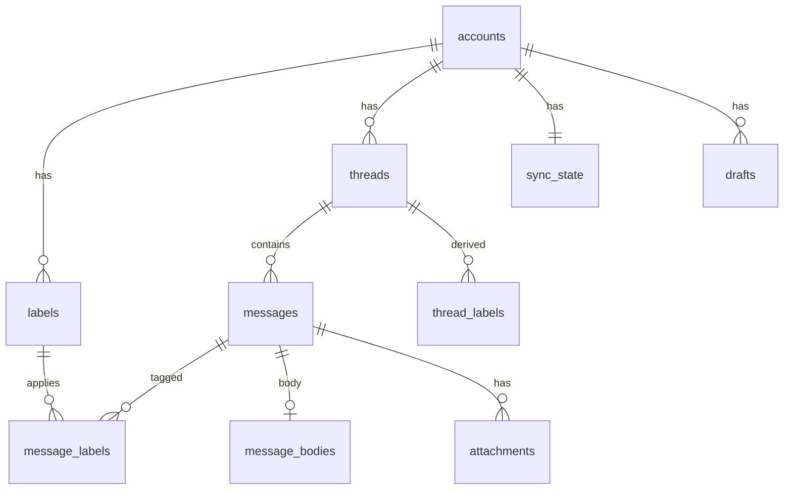
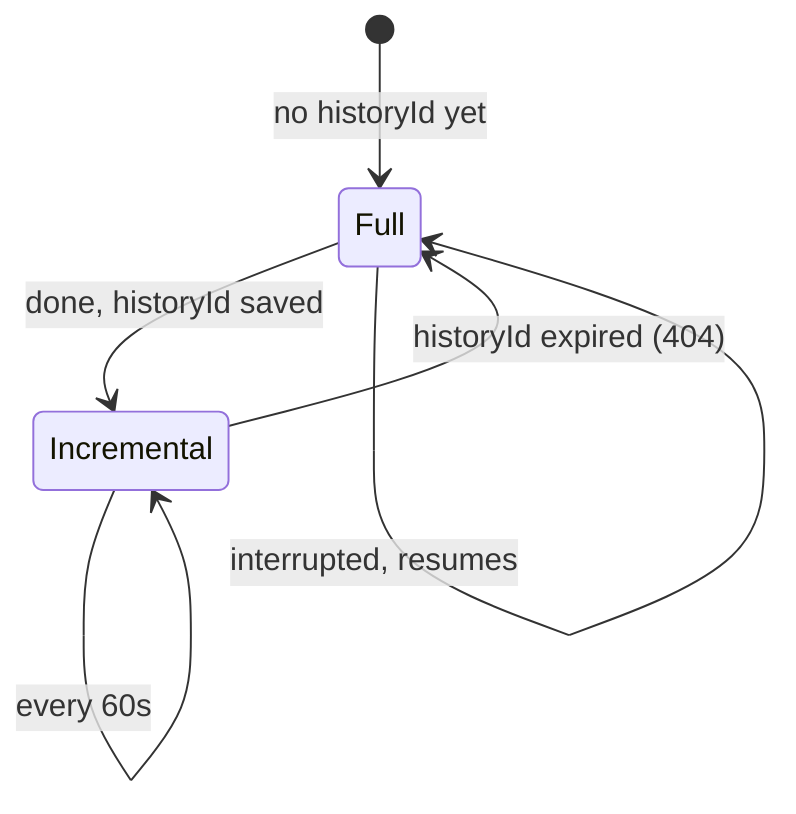

# Mailboat architecture

How Mailboat is put together and why. For what is left to build, see
[ROADMAP.md](ROADMAP.md). For agent rules and commands, see
[`CLAUDE.md`](../CLAUDE.md).

## Overview

| Part | Language | Responsibility |
|---|---|---|
| `crates/core` | Rust | Database, Gmail client, sync, sign-in, HTML sanitizing. No Tauri dependency, so its tests run fast. |
| `src-tauri` | Rust | Thin layer: registers commands and events, app setup, window, capabilities. |
| `src` | TypeScript/React | All UI logic: views, selection, keyboard, formatting. |

Types shared by Rust and TypeScript are generated by `tauri-specta` into
`src/platform/tauri/bindings.ts`. A test fails if that file is stale.

## Data model

Every Gmail-derived row belongs to an account. Gmail IDs are only unique
within one mailbox, so tables use a local integer `id` plus
`UNIQUE(account_id, gmail_*_id)`, and child tables reference parents through
composite `(account_id, id)` foreign keys. The UI only ever sees local IDs.

- `thread_labels` is the union of a thread's message labels, rebuilt on
  every change, so list views never scan messages.
- `messages_fts` (FTS5) indexes subject, people, snippet and body text for
  all accounts. Its rowid is `messages.id`.
- `sender_image_prefs` is the one table without `account_id`: it describes
  a sender, not mailbox data.
- Schema changes are numbered migrations in `crates/core/src/db/schema.rs`.

## One query layer

`mailboat_core::db::query::list_threads` serves every list view. It takes an
account filter (all, or a list of IDs) and a view (system label, user
label, or search). "All Inboxes" is the INBOX view with the "all" filter; a
single account's inbox is the same query filtered to one ID. System labels
match by Gmail ID across accounts; a user label is one row of one account,
so it never merges with another account's label of the same name. Paging
uses a `(last_message_at, id)` cursor.

Two views aren't Gmail labels: **All Mail** is every thread with at least
one message outside Spam and Trash, and **Archive** is All Mail minus
threads in the Inbox (Gmail has no archived label). Every other view
except Spam and Trash (Inbox, Starred, user labels, search, and their
unread counts) is also limited to All Mail: Gmail's trash call can leave
a thread's INBOX label in place, and Gmail itself hides trashed mail
everywhere but the Trash.

## Sync

Each account has its own background worker (`sync/worker.rs`) with its own
cursor, backoff and error state.

- **Full sync:** read the mailbox's current historyId first, then list the
  threads in the sync scope (newest 2,000 Inbox, 5,000 All Mail, 1,000
  Starred, and small Drafts/Spam/Trash windows) and fetch their metadata in
  batches.
- **Widening:** when the scope grows (`SCOPE_VERSION`), accounts synced
  under the old scope fetch only the threads they're missing, after a normal
  incremental pass; the history cursor is untouched.
  Progress is saved per thread; an interrupted full sync resumes from the
  same historyId and skips threads already fetched.
- **Incremental sync:** `history.list` from the saved historyId, then
  re-fetch every thread it mentions.
- **Bodies** are fetched when a message is opened, and the newest few are
  prefetched after each pass. The same fetch records the message's
  attachment parts (`attachments` table). Bodies cached before attachments
  were recorded (`message_bodies.parts_version` below
  `store::PARTS_VERSION`) count as missing and are fetched again once.
- **Older mail on demand** (`sync/older.rs`): when a list reaches the
  end of the cache, the app walks Gmail's own list for that view (500
  IDs per cheap call), skips threads already cached, and fetches the next
  25 missing ones on the interactive lane, each account at once. A cursor
  per account and view (in memory) resumes the walk next time. Older
  threads are then kept current by incremental sync like any other; a
  full resync (expired historyId) drops them again, and they reload on
  the next scroll after a relaunch.
- **Removing an account** stops its worker and waits for it to end
  (`Supervisor::stop_and_wait`) before deleting its rows, so a sync in
  flight can't write into the account being deleted. Cascading foreign
  keys remove all its mail; a trigger clears its search index rows.
- **Failures:** an auth failure parks only that account until it signs in
  again; rate limits and network errors retry; nothing blocks other
  accounts or the UI.

### Quota

Gmail charges quota units per call (threads.get = 10, messages.get = 5).
The owner's Google Cloud project allows 6,000 units per minute per user, the
maximum it can be set to, and Google enforces it as roughly 100 units per
second with almost no burst. `gmail/pacer.rs` is a token bucket per account
(60 units/s, 60-unit bursts, batches of 5). When Google refuses anyway it
pauses (a full minute for per-minute errors) and halves its rate, then
recovers gradually. Usage per minute and every refusal go to the sync log.

## Sign-in and tokens

Desktop OAuth with a loopback redirect and PKCE: Mailboat listens on
`127.0.0.1` on a random port, opens the browser at Google's consent page,
and exchanges the returned code. The OAuth client is the owner's own
"External, in production, unverified" Google Cloud client, read from
`google-oauth-client.json` in the app's config folder (never committed).

Refresh tokens live only in the OS keychain, keyed by Google's stable account
ID. Access tokens live only in memory. Dev builds are signed with the owner's
Apple Development certificate so keychain approval survives rebuilds.

## Actions

`mailboat_core::actions`: read/unread, archive (remove INBOX) and move to
Inbox, star/unstar, user labels, trash and restore. Each is a label plan
(labels to add and remove, per account) run by one routine: it groups the
chosen threads by owning account, applies the change to the local cache
first, then calls Gmail with that account's client on the interactive
quota lane (`threads.modify`, or `threads.trash` / `threads.untrash`).
Threads Gmail refuses get every touched label restored from a snapshot,
and the error is returned. A user label belongs to one account, so it only
applies to that account's threads; a label from an account with no
selected thread is refused. Deleting forever isn't offered: it needs the
full `https://mail.google.com/` scope, and Gmail empties the Trash after
30 days anyway. The UI also updates its cached lists immediately
and rolls back on error (`features/mailbox/ui/useSetRead.ts`).

## Attachments

`mailboat_core::attachments`. Parts with a file name, or a Content-ID, are
attachments; ones the HTML shows as `cid:` are `inline` and aren't listed.
Files download on first use (open, Quick Look, save) with the owning
account's client into `<app cache>/attachments/<account id>/<attachment
id>/<safe name>`, and are reused after. Gmail's attachment IDs change
between fetches, so a refused ID triggers a re-fetch of the message for a
fresh one; small parts come with the message and have no ID at all.

- **Names** from emails are untrusted: `safe_filename` keeps only the last
  path part and drops control and reserved characters and leading dots,
  so `../../.zshrc` becomes `zshrc`.
- **Quarantine:** every file Mailboat writes gets macOS's
  `com.apple.quarantine` tag (as browsers do), so Gatekeeper checks it
  before anything in it runs.
- **Save** copies to Downloads with a free name ("a (1).pdf"); "Show in
  Finder" reveals the copy. **Quick Look** uses `qlmanage -p`.
- **Inline images** (png, jpeg, gif, webp, bmp; up to 5 MB each) are
  downloaded when the message opens and embedded as `data:` URLs in place
  of `cid:` links. They're part of the email, not remote content, so they
  show even where remote images are held back. Anything not shown
  (blocked remote images, unresolved `cid:`, relative paths) becomes a
  transparent placeholder box sized from the email's own width and height,
  instead of the web view's broken-image icon.
- Removing an account deletes its attachment folder.
- **The paperclip** (`has_attachments`): sync's header-only fetch
  (`format=metadata`) doesn't include a message's parts, so sync counts
  `multipart/mixed` mail as having attachments. Once a body is fetched, its
  real list (non-inline parts) decides, and later syncs keep that answer.
  Caches built before this had no paperclips at all; a one-time catch-up
  per account (`sync_state.attachments_version`) lists Gmail's
  `has:attachment` message IDs (newest 20,000, 5 units per 500) and marks
  the cached ones.

## Compose

`mailboat_core::compose` (Milestone 4).

- **Sending** builds an RFC 5322 message with `mail-builder` and sends it
  with `messages.send`, using the From account's own client. A reply or
  forward carries `In-Reply-To` and `References` from the original and
  joins its Gmail thread only when sent from the same account; from
  another account it starts a thread there (threads never merge across
  accounts). The new thread is fetched straight after and cached, so it
  shows at once.
- **Never sent twice:** `messages.send` isn't retried after timeouts or
  server errors, since Gmail may already have sent it. Rate limits (403,
  429) and connection failures happen before Gmail accepts anything, so
  those still retry.
- **From** (`compose::identities`): each account's Gmail "Send mail as"
  addresses (`settings.sendAs`, 1 unit), stored in `send_as`. Each sync
  worker fetches them once after its first good pass and emits
  `IdentitiesChangedEvent`; compose only reads the table, so it never
  waits on Google. Aliases awaiting verification are left out; an account
  never fetched still offers its own address. Sending checks that From
  belongs to the account.
- **Reply-To:** sync now asks for the header (`messages.reply_to_json`).
  Mail cached before that has NULL there; replying fetches that one
  message's headers (5 units) and remembers them.
- **Address suggestions** (`compose::contacts`): one query over cached
  mail of every account builds the whole ranked list (thousands of people, fast), which the UI loads once and filters as you type
  (`features/compose/model/contacts.ts`); it refreshes when mail changes.
  People you've sent to (To/Cc of SENT mail) rank above people who only
  wrote to you; within each, every message counts less the older it is
  (a month old counts half). Spam, Trash and no-reply or bounce senders
  you never wrote to are left out.

## Showing email safely

1. Rust sanitizes the HTML (`mail/sanitize.rs`, using `ammonia`): no
   scripts, event handlers, forms, frames or `javascript:` links.
2. Tracking pixels are always removed. Remote images then load by default,
   except in Spam (always held back) and Trash (held back unless the sender
   is allowed); a per-sender load/block choice wins outside Spam
   (`mail/images.rs`). The reader says which applied and offers the
   opposite choice.
3. The result is a full document with its own Content-Security-Policy,
   shown in an `<iframe sandbox>` without `allow-scripts`.
   Emails without their own style sheet (and not marked "light only") are
   "adaptive": the page is transparent so they sit on the reader's glass,
   and a `prefers-color-scheme: dark` sheet remaps their inline colors
   (`mail/colors.rs`). Elements get `data-mc` / `data-mb` numbers; the sheet
   holds only colors the sanitizer computed.
4. Links (http, https, mailto only) are rewritten to Mailboat's own
   `mailboat-link:` scheme. A click makes the frame request that URL; the app
   opens the real link in the default browser and answers 204 No Content,
   so the email stays put. Other links are made inert.

## Decisions

| Date | Decision | Why |
|---|---|---|
| 2026-10-14 | Split Rust into `crates/core` and `src-tauri` | Core logic tests without compiling Tauri; keeps logic out of the IPC layer. |
| 2026-10-14 | Write our own Gmail client instead of `google-gmail1` | That crate is ~30,000 generated lines, has no HTTP batch support, no hook for quota pacing, and depends on an OAuth library without PKCE. Ours is ~400 lines covering what Mailboat uses. |
| 2026-10-14 | `reqwest` + `tokio` instead of MonoCode's blocking `ureq` | Independent async workers per account. |
| 2026-10-14 | Sanitize email HTML in Rust, display in a sandboxed `srcdoc` iframe | Security lives on the trusted side; the iframe can't run scripts, and the app can still measure height and catch link clicks. |
| 2026-10-14 | OAuth client: External, in production, unverified | Lets both a @gmail.com and a Workspace account sign in without Google review; Testing mode would expire tokens weekly. |
| 2026-10-15 | Pace Gmail at 60 units/s, batches of 5 | The project's per-user limit is 6,000/minute (documented default is 15,000), enforced per second. |
| 2026-10-15 | Sign dev builds with an Apple Development certificate | macOS ties keychain approval to the exact build; signing gives every build one identity. |
| 2026-10-15 | Use the `oauth2` crate for the OAuth protocol | Security-sensitive code shouldn't be homemade; it supports PKCE. The loopback listener and keychain storage stay ours. |
| 2026-10-15 | Email links go through a `mailboat-link:` scheme handler | Catching clicks from the sandboxed frame with JavaScript didn't work in the macOS web view; a scheme handler doesn't need scripts at all. |
| 2026-10-15 | Sync scope: newest 5,000 All Mail threads, not just INBOX/STARRED/SENT | The owner keeps Inbox Zero; nearly all mail is archived and was missing. 5,000 threads is ~15 minutes at the 6,000/minute quota; older mail will load on demand (Milestone 2). |
| 2026-10-15 | Track milestones in `docs/ROADMAP.md` | Items moved between milestones must not get lost. |
| 2026-10-15 | UX Spike 1: the owner's screenshots of Tern, Arc and MonoCode set the visual direction | Glass sidebars, a darker glass body with rounded corners where they meet, resizable panes. Where references differ, the owner's screenshots win; MonoCode fills gaps (tokens, motion). |
| 2026-10-15 | Window glass via Tauri's built-in `windowEffects` (`underWindowBackground`), `transparent` window, `macos-private-api` feature | Blur has to come from the native window; CSS can't blur the desktop. MonoCode and Synara both use this material as their base. The flag uses a private API, which rules out the Mac App Store (not a goal). A stronger, adjustable blur (`CGSSetWindowBackgroundBlurRadius`, as in Synara/MonoCode) is a later option if this looks too faint. |
| 2026-10-15 | Two glass tints: thin over the sidebar, ~85% over panels with reading text | Legibility: text never sits on thin glass. Tints are CSS tokens (`--glass-*-strength`) so they're easy to tune. |
| 2026-10-15 | Hand-built pane splitters, no library | About 60 lines with pointer capture, as MonoCode's sidebar resizer does; a library (e.g. `react-resizable-panels`) would add a dependency for two handles. The email iframe gets `pointer-events: none` during a drag so it can't swallow the pointer. |
| 2026-10-15 | Icons: Hugeicons (`@hugeicons/react`, `@hugeicons/core-free-icons`), wrapped in `src/shared/ui/icons.tsx` | The outline set MonoCode uses, and the look of Tern's toolbar. Icons are imported one by one so only the ones used are bundled. |
| 2026-10-15 | Layout: the list is the body card; the reader sits on the glass | Owner's call: rounded corners wrap the list on both sides, and the reader reads as a right-hand sidebar that can be dragged narrow. Glass tints lowered to 12%/62% (dark) to get closer to Tern. |
| 2026-10-15 | Traffic lights centered in a 40px toolbar via `trafficLightPosition` `{x:16, y:22}` | Tauri config, no custom Rust. Measured: `y` 22 puts the buttons' centers 20pt from the top, matching the toolbar icons. MonoCode saw them jump during live resize with its own titlebar stretching; watch for that. |
| 2026-10-15 | Panel toggles: ⌃⌘S sidebar, ⌃⌘R reader | ⌃⌘S is macOS's standard Show Sidebar key (Finder, Mail, Notes). ⌘B was avoided: the composer will need it for bold. Matched on the physical key (`KeyboardEvent.code`) so other layouts work. |
| 2026-10-15 | Panels slide with CSS transitions, no animation library | The panels stay mounted; a wrapper animates its size (width, or flex-grow for the reader) and clips, while the content keeps a fixed width so nothing reflows mid-slide. Transitions switch off while a splitter drags and under macOS "Reduce motion". |
| 2026-10-15 | Sync status lives on the account avatar; routine syncs show nothing | Incremental syncs run about once a minute and usually change nothing, so a text line flashed and shifted the sidebar each time. The arc appears only after 1.5s of syncing; only actionable errors get text. Chosen over a toolbar activity icon (saved for the future log console) and a list shimmer (not per account). |
| 2026-10-15 | Search sits centered in the title bar | Owner's request, after VS Code. It stays scoped to the sidebar's current view (one account or all). Its width is `clamp(200px, 100vw − 600px, 440px)` so it never collides with the toolbar buttons at the 820px minimum window width. |
| 2026-10-15 | Sidebar labels grouped by `/` and by a `Prefix: ` name | Gmail nests with `/`; many apps (Acme) group with "Prefix: Name", so both fold. Groups need two or more entries, so a lone chain like `[Gmail]/Trash/Sent` stays one row. Logic in `features/accounts/model/labelTree.ts` with tests. |
| 2026-10-15 | Pointer-following glow uses a per-frame glide, not CSS transitions | Restarting a transition on every pointer move reset its speed each time and stuttered; a `requestAnimationFrame` loop closing a fixed fraction of the gap per unit time (`model/glow.ts`, tested) glides and stops when settled. The glow is a multi-stop gradient: WebKit re-rendered a moving `filter: blur()` every frame. |
| 2026-10-15 | Reader scroll area is `overflow-y: scroll`, not `auto` | The app styles scrollbars (`::-webkit-scrollbar`), which makes WebKit use classic scrollbars that take width. With `auto`, a long email's scrollbar appearing narrowed the reader and reflowed the email visibly. `scrollbar-gutter: stable` would be the modern fix but isn't reliable in WebKit. |
| 2026-10-15 | Remote images load by default outside Spam (was: blocked unless the sender is allowed) | Owner's choice (option A of three): it's what other mail apps do, and per-sender allowlisting every email was tedious. The cost is privacy, not code execution (email is sanitized and sandboxed without scripts): a sender's server sees the open time and IP. Spam stays blocked because sender addresses there are often forged and an image load confirms the mailbox is live; known trackers are still stripped. No schema change: a missing `sender_image_prefs` row now means "default" instead of "block". Alternatives not built: default only for people you've written to; background prefetch like Apple Mail. |
| 2026-10-15 | Dark mode for email by remapping colors in Rust, not by inverting | Owner wanted emails on the glass like MonoCode conversations. Inverting (CSS `filter`) mangles logos and photos; Gmail's mobile app instead remaps near-whites and near-blacks and keeps brand colors and images, so Mailboat does the same. Light-mode colors stay inline and dark ones come from a `prefers-color-scheme: dark` sheet, so the system appearance switch updates open mail. Emails with their own `<style>` color rules keep the white card until those can be rewritten. "Neutral" uses chroma, not HSL saturation, which overstates tints near white. |
| 2026-10-15 | App icon drawn as an SVG in `design/icon/mailboat-icon.svg`; every size generated with `bun tauri icon design/icon/mailboat-icon.svg` | One editable source instead of hand-made PNGs. The generated Android/iOS folders are deleted (desktop only). Each design round's comparison sheet is kept in `design/icon/sheets/`, and the icons to offer in a future Settings picker in `design/icon/choices/` (see its README); the other generated SVGs and PNGs were deleted. |
| 2026-10-15 | List rows show the account as a hollow ring in a softened (75%) account colour; unread stays a solid accent dot | With two accounts, a solid account dot and the unread dot looked the same, especially when the account colour is also blue. Shape (hollow vs solid) tells them apart regardless of colour. The owner tried six styles in the app: solid edge bar, no unread dot, avatar, glass edge bar, ring, glass dot; the bars and solid dots were too busy and avatars too noisy. The ring only shows in views that mix accounts. |
| 2026-10-15 | No custom scrollbar styling; the system's own scrollbars are used | Any `::-webkit-scrollbar` rule makes WebKit draw always-visible scrollbars. Without one, macOS overlay scrollbars appear while scrolling and fade after, take no width (so the reader uses `overflow-y: auto` and long emails don't reflow), follow light/dark, and honour the user's System Settings. Owner asked for the usual macOS behaviour. Windows may need its own look later (roadmap). |
| 2026-10-15 | Sidebar keeps per-account sections ("Tidy"), with unread counts and folds | The owner tried three layouts in the app: an account switcher (chips filtering one set of views), Mimestream-style nesting (each view unfolds a row per account) and this one, and preferred it. Counts show only on Inbox, Starred and labels, where unread means something is waiting (owner tried an "Everything" setting with Unread, Archive and All Mail, and none; those views are always full of old unread mail); they come from `query::unread_counts`, per account, summed for unified views. Unread (list and count) leaves out Spam and Trash, as Gmail does. Folds reset on relaunch for now. |
| 2026-10-15 | Glass tints: dark 6.5% (sidebar/reader) and 34% (list panel); light 10% and 37% | Found with a temporary slider that scaled every tint by one factor, so areas kept their ratios; the owner picked 45% clearer than the first values (12%/62%, light 18%/68%), and the slider was then removed. Per-area sliders are planned for Settings: one shared factor changed the list panel far more than the sidebar. |
| 2026-10-15 | App icon: a folded-ribbon M (fold style S4) on a flat near-black tile, replacing the glass icon; green (C13) at first, then cobalt (C04) and sky (C03), now Apple's system blue `#0A84FF` (C17): cobalt read violet and sky teal next to Mail, and macOS's rendering of #0A84FF measures within a few points of Mail's icon blue. A mail blue suits an alternative to Mail and Mimestream | The owner found the best Dock icons have sharp contrast between a flat background and the mark, and gradients looked weak. Seven rounds of options are kept as sheets; the 16 colours of the final style and the old glass icon are kept as SVGs for a future icon picker. |
| 2026-10-15 | macOS icon also ships as an Icon Composer icon (`src-tauri/macos/AppIcon.icon` compiled to `Assets.car`, `CFBundleIconName`), after MonoCode | Only icons in this format get macOS 26's glass rim and depth in the Dock; a classic `.icns` is drawn flat. `scripts/build-app-icon.sh` renders the artwork layer to PNG (Icon Composer ignores SVG shadows) and runs Xcode's `actool`; the result is committed so builds don't need Xcode. The `.icns` stays as the fallback. |
| 2026-10-15 | Dev builds run from a signed `target/debug/Mailboat.app` built by `scripts/dev-run.sh`; `src-tauri/src/dock.rs` clears Tauri's dev Dock image | macOS only applies the icon treatment to bundles, and Tauri paints a flat image on the Dock in dev. MonoCode builds its dev bundle in Rust and signs it ad hoc; Mailboat does it in the existing runner script so the bundle is signed with the Apple Development certificate and keychain access still survives rebuilds. Needs `objc2`/`objc2-app-kit`, already in the build through Tauri. |
| 2026-10-15 | Splitter positions saved in local storage: sidebar in pixels, list as a share of the panes | The owner wanted the sidebar to keep its width when the window resizes and the list and reader to scale together. The list is laid out with a percentage flex-basis, so the browser does the proportional resize with no code running; dragging converts the pixel position to a share, kept between 10% and 90% and within the list's and reader's minimum widths. Local storage, like other view state; move to Settings storage if one arrives. |
| 2026-10-16 | Menus and confirmations use the web view's own popover and `<dialog>`, not a library or Tauri native menus | They give click-outside, Escape and focus handling for free and float above panels that clip; native menus would need the menu permission on the web side. |
| 2026-10-16 | Actions take effect at once, with an Undo toast, and the next conversation opens | Gmail and Mail both do this; waiting on Gmail (~0.3s) for every `e` felt slow. Undo is just the inverse action (archive ↔ move to Inbox, trash ↔ restore, label add ↔ remove). Advancing marks the next conversation read, as opening any conversation does. |
| 2026-10-16 | Thread summaries carry `inInbox`, `inTrash` and user `labelIds` | So buttons toggle correctly per conversation (archived mail offers "Move to Inbox") and the label picker can tick labels for a multi-selection, without a query per row. |
| 2026-10-16 | No "Delete forever" | Gmail's delete call needs the full `https://mail.google.com/` scope; Mailboat asks only for `gmail.modify`, and Gmail empties the Trash after 30 days. |
| 2026-10-16 | Attachments open through Rust (`open`, `qlmanage -p`, `open -R`), not a Tauri plugin | No new plugin or web permission: the web side only asks Rust to open an attachment by its local ID, never a path. Save goes straight to Downloads (as browsers do) instead of a save dialog, which would need the dialog plugin. `qlmanage` is Apple's command-line Quick Look; a native panel would need much more Objective-C glue. Downloads are tagged with macOS quarantine. |
| 2026-10-16 | Inline images embedded as `data:` URLs, not served by a custom scheme | The email's CSP already allows `data:` images, and the frame stays fully self-contained; a scheme handler would need another frame-src exception. Capped at 5 MB per image to keep the document small. |
| 2026-10-16 | Compose: new mail in a floating card that snaps to corners and side midpoints (like iOS picture-in-picture); replies and forwards inline in the reader; full formatting; 5-second undo send; no pop-out window | Owner's design (Milestone 4). The card must never block the reader, so text can be copied between an open message and a draft, which Notion Mail can't do. Snapping instead of free dragging keeps it tidy; Gmail's defaults for replies and undo send. |
| 2026-10-16 | Outgoing mail built with `mail-builder` (Stalwart), not by hand or with `lettre` | MIME encoding (RFC 2047 names and subjects, quoted-printable, folding) is a standard protocol best left to a maintained crate. `lettre` is an SMTP client; `mail-builder` only builds messages, which is all Gmail's API needs. Default features off (no hostname lookup: Mailboat sets its own Message-ID). |
| 2026-10-16 | `messages.send` is never retried after a timeout or server error | Gmail may have sent the mail before failing; retrying could deliver it twice. The error is shown and the message stays in compose, so the user decides. |
| 2026-10-16 | Gmail aliases are fetched by the sync worker, not when compose opens | Compose shouldn't wait on the network (an offline fetch retries for up to a minute). The list is small and rarely changes; once per launch is enough. |
| 2026-10-16 | Compose card is glass with its own `backdrop-filter` blur, tint 72% (dark) / 78% (light) | Owner wanted it to match the app's glass. The window's native blur only shows the desktop, and the card floats over the app's own content (often a white email), so it blurs that itself and needs a thicker tint than the list panel (34%) for writing to stay legible. The blur makes the card a containing block for fixed elements, so anything that pops out of it (suggestions, dialogs) must use the top layer. |
| 2026-10-16 | Compose card snapping hand-built (`features/compose/model/snap.ts`), spring as a CSS overshoot curve, no animation library | Eight spots (corners and side middles); on release the card goes to the spot nearest its position plus 0.18s of its speed, so flicks land where they were thrown, as in iOS picture-in-picture. A `cubic-bezier(0.34, 1.45, 0.64, 1)` transition on left/top gives the rubber-band settle without a physics library, like the panels' slides. |
| 2026-10-16 | Composer is TipTap 3 (StarterKit, TextStyleKit, TextAlign); sent HTML gets `margin:0` paragraphs and ` ` in empty ones | TipTap was the stack's planned editor. Browsers and mail apps give `
` a 1em gap and collapse empty ones, while the editor shows neither, so `emailHtml` makes the email look as written. The plain-text copy comes from the editor (`getText`), since Rust's `html_to_text` flattens everything to one line (fine for search, not for mail). |
| 2026-10-16 | Outgoing mail uses Gmail's upload endpoint (`/upload/.../messages/send?uploadType=multipart`); files are picked with an HTML file input and passed to Rust as base64 | The JSON `raw` form is meant for small messages; the upload endpoint takes up to 35 MB, so attachments up to Gmail's 25 MB fit. A file input needs no Tauri dialog plugin or new web permission. Base64 over IPC costs a third more bytes, fine at these sizes. |
| 2026-10-16 | Signatures and quotes stay outside the editor and are appended when sending | TipTap's schema rewrote them (dropped ``, inline styles, tables, Gmail's line structure). Shown read-only in a sandboxed preview, sent as Gmail's own HTML in its `gmail_signature` / `gmail_quote` wrappers, as Gmail sends them. |
| 2026-10-16 | Address suggestions filtered in the UI from a list loaded once, not queried per keystroke | Owner noticed a lag: each key cost a database query plus an IPC trip. The ranked list is small (a small list for thousands of people), so filtering in memory is instant. A per-address name lookup written as a correlated subquery took many seconds on a large cache; a grouped join is instant. |
| 2026-10-16 | Older mail loads by walking Gmail's list for the view and skipping cached threads, not with a `before:<oldest date>` search | The cache isn't one date range per view (an old starred thread can sit far below the rest of a label), so “older than the oldest cached” would silently skip gaps. Listing IDs costs 10 units per 500, so skipping the cached part is cheap. |
