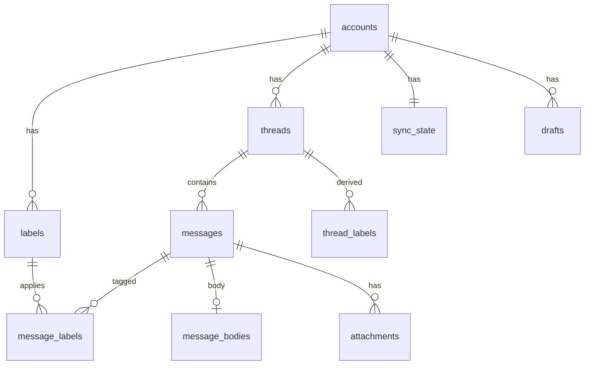
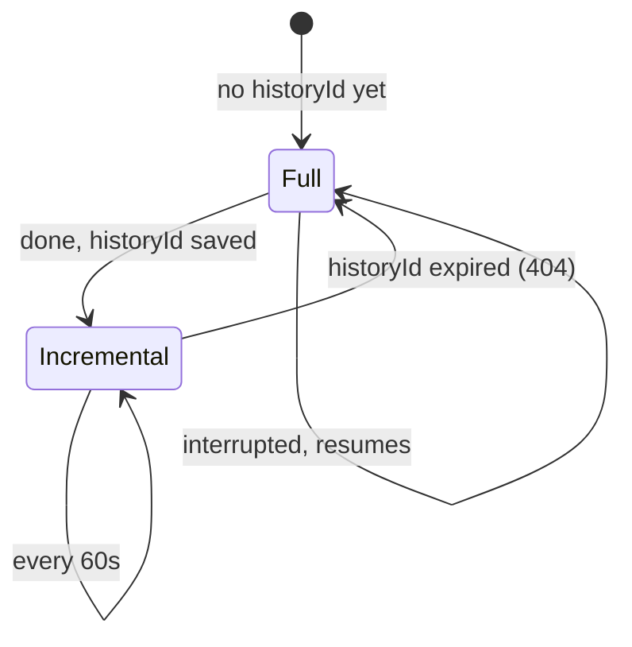

# Mailboat architecture

How Mailboat is put together and why. For what is left to build, see
[ROADMAP.md](ROADMAP.md). For agent rules and commands, see
[`CLAUDE.md`](../CLAUDE.md).

## Overview

| Part | Language | Responsibility |
|---|---|---|
| `crates/core` | Rust | Database, Gmail client, sync, sign-in, HTML sanitizing. No Tauri dependency, so its tests run fast. |
| `src-tauri` | Rust | Thin layer: registers commands and events, app setup, window, capabilities. |
| `src` | TypeScript/React | All UI logic: views, selection, keyboard, formatting. |

Types shared by Rust and TypeScript are generated by `tauri-specta` into
`src/platform/tauri/bindings.ts`. A test fails if that file is stale.

## Data model

Every Gmail-derived row belongs to an account. Gmail IDs are only unique
within one mailbox, so tables use a local integer `id` plus
`UNIQUE(account_id, gmail_*_id)`, and child tables reference parents through
composite `(account_id, id)` foreign keys. The UI only ever sees local IDs.

- `thread_labels` is the union of a thread's message labels, rebuilt on
  every change, so list views never scan messages.
- `messages_fts` (FTS5) indexes subject, people, snippet and body text for
  all accounts. Its rowid is `messages.id`.
- `sender_image_prefs` is the one table without `account_id`: it describes
  a sender, not mailbox data.
- Schema changes are numbered migrations in `crates/core/src/db/schema.rs`.

## One query layer

`mailboat_core::db::query::list_threads` serves every list view. It takes an
account filter (all, or a list of IDs) and a view (system label, user
label, or search). "All Inboxes" is the INBOX view with the "all" filter; a
single account's inbox is the same query filtered to one ID. System labels
match by Gmail ID across accounts; a user label is one row of one account,
so it never merges with another account's label of the same name. Paging
uses a `(last_message_at, id)` cursor.

Two views aren't Gmail labels: **All Mail** is every thread with at least
one message outside Spam and Trash, and **Archive** is All Mail minus
threads in the Inbox (Gmail has no archived label). Search also skips Spam
and Trash.

## Sync

Each account has its own background worker (`sync/worker.rs`) with its own
cursor, backoff and error state.

- **Full sync:** read the mailbox's current historyId first, then list the
  threads in the sync scope (newest 2,000 Inbox, 5,000 All Mail, 1,000
  Starred, and small Drafts/Spam/Trash windows) and fetch their metadata in
  batches.
- **Widening:** when the scope grows (`SCOPE_VERSION`), accounts synced
  under the old scope fetch only the threads they're missing, after a normal
  incremental pass; the history cursor is untouched.
  Progress is saved per thread; an interrupted full sync resumes from the
  same historyId and skips threads already fetched.
- **Incremental sync:** `history.list` from the saved historyId, then
  re-fetch every thread it mentions.
- **Bodies** are fetched when a message is opened, and the newest few are
  prefetched after each pass.
- **Failures:** an auth failure parks only that account until it signs in
  again; rate limits and network errors retry; nothing blocks other
  accounts or the UI.

### Quota

Gmail charges quota units per call (threads.get = 10, messages.get = 5).
The owner's Google Cloud project allows 6,000 units per minute per user, the
maximum it can be set to, and Google enforces it as roughly 100 units per
second with almost no burst. `gmail/pacer.rs` is a token bucket per account
(60 units/s, 60-unit bursts, batches of 5). When Google refuses anyway it
pauses (a full minute for per-minute errors) and halves its rate, then
recovers gradually. Usage per minute and every refusal go to the sync log.

## Sign-in and tokens

Desktop OAuth with a loopback redirect and PKCE: Mailboat listens on
`127.0.0.1` on a random port, opens the browser at Google's consent page,
and exchanges the returned code. The OAuth client is the owner's own
"External, in production, unverified" Google Cloud client, read from
`google-oauth-client.json` in the app's config folder (never committed).

Refresh tokens live only in the OS keychain, keyed by Google's stable account
ID. Access tokens live only in memory. Dev builds are signed with the owner's
Apple Development certificate so keychain approval survives rebuilds.

## Actions

`mailboat_core::actions` (read/unread so far; Milestone 3 adds the rest). Each
action groups the chosen threads by owning account, applies the change to
the local cache first, then calls Gmail with that account's client on the
interactive quota lane. Threads Gmail refuses are restored from a snapshot,
and the error is returned. The UI also updates its cached lists immediately
and rolls back on error (`features/mailbox/ui/useSetRead.ts`).

## Showing email safely

1. Rust sanitizes the HTML (`mail/sanitize.rs`, using `ammonia`): no
   scripts, event handlers, forms, frames or `javascript:` links.
2. Tracking pixels are always removed; remote images are held back unless
   the sender is trusted.
3. The result is a full document with its own Content-Security-Policy,
   shown in an `<iframe sandbox>` without `allow-scripts`.
4. Links (http, https, mailto only) are rewritten to Mailboat's own
   `mailboat-link:` scheme. A click makes the frame request that URL; the app
   opens the real link in the default browser and answers 204 No Content,
   so the email stays put. Other links are made inert.

## Decisions

| Date | Decision | Why |
|---|---|---|
| 2026-10-14 | Split Rust into `crates/core` and `src-tauri` | Core logic tests without compiling Tauri; keeps logic out of the IPC layer. |
| 2026-10-14 | Write our own Gmail client instead of `google-gmail1` | That crate is ~30,000 generated lines, has no HTTP batch support, no hook for quota pacing, and depends on an OAuth library without PKCE. Ours is ~400 lines covering what Mailboat uses. |
| 2026-10-14 | `reqwest` + `tokio` instead of MonoCode's blocking `ureq` | Independent async workers per account. |
| 2026-10-14 | Sanitize email HTML in Rust, display in a sandboxed `srcdoc` iframe | Security lives on the trusted side; the iframe can't run scripts, and the app can still measure height and catch link clicks. |
| 2026-10-14 | OAuth client: External, in production, unverified | Lets both a @gmail.com and a Workspace account sign in without Google review; Testing mode would expire tokens weekly. |
| 2026-10-15 | Pace Gmail at 60 units/s, batches of 5 | The project's per-user limit is 6,000/minute (documented default is 15,000), enforced per second. |
| 2026-10-15 | Sign dev builds with an Apple Development certificate | macOS ties keychain approval to the exact build; signing gives every build one identity. |
| 2026-10-15 | Use the `oauth2` crate for the OAuth protocol | Security-sensitive code shouldn't be homemade; it supports PKCE. The loopback listener and keychain storage stay ours. |
| 2026-10-15 | Email links go through a `mailboat-link:` scheme handler | Catching clicks from the sandboxed frame with JavaScript didn't work in the macOS web view; a scheme handler doesn't need scripts at all. |
| 2026-10-15 | Sync scope: newest 5,000 All Mail threads, not just INBOX/STARRED/SENT | The owner keeps Inbox Zero; nearly all mail is archived and was missing. 5,000 threads is ~15 minutes at the 6,000/minute quota; older mail will load on demand (Milestone 2). |
| 2026-10-15 | Track milestones in `docs/ROADMAP.md` | Items moved between milestones must not get lost. |
| 2026-10-15 | UX Spike 1: the owner's screenshots of Tern, Arc and MonoCode set the visual direction | Glass sidebars, a darker glass body with rounded corners where they meet, resizable panes. Where references differ, the owner's screenshots win; MonoCode fills gaps (tokens, motion). |
| 2026-10-15 | Window glass via Tauri's built-in `windowEffects` (`underWindowBackground`), `transparent` window, `macos-private-api` feature | Blur has to come from the native window; CSS can't blur the desktop. MonoCode and Synara both use this material as their base. The flag uses a private API, which rules out the Mac App Store (not a goal). A stronger, adjustable blur (`CGSSetWindowBackgroundBlurRadius`, as in Synara/MonoCode) is a later option if this looks too faint. |
| 2026-10-15 | Two glass tints: thin over the sidebar, ~85% over panels with reading text | Legibility: text never sits on thin glass. Tints are CSS tokens (`--glass-*-strength`) so they're easy to tune. |
| 2026-10-15 | Hand-built pane splitters, no library | About 60 lines with pointer capture, as MonoCode's sidebar resizer does; a library (e.g. `react-resizable-panels`) would add a dependency for two handles. The email iframe gets `pointer-events: none` during a drag so it can't swallow the pointer. |
| 2026-10-15 | Icons: Hugeicons (`@hugeicons/react`, `@hugeicons/core-free-icons`), wrapped in `src/shared/ui/icons.tsx` | The outline set MonoCode uses, and the look of Tern's toolbar. Icons are imported one by one so only the ones used are bundled. |
| 2026-10-15 | Layout: the list is the body card; the reader sits on the glass | Owner's call: rounded corners wrap the list on both sides, and the reader reads as a right-hand sidebar that can be dragged narrow. Glass tints lowered to 12%/62% (dark) to get closer to Tern. |
| 2026-10-15 | Traffic lights centered in a 40px toolbar via `trafficLightPosition` `{x:16, y:22}` | Tauri config, no custom Rust. Measured: `y` 22 puts the buttons' centers 20pt from the top, matching the toolbar icons. MonoCode saw them jump during live resize with its own titlebar stretching; watch for that. |
| 2026-10-15 | Panel toggles: ⌃⌘S sidebar, ⌃⌘R reader | ⌃⌘S is macOS's standard Show Sidebar key (Finder, Mail, Notes). ⌘B was avoided: the composer will need it for bold. Matched on the physical key (`KeyboardEvent.code`) so other layouts work. |
| 2026-10-15 | Panels slide with CSS transitions, no animation library | The panels stay mounted; a wrapper animates its size (width, or flex-grow for the reader) and clips, while the content keeps a fixed width so nothing reflows mid-slide. Transitions switch off while a splitter drags and under macOS "Reduce motion". |
| 2026-10-15 | Sync status lives on the account avatar; routine syncs show nothing | Incremental syncs run about once a minute and usually change nothing, so a text line flashed and shifted the sidebar each time. The arc appears only after 1.5s of syncing; only actionable errors get text. Chosen over a toolbar activity icon (saved for the future log console) and a list shimmer (not per account). |
