# Features

A look at what Mailboat does, one picture at a time. Every picture is Mailboat's
demo mode: made-up people and mail, nothing real. (The short version is in the
[README](../README.md).)

The bold line under each heading is the short version: a tagline here, and a
ready-made post on its own, one feature at a time or all at once. The features
that move also have a short loop: a small GIF for a page and an MP4 for a post.

## Gmail features that IMAP clients can't do

Mailboat talks to Gmail's own API, so the things that live in your Gmail
settings work from the app, and keep working when it is closed.

### Rules

**Gmail rules, edited right in your mail app, and they keep working when it's closed.**

<picture>
  <source media="(prefers-color-scheme: dark)" srcset="images/features/rules-dark.png">
  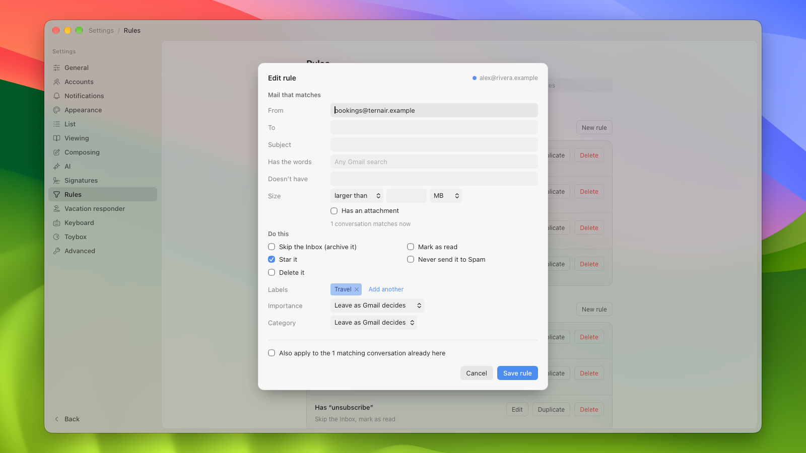
</picture>

Your Gmail filters, edited in the app. Match on who sent it, who it is to, the subject, words, size or an attachment, then star it, label it, skip the Inbox, mark it read or mark it important. The editor says how many conversations match now, and can apply the rule to them. Google runs the rules, so they work with Mailboat closed.

### Vacation responder

**Set Gmail's out-of-office reply without opening a browser.**

<picture>
  <source media="(prefers-color-scheme: dark)" srcset="images/features/vacation-dark.png">
  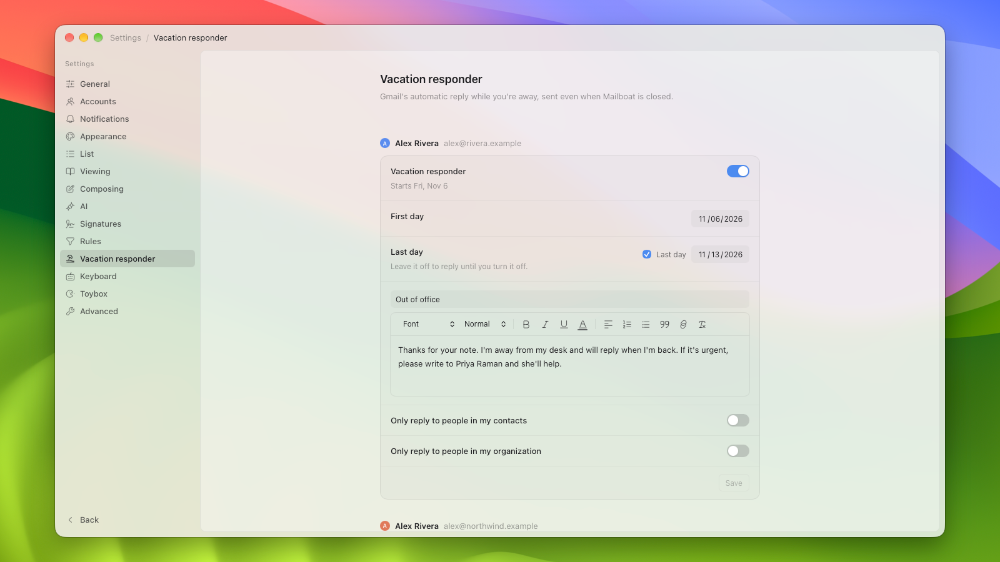
</picture>

Gmail's automatic reply while you're away: the first and last day, a subject and a formatted message, and whether it goes only to your contacts or your organization. Google sends it, even when Mailboat is closed.

### Signatures

**One signature per address, stored in Gmail, not in the app.**

<picture>
  <source media="(prefers-color-scheme: dark)" srcset="images/features/signatures-dark.png">
  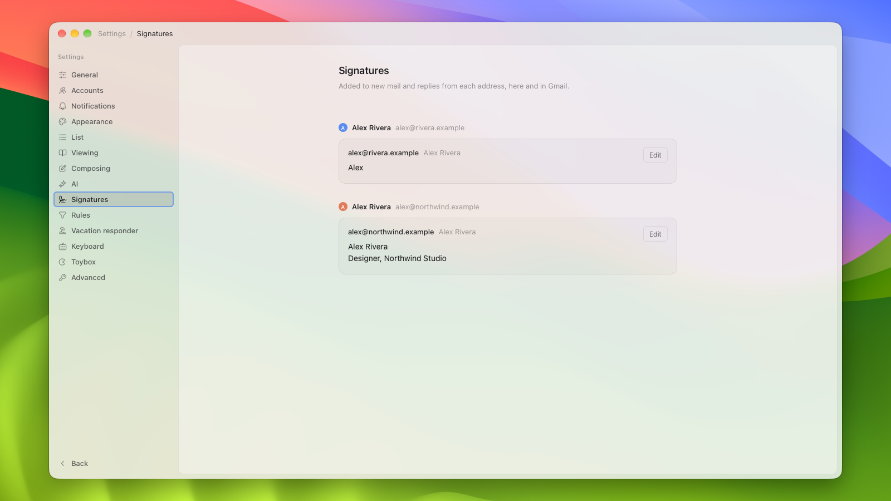
</picture>

A signature for each address you send from, kept in Gmail so it follows you everywhere. New mail and replies get the right one for the From address.

### Meeting invitations

**Reply to a meeting invitation without leaving the email.**

<picture>
  <source media="(prefers-color-scheme: dark)" srcset="images/features/invitation-dark.png">
  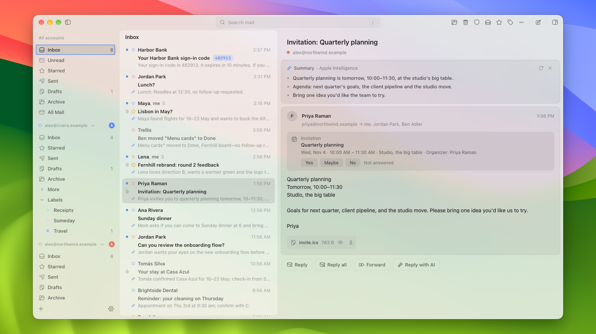
</picture>

Answer Yes, Maybe or No in the email itself. The answer goes through Google Calendar, and the summary above says what the meeting is about.

## AI that stays optional

Apple Intelligence runs on your Mac and is the default. You can use your own ChatGPT or Claude subscription instead (no API keys). Nothing is sent without you seeing it.

### Write with AI

**Reply ideas and drafts from Apple Intelligence, on your Mac.**

<picture>
  <source media="(prefers-color-scheme: dark)" srcset="images/features/write-with-ai-dark.png">
  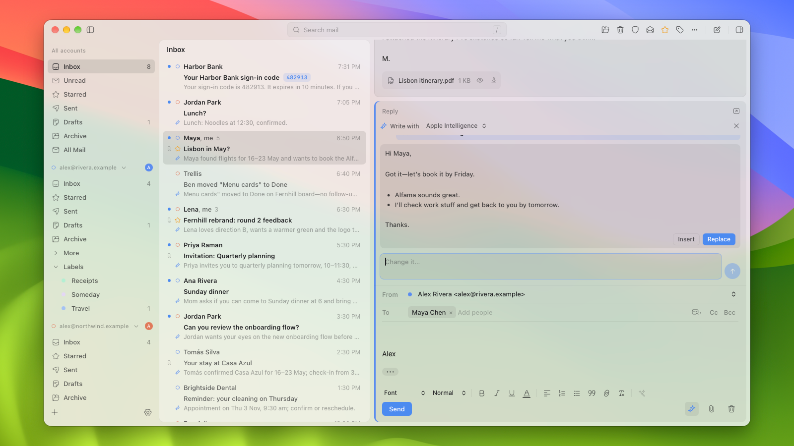
</picture>

*Animated:* [GIF](images/loops/write-with-ai.gif) · [MP4](images/loops/write-with-ai.mp4)

Say how to reply, or tap a reply idea, and the assistant drafts it from the conversation. Refine it, then Insert or Replace. It reads the conversation you're answering, and nothing is sent until you press Send.

### Summaries

**Long threads, in a few bullet points.**

<picture>
  <source media="(prefers-color-scheme: dark)" srcset="images/features/conversation-dark.png">
  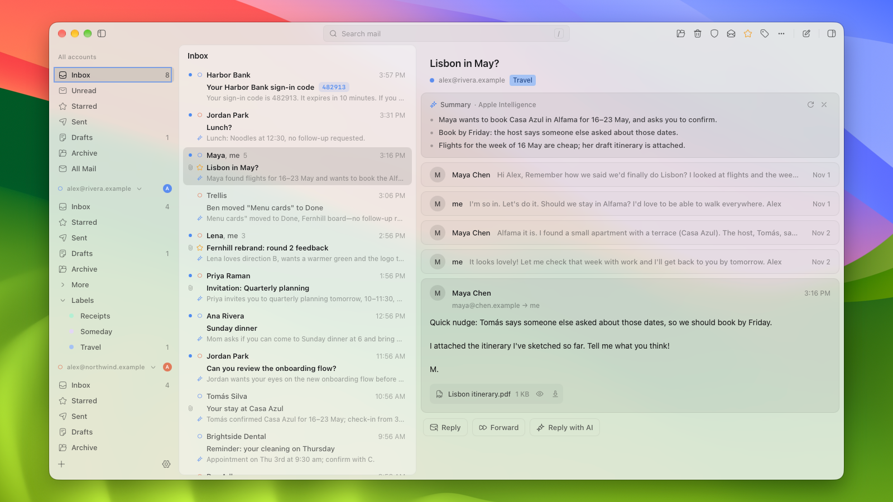
</picture>

A few points above a long conversation, and a one-line summary in place of each row's first words. They are written on your Mac and reused until new mail arrives; they stay saved on your computer until they are written again or cleared, or forgotten at quit if you turn off Keep saved summaries in Settings → AI.

### AI apps (MCP)

**Let Claude search and read your Gmail with one click, and save drafts that wait for you.**

<picture>
  <source media="(prefers-color-scheme: dark)" srcset="images/features/ai-apps-dark.png">
  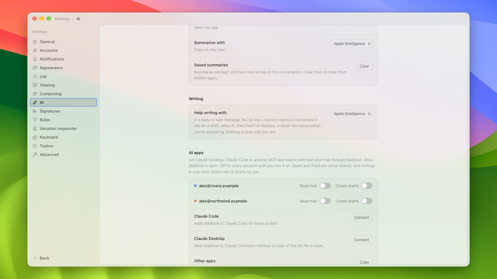
</picture>

Let Claude Desktop, Claude Code or another MCP app search and read your mail through Mailboat, while Mailboat is open, and save drafts. One click adds Mailboat to Claude. It is off for every account until you turn it on, Spam and Trash are never shared, and nothing is ever sent for you.

### Providers

**Pick who does the summaries and who helps you write.**

<picture>
  <source media="(prefers-color-scheme: dark)" srcset="images/features/ai-dark.png">
  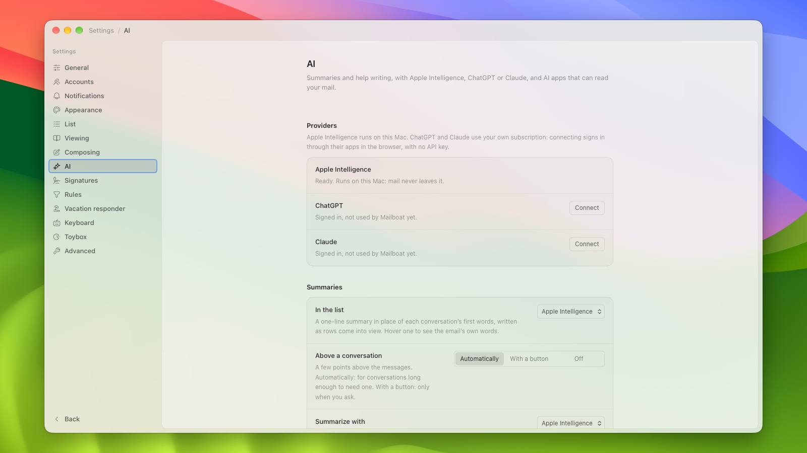
</picture>

Choose which AI does what: summaries in the list, summaries above a conversation, and writing. Apple Intelligence keeps everything on the Mac; ChatGPT and Claude use your own sign-in.

## Inbox Zero, for fun

A view with no mail is a place to play. Pick a toy, and after a minute without input a screensaver scene plays over the empty view.

### Bubble wrap

**Inbox Zero, with bubble wrap.**

<picture>
  <source media="(prefers-color-scheme: dark)" srcset="images/features/inbox-zero-bubbles-dark.png">
  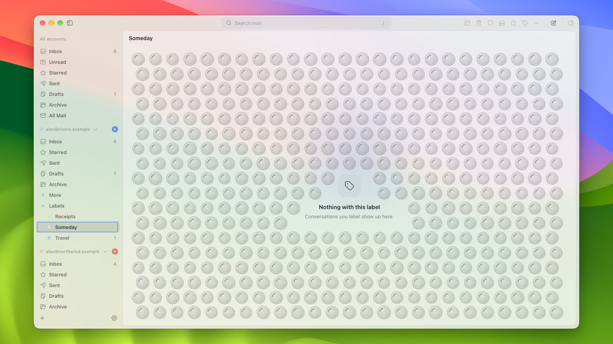
</picture>

*Animated:* [GIF](images/loops/bubble-wrap.gif) · [MP4](images/loops/bubble-wrap.mp4)

A sheet of bubbles behind the empty view: click one to pop it, or drag across a row. Pop them all and a fresh sheet comes.

### Sky

**A quiet sky behind an empty inbox.**

<picture>
  <source media="(prefers-color-scheme: dark)" srcset="images/features/inbox-zero-sky-dark.png">
  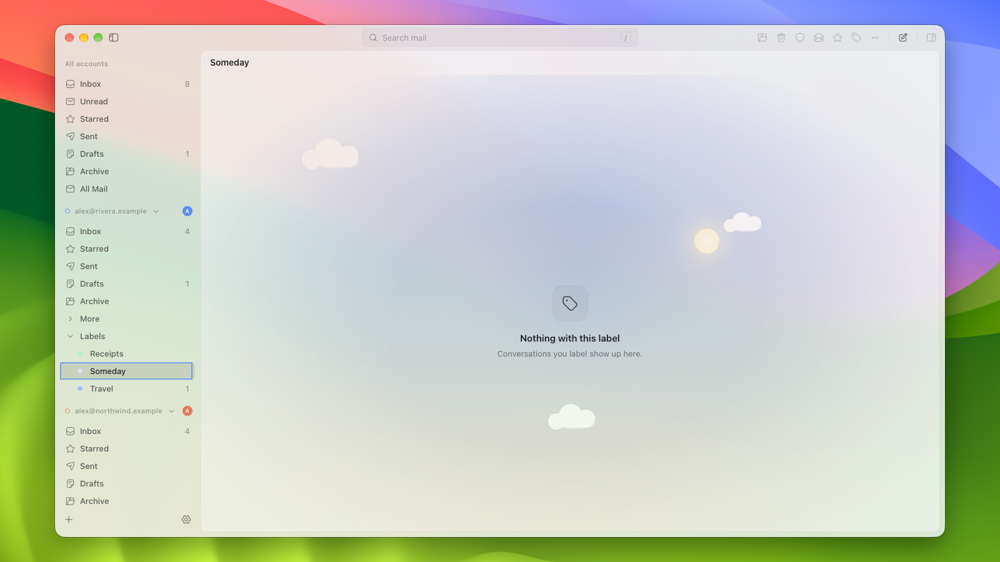
</picture>

It follows the time of day, with the sun or tonight's moon on its way across.

### Screensavers

**Inbox Zero, then a koi pond.**

<picture>
  <source media="(prefers-color-scheme: dark)" srcset="images/features/screensaver-dark.png">
  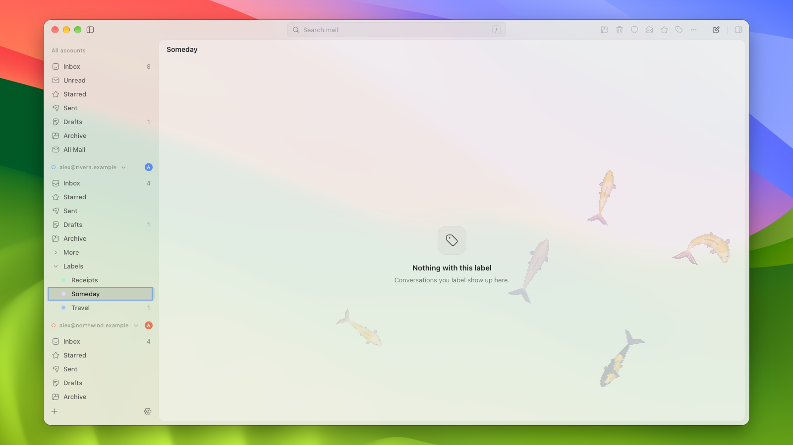
</picture>

*Animated:* [GIF](images/loops/koi-pond.gif) · [MP4](images/loops/koi-pond.mp4)

Ten pixel-art scenes (sandscape, envelope flock, life, rain on glass, koi pond, fireflies, lava lamp, jellyfish, starfield and fireworks) in six color schemes, or a random one. Start one from the command palette while the view is empty.

### Toybox settings

**All the toys, in one settings page.**

<picture>
  <source media="(prefers-color-scheme: dark)" srcset="images/features/toybox-dark.png">
  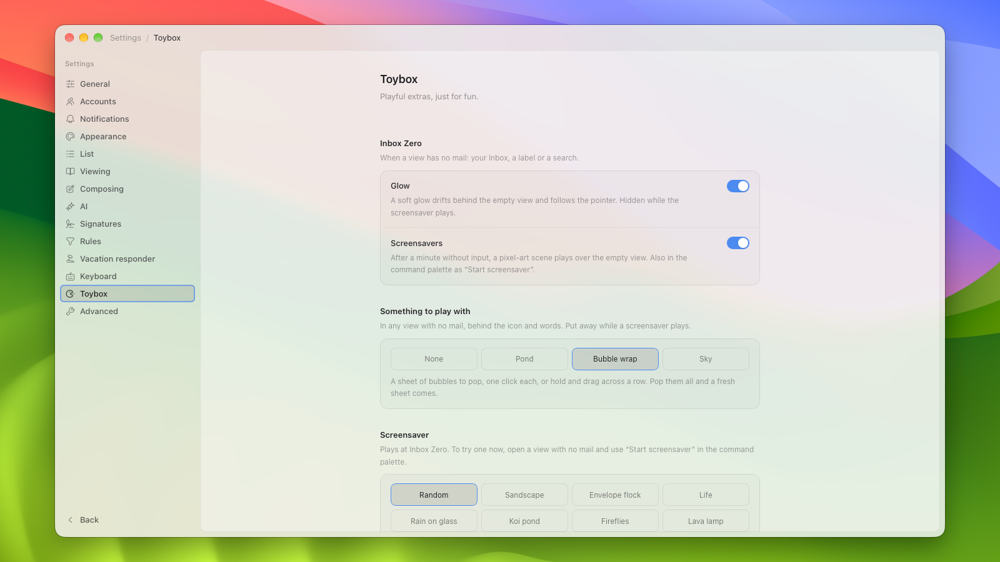
</picture>

The screensavers, and something to play with behind an empty view: the glow, a pond, bubble wrap or the sky. Each toy can be drawn as pixel art or ASCII art, and so can the jellyfish, starfield and fireworks screensavers.

### Screensaver scenes and colors

**Ten screensaver scenes, six color schemes.**

<picture>
  <source media="(prefers-color-scheme: dark)" srcset="images/features/screensaver-settings-dark.png">
  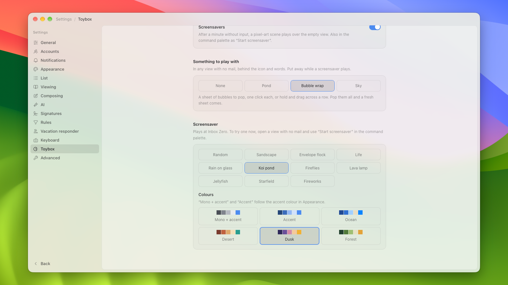
</picture>

Pick one scene or a random one, and a color scheme: mono with your accent color, accent, ocean, desert, dusk or forest.

## Reading and finding mail

### One inbox for every account

**All your Gmail accounts in one calm inbox.**

<picture>
  <source media="(prefers-color-scheme: dark)" srcset="images/features/inbox-dark.png">
  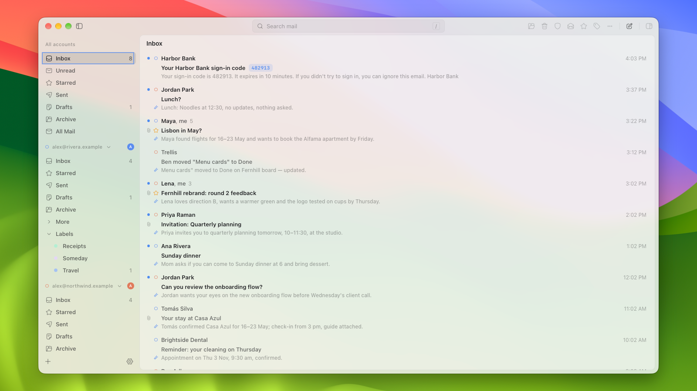
</picture>

Every account in one list, each with its own color. Threads never merge across accounts, and every action uses the account the mail belongs to.

### Sign-in codes

**Sign-in codes you can copy in one click.**

<picture>
  <source media="(prefers-color-scheme: dark)" srcset="images/features/codes-dark.png">
  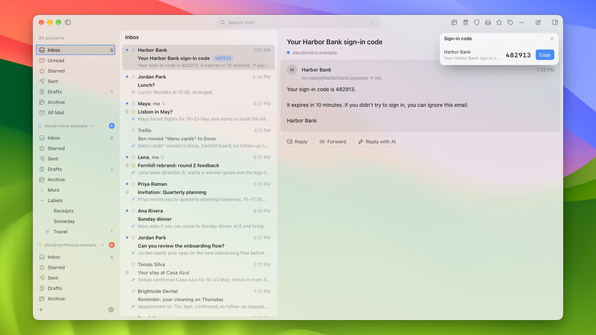
</picture>

One-time codes come out of the email as a pill on its row (click it to copy the code), and arrive in a notification that leads with the code and has a Copy button.

### Search

**Search all your Gmail accounts at once.**

<picture>
  <source media="(prefers-color-scheme: dark)" srcset="images/features/search-dark.png">
  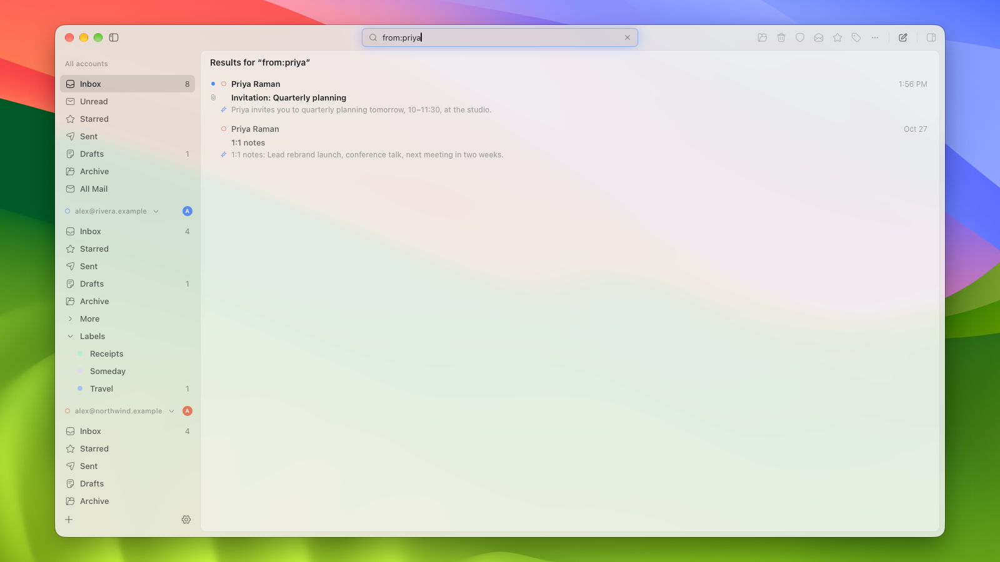
</picture>

Instant local search across all accounts, with Gmail's own operators (from:, has:attachment and the rest) merged in as the answer arrives.

## Fast

### Command palette

**⌘K: every action in one place.**

<picture>
  <source media="(prefers-color-scheme: dark)" srcset="images/features/palette-dark.png">
  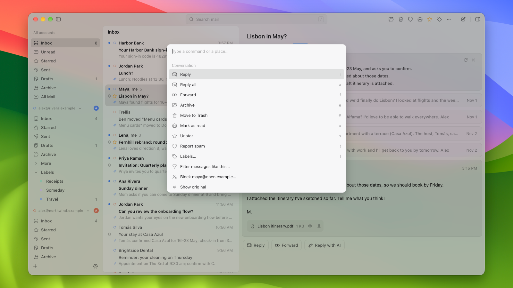
</picture>

⌘K opens the command palette, with the actions for the conversation in front of you and the shortcut for each.

### Swipes

**Swipe a conversation away to archive it, and undo it with a key.**

<picture>
  <source media="(prefers-color-scheme: dark)" srcset="images/features/list-dark.png">
  
</picture>

*Animated:* [GIF](images/loops/swipe-archive.gif) · [MP4](images/loops/swipe-archive.mp4)

Two fingers to the left on a conversation archives it from the Inbox (anywhere else it moves it to Trash), and a toast offers Undo (or press z). What each swipe does is yours to choose in Settings, List, where rows can also be compact, default or roomy, with no, one or two lines of preview.

### Keyboard shortcuts

**Gmail's keyboard shortcuts, and a cheat sheet on ?.**

<picture>
  <source media="(prefers-color-scheme: dark)" srcset="images/features/shortcuts-dark.png">
  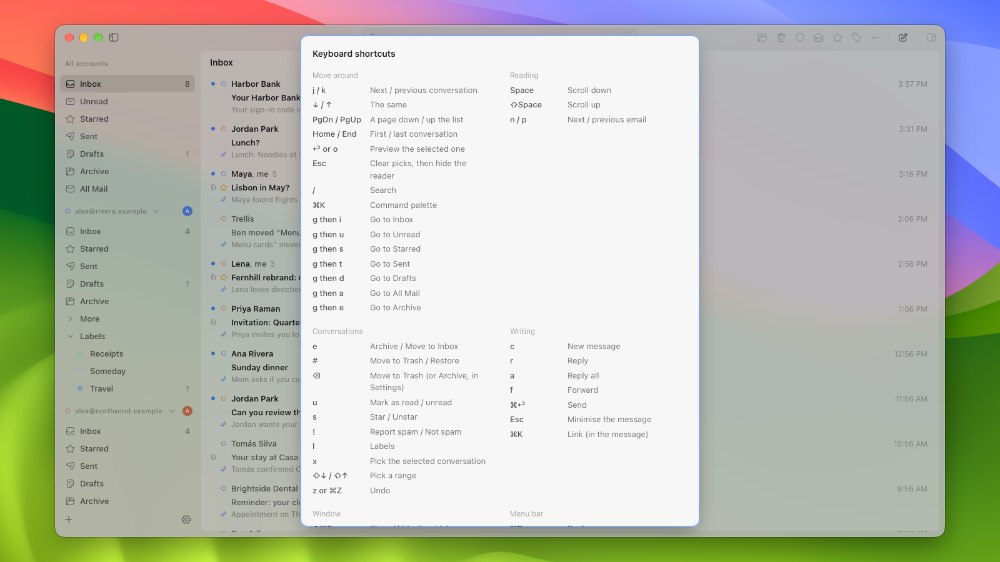
</picture>

Gmail's own keys (j and k, e, #, g then i, c, r) plus the extras, in a sheet one question mark away.

### Keyboard settings

**Every shortcut, in one place.**

<picture>
  <source media="(prefers-color-scheme: dark)" srcset="images/features/keyboard-dark.png">
  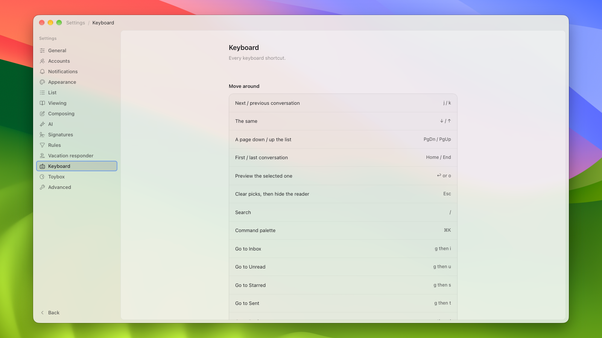
</picture>

## Make it yours

### Appearance

**Light, dark, your accent color, and your own app icon.**

<picture>
  <source media="(prefers-color-scheme: dark)" srcset="images/features/appearance-dark.png">
  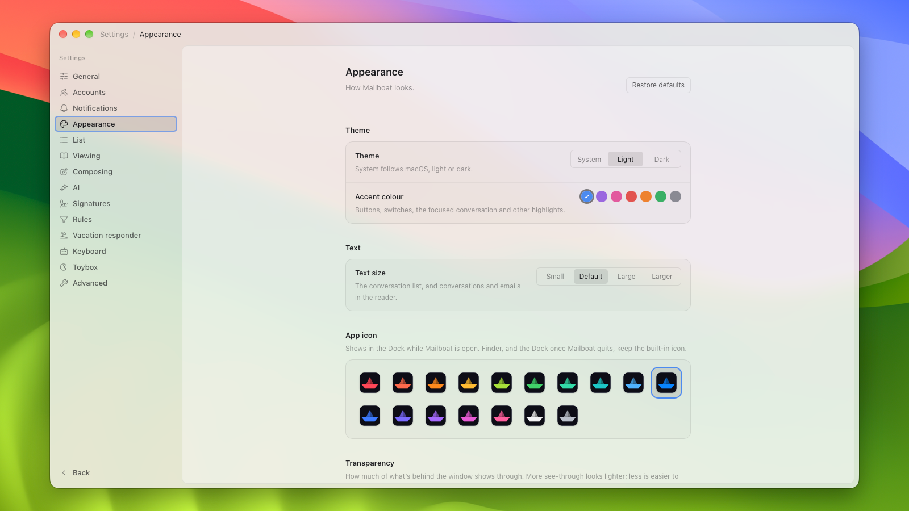
</picture>

Light, dark or follow macOS; seven accent colors; four text sizes; seventeen app icons for the Dock; and a transparency control for how much of what's behind the window shows through.
