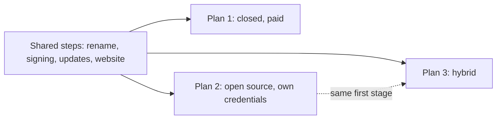
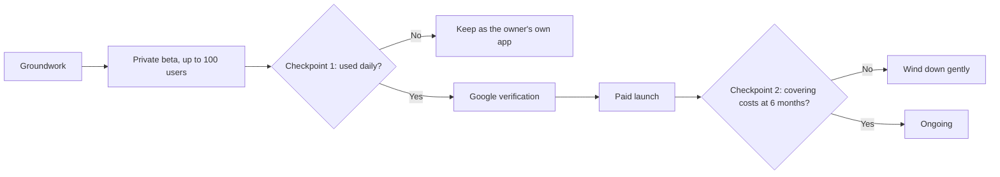
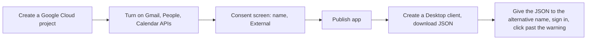
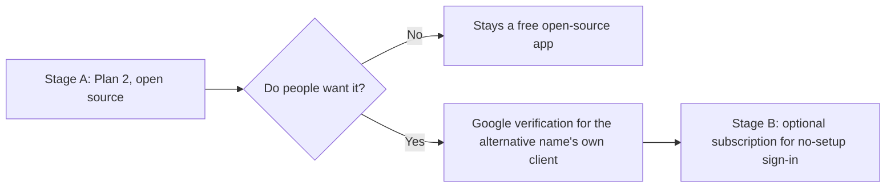

# Releasing the alternative name

How Mailboat (to be renamed **the alternative name**) could reach other people. Three plans,
worked out with the owner on 2026-10-25.

**Chosen (owner, 2026-10-25): Plan 3, the hybrid.** Open source first,
with each user bringing their own Google credentials (Stage A, which is
Plan 2), and a paid no-setup option later only if people want it
(Stage B). For the open-source stage the owner may use their personal
accounts (GitHub, social media, Apple).

- The work is in `docs/ROADMAP.md`, Milestones 10–16 (Release: the road
  to an open-source the alternative name). Tasks are tracked there, not here.
- This document keeps the plans and research behind them. The lists
  under each plan are reference, not a checklist. Plans 1 and 2 were not
  chosen as such, but Plan 2 is Stage A, and Plan 1's Google and Polar
  steps are what Stage B (Milestone 16) would follow.
- Choices a future agent might second-guess are in `docs/ARCHITECTURE.md`
  → Decisions (2026-10-25 rows).

## The owner's goals

- An interesting experience and a side project, **not a full-time job**: no
  daily social media, little support.
- Mac and Windows.
- Money and effort are spent only after a checkpoint shows people want it.
- No company (LLC) for now: the owner's name shows as the Windows
  publisher and in the Mac signature. Revisit if there's revenue.

## The three plans at a glance

| | 1. Closed source, paid | 2. Open source, bring your own Google credentials | 3. Hybrid: open source first, paid later (chosen) |
|---|---|---|---|
| Setup for a user | None | 10–15 min, guided in the app | Free: guided. Paid: none |
| Google verification and security assessment | Required (yearly) | **None** | Only when the paid version starts |
| Users before Google approves | 100 in total | No limit | No limit (free) |
| Income | a subscription | Tips at most | Tips, then subscriptions |
| Payments and licences | Polar | None | Polar, added later |
| Code | Private | Public | Public |
| Yearly fixed cost | the fixed costs + assessment if required | the signing fees (signing), or none if unsigned | the signing fees, then as Plan 1 |
| Reach | Anyone with Gmail | Technical people | Technical people, then anyone |

Plan 3's first stage *is* Plan 2, so starting with Plan 2 keeps Plan 3
open. Starting with Plan 1 makes opening the code later harder (see
"Choices that keep the doors open").

---

## Plan 1: Closed source, paid

Agreed in detail with the owner on 2026-10-25.

- Price: a subscription per person (not per Gmail account), up
  to 2 devices. Mimestream is its yearly price, Mac only.
- Trial: 14 days with a card up front, run by Polar, so there's no trial
  server to write. Cost: a new email and card start another trial; and
  Mimestream's trial needs no card.
- Hosting: Cloudflare Pages (site), R2 (installers and update files),
  Registrar (domains), Email Routing (brand email).
- Release builds made on the owner's Mac by one script; GitHub Actions
  later.

### Groundwork

- Website on Cloudflare Pages: home, pricing, download, privacy
      policy, terms of use (limits liability, as there's no company),
      support. The privacy policy says what Google data the app uses,
      that it stays on the user's device, and that the app follows
      Google's Limited Use rules
- Check whether `gmail.compose` is needed beside `gmail.modify`
      (which may already cover drafts and sending), and drop any scope
      that isn't; Google asks for a reason for each one

### Google verification (prepared in groundwork, submitted after Checkpoint 1)

the alternative name asks for restricted scopes (`gmail.modify`; `gmail.compose` and
`gmail.settings.basic` are believed restricted, to confirm on Google's
list) and sensitive ones (contacts, calendar). An individual can get
verified; it's paperwork and waiting (weeks to months).

- New production OAuth client in a Cloud project named for the alternative name
      (the current one stays for development). Each account records its
      client (`accounts.oauth_client`), so both can coexist
- Verify the domain in Google Search Console
- Consent screen: name, logo, home page, privacy policy, terms, brand
      support email
- Demo video, unlisted on YouTube: the sign-in, the consent screen
      with the client ID in the address bar, each scope in use
- A written reason for each scope
- Security assessment (CASA): Google requires it when restricted data
      is stored on or sent to servers. the alternative name keeps mail on the device,
      and AI and MCP only send it where the user chooses, so ask to be
      exempt. If Google insists: yearly, a paid assessment
- Until approved, the current "unverified, in production" client
      allows 100 users in total (every account that ever signs in counts;
      the count can't be reset): enough for the beta

### Private beta (up to 100 users, free)

- Updates read from Cloudflare R2, which also holds the installers
      (free up to 10 GB, no download fees)
- The Google client ID and secret go into release builds at build
      time, never committed. A desktop app can't keep them secret, and
      Google says so; PKCE and the verified consent screen are the
      protection

### Checkpoint 1 (end of the beta)

- Launch the beta once where the right people are: r/macapps, Show
      HN, Claude and MCP communities (the AI and AI-apps features are the
      pitch), "Mimestream, but on Windows too" for Windows users
- After about 2 weeks, with the owner: did the places fill, do people
      still use it daily (ask them; there are no analytics), would they
      pay a monthly price? If not, stop: nothing more is spent. If yes, submit
      Google verification

### Paid launch (after Google approves)

- Website and terms say how a wind-down would go, before anyone pays:
      notice by email, refunds for unused time, and the app keeps working
      with mail already downloaded
- Polar store: one product, a subscription, 14-day trial with
      a card, a licence-key benefit limited to 2 device activations.
      First a sandbox purchase, to confirm the key works during the trial
      and is revoked when it's cancelled or a payment fails (Polar's docs
      say so for subscriptions, not trials specifically)
- In the app: enter the licence key (or open a link from checkout),
      activate it with Polar's public API (made for desktop apps; no
      server of ours), check again now and then with a few days' grace
      offline, lock to a "Subscribe" screen when revoked. Settings shows
      the plan and "Deactivate this device"
- Website: pricing, checkout links, "what's new"; make the case for
      the price (Windows, AI, AI apps)

### Checkpoint 2 (six months after the paid launch)

- With the owner: does it cover its costs, and is support still a few
      emails a week? If not, wind down as promised. If yes, carry on at
      the owner's pace

### Ongoing

- Google re-verification every 12 months (and the assessment, if
      required)
- Promotion, if the owner wants more than costs covered (see
      "Promotion" below)

---

## Plan 2: Open source, bring your own Google credentials

Each user makes their own Google OAuth client and gives its JSON file to
the alternative name, which the app already supports (it's how the owner runs it today).
Each user is then their own "developer" under Google's personal-use
rules, so **there is no Google verification, no security assessment and
no user limit**, and nothing to sell.

### The hurdle: setting up Google credentials

- About 10–15 minutes in a console made for developers, and Google
  redesigns those screens often, so screenshots go stale.
- **"Publish app" is the step people miss.** In "Testing", Google expires
  sign-ins after 7 days for everything beyond name and email, so the app
  would sign them out every week. Publishing ("In production", still
  unverified) stops that, and means no account has to be added as a test
  user.
- Users still see "Google hasn't verified this app" for their own app,
  and click Advanced to continue. The walkthrough should show this
  screen in advance so it doesn't alarm them.
- One client serves all of a user's Gmail accounts.

### The interactive walkthrough

A setup screen in the app (part of Onboarding), not just a web page:

- One card per step, each with a button that opens the exact Google
      Console page (passing the project ID once known), a short
      explanation, and a "Done" tick. Exact Console addresses to be
      checked when building, as Google moves them
- Optional fast path for people with Google's `gcloud` tool: one
      copy-paste command that creates the project and turns on the three
      APIs. The consent screen and the Desktop client stay manual
      (`gcloud` can't make that kind of client)
- Drop the JSON on the window, or choose it. The app checks it (a
      "Desktop" client with an ID and secret) and says plainly what's
      wrong if not (e.g. a "Web" client was made)
- A test sign-in at the end. If Google later refuses a sign-in about
      7 days on (`invalid_grant`), the app explains that the project is
      probably still in "Testing" and links to "Publish app"
- The same steps as a page on the website, and a short screen
      recording, for people deciding whether to install
- Settings → Accounts shows which client each account uses, and lets
      the user replace the JSON

### Making the code public

- Publish a **fresh history** (one starting commit), not this repository's: it stays as a private archive. Check first that fixtures and examples hold no real
      mail, and that nothing personal is left in docs
- Licence: see "Choices that keep the doors open". GPL-3.0 suggested
- Contributions: bug reports and ideas welcome; outside code not
      accepted. An email client is an attractive target for a malicious
      change, and every change would need careful review. Say so in `CONTRIBUTING.md`
- Hosting on GitHub, all free for a public repo: Pages (website; or
      keep Cloudflare), Releases (installers and the update file),
      Actions (unlimited minutes, Mac builds included). The domain and
      update address stay on `altname` either way
- Signing: still advised (the signing fees). Unsigned, Mac users must
      allow the app in System Settings, Windows shows a SmartScreen
      warning, and Homebrew announced it would drop casks that aren't
      signed and notarized from September 2026
- Tips: GitHub Sponsors
- Privacy policy and terms still on the website (no Google
      requirement here, but users should know where their mail goes)

### Checkpoint

- After about a month, with the owner: GitHub's download counts and
      stars, issues from people who finished setup, and whether people
      say they'd pay to skip it. This is the evidence Plan 3 needs

---

## Plan 3: Hybrid, open source first, paid later (chosen)

Chosen by the owner, 2026-10-25. Start exactly as Plan 2. If people want it,
add a paid option whose value is **convenience**: the alternative name's own
Google-verified credentials, so no setup at all. Same app, same features
for everyone.

### How the app works in both stages

- **One app, one download.** On first launch: "Use your own Google
  credentials (free)" or "Subscribe: sign in with Google, no setup"
  (Stage B only). A user can switch either way later, by signing each
  account in again.
- **No features held back for payers.** Splitting features makes the
  code and the community messy ("open core"). Payers get the no-setup
  sign-in, and the satisfaction of supporting it.
- **Each account already records its OAuth client**
  (`accounts.oauth_client`), so one app can hold accounts signed in
  both ways.
- **the alternative name's own client ID and secret only go into official builds**, at
  build time. The public code has none. Someone could pull them out of an
  official build and use them in their own, as with any desktop app;
  that breaks Google's terms, and it's accepted as rare.
- **The licence check is public code too.** Anyone could remove it from
  their own build, but their build still needs their own credentials, so
  they're back to Plan 2. That is fine.

### Stage A

Plan 2, in full.

### Stage B (only if Stage A's checkpoint says yes)

- Plan 1's Google verification (all of it), for the alternative name's own client
- Plan 1's Polar store and in-app licence, used only when the user
      picks "Subscribe"
- Price to decide then: the paid option buys setup-free sign-in, not
      features, so it may need to be lower than Plan 1's the yearly price
- Plan 1's wind-down promise; plus, if paid ends, subscribers can
      switch to their own credentials and keep going

---

## Choices that keep the doors open

Decide these before the first public release, whatever the plan:

- **Own the domain and point everything at it.** The update address
  baked into every installed app should be `https://altname/…`, not a
  GitHub or Cloudflare address, so hosting can change without stranding
  users.
- **Keep the copyright in one pair of hands.** If only the owner's
  project adds code (no outside contributions, or contributors sign an
  agreement), the owner can change the licence later, or sell paid
  builds under any terms.
- **Licence, if open source:**
  - **GPL-3.0** (suggested): anyone who distributes a changed copy must
    publish their source too, so nobody can sell a closed copy. Widely
    respected by a technical audience.
  - **MIT**: no conditions. Anyone could sell a closed copy.
  - **Functional Source License** (used by Sentry): forbids competing
    commercial use, and becomes fully open (Apache or MIT) two years
    after each release. Not "open source" by the usual definition, which
    some people mind.
- **One bundle ID for every build**, so moving between free and paid
  never means reinstalling or losing data.
- **No server of ours ever receives Gmail data**, in any plan. It's the
  case for skipping Google's paid assessment and the simplest privacy
  promise.
- **Open-sourcing later is harder than now.** Closed for a while, then
  open, means the same history clean-up plus explaining the change to
  paying customers.

## Background

### Promotion (if wanted)

1. Affiliate program: reward writers and YouTubers for the customers they bring. Affonso has an official
   Polar integration.
2. Setapp (Mac app bundle): paid by usage; a separate
   build with Setapp's licensing; Windows unconfirmed.
3. One-off sponsorships at launch (e.g. The Sweet Setup once listed
   a listing fee; a developer newsletter charges a fee), each
   with its own discount code.
4. Small Reddit ad tests.

Poor fits: a general social-media manager (generic posts don't land with
a technical audience; Reddit and Hacker News punish marketing), and any
paid upvotes, followers or reviews (against the rules; US law requires
disclosing paid endorsements).

### Name checks (2026-10-25)

"Mailboat" collides with Mailboat, Inc. (mailboat.com), which sells software and
has an app on Apple's store. "the alternative name": `altname`, `altname.example`,
`altname` free; no Mac App Store app; US trademarks only dead or in
other trades; the alternative name XG is museum software. `altname` taken on GitHub and
Bluesky; `altname` free on both. "another candidate" was rejected: a registered US
trademark for software (another company, No. 4956463).

## Sources

- [Google: restricted scope verification](https://developers.google.com/identity/protocols/oauth2/production-readiness/restricted-scope-verification)
- [Google: sensitive and restricted scopes](https://support.google.com/cloud/answer/13464325)
- [Google: test users' sign-ins expire after 7 days](https://support.google.com/cloud/answer/15549945)
- [Google forum: restricted scope in a client-only app](https://discuss.google.dev/t/restricted-gmail-scope-in-a-client-only-app-is-a-security-assessment-required/404126)
- [Polar: licence keys](https://polar.sh/docs/features/benefits/license-keys)
- [Polar: managing subscriptions](https://polar.sh/docs/features/subscriptions/manage)
- [Polar: Affonso integration](https://polar.sh/docs/features/integrations/affonso)
- [Microsoft: code signing options](https://learn.microsoft.com/en-us/windows/apps/package-and-deploy/code-signing-options)
- [Workbrew: Homebrew 5.0.0 and unsigned casks](https://workbrew.com/blog/what-homebrew-5-0-0-means-for-your-mac-fleet)
- [Setapp Marketplace overview](https://docs.setapp.com/docs/setapp-marketplace-overview)
- [Mimestream pricing](https://mimestream.com/pricing)
